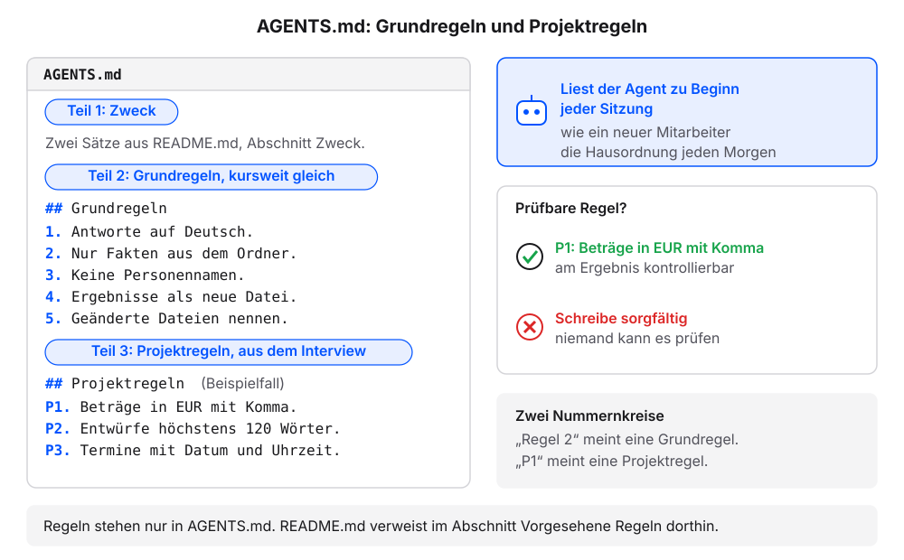
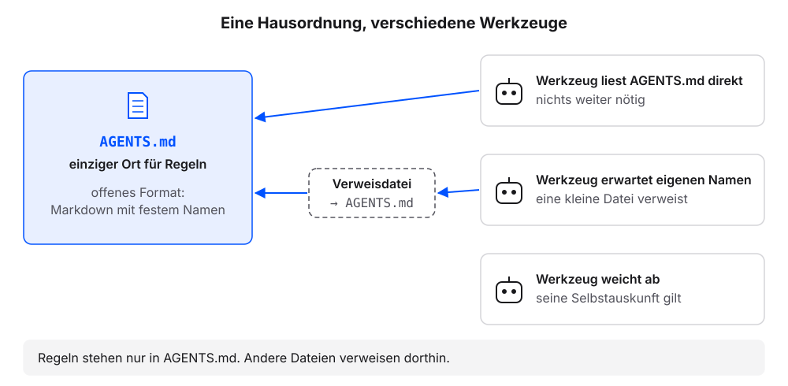
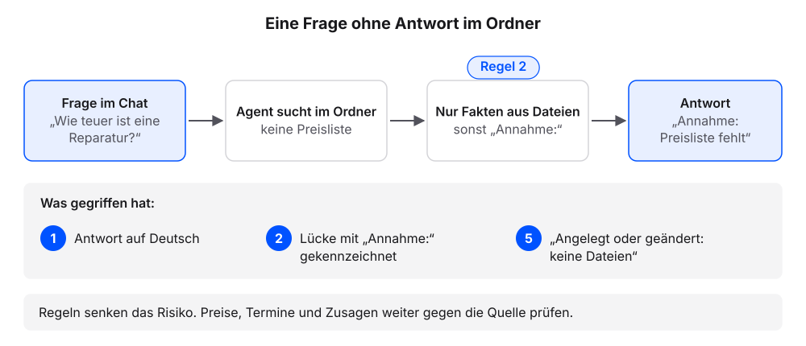
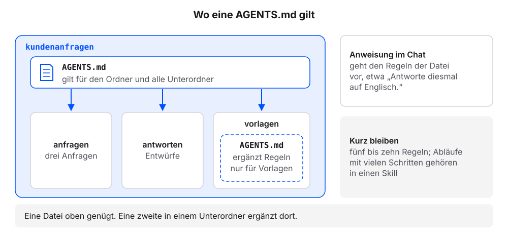

# AGENTS.md: die Hausordnung

Jede neue Sitzung beginnt ohne Erinnerung an die vorige. Was wir dem Agenten gestern im Chat gesagt haben, weiß er heute nicht mehr. Dauerhafte Regeln schreiben wir deshalb in eine Datei, die der Agent zu Beginn jeder Sitzung von selbst liest: die `AGENTS.md`. Der Agent legt sie mit fünf Regeln an; danach prüfen wir in einer neuen Sitzung, ob er sie von selbst liest und befolgt. Die Erklärung folgt jeweils am eigenen Ergebnis.

**Voraussetzung:** Der Ordner `kundenanfragen` ist in der App gewählt, mit dem Stand aus dem Kapitel [Der Projektordner](projektordner.qmd): `README.md`, `anfragen` mit drei Anfragen und `antworten`.

## Schritt 1: Die Hausordnung anlegen

1. Diesen Auftrag senden:

   ```text
   Lege die Datei AGENTS.md an. Teil 1: zwei Sätze, worum es in diesem Ordner geht (siehe README.md). Teil 2: die Überschrift „Regeln“ und diese fünf Regeln, wörtlich:
   1. Antworte auf Deutsch.
   2. Nutze nur Fakten aus Dateien in diesem Ordner. Schreibe „Annahme:“ vor jede Angabe, die nicht daraus stammt.
   3. Schreibe keine Personennamen in neue Dateien.
   4. Lege Ergebnisse als neue Datei an. Ändere bestehende Dateien nur nach Rückfrage.
   5. Nenne am Ende jedes Auftrags, welche Dateien du angelegt oder geändert hast.
   Zeige mir die Datei, bevor du sie speicherst.
   ```

2. Prüfen: Der Agent zeigt die Datei, bevor er sie speichert.
3. Das Speichern freigeben.
4. Diese Frage senden:

   ```text
   Liste die Dateien in diesem Ordner auf. Zeig mir dann den Inhalt von AGENTS.md genau so, wie er in der Datei steht, mit allen Zeichen.
   ```

5. Prüfen: Die Liste nennt `AGENTS.md` neben `README.md`. Der Inhalt enthält fünf nummerierte Regeln.

### Das sollten wir jetzt sehen

Der Verlauf im Chat, sinngemäß:

```{=html}
<div style="max-width:620px;border:1px solid #dcd9d2;border-radius:12px;overflow:hidden;background:#fbfaf7;color:#1f2430;margin:0 0 1rem;line-height:1.45" role="group" aria-label="Chat: Auftrag, Datei zur Freigabe, Anlegen und Inhalt der AGENTS.md">

<div style="padding:12px;display:grid;gap:8px">
<div style="justify-self:end;max-width:94%;border-radius:10px;padding:8px 11px;background:#dfe6f3"><span style="display:block;font-size:11.5px;color:#5b6170;margin-bottom:2px">Wir</span>Lege die Datei AGENTS.md an. Teil 1: zwei Sätze, worum es in diesem Ordner geht (siehe README.md). Teil 2: die Überschrift „Regeln“ und diese fünf Regeln, wörtlich:<br>1. Antworte auf Deutsch.<br>2. Nutze nur Fakten aus Dateien in diesem Ordner. Schreibe „Annahme:“ vor jede Angabe, die nicht daraus stammt.<br>3. Schreibe keine Personennamen in neue Dateien.<br>4. Lege Ergebnisse als neue Datei an. Ändere bestehende Dateien nur nach Rückfrage.<br>5. Nenne am Ende jedes Auftrags, welche Dateien du angelegt oder geändert hast.<br>Zeige mir die Datei, bevor du sie speicherst.</div>
<div style="justify-self:stretch;border:1px solid #d9b26a;border-radius:10px;padding:8px 11px;background:#fbf3e3"><span style="display:block;font-size:11.5px;color:#5b6170;margin-bottom:2px">Agent</span>So sieht <code>AGENTS.md</code> aus. Darf ich speichern?<pre style="margin:6px 0 0;padding:8px 10px;border:1px solid #dcd9d2;border-radius:8px;background:#fbfaf7;font-family:ui-monospace,SFMono-Regular,Menlo,monospace;font-size:.85rem;line-height:1.6;white-space:pre-wrap;word-break:break-word"><i style="color:#23417a;font-style:normal;font-weight:700">#</i> Kundenanfragen

Dieser Ordner sammelt Kundenanfragen eines kleinen Betriebs.
Antworten entstehen als Entwürfe in antworten.

<i style="color:#23417a;font-style:normal;font-weight:700">##</i> Regeln

<i style="color:#23417a;font-style:normal;font-weight:700">1.</i> Antworte auf Deutsch.
<i style="color:#23417a;font-style:normal;font-weight:700">2.</i> Nutze nur Fakten aus Dateien in diesem Ordner. Schreibe „Annahme:“ vor jede Angabe, die nicht daraus stammt.
<i style="color:#23417a;font-style:normal;font-weight:700">3.</i> Schreibe keine Personennamen in neue Dateien.
<i style="color:#23417a;font-style:normal;font-weight:700">4.</i> Lege Ergebnisse als neue Datei an. Ändere bestehende Dateien nur nach Rückfrage.
<i style="color:#23417a;font-style:normal;font-weight:700">5.</i> Nenne am Ende jedes Auftrags, welche Dateien du angelegt oder geändert hast.</pre><br><span style="display:inline-block;margin:6px 6px 0 0;padding:2px 10px;border:1px solid #23417a;color:#23417a;border-radius:999px;font-size:12.5px;font-weight:600">Erlauben</span><span style="display:inline-block;margin:6px 6px 0 0;padding:2px 10px;border:1px solid #dcd9d2;border-radius:999px;font-size:12.5px">Ablehnen</span></div>
<div style="justify-self:start;font-family:ui-monospace,SFMono-Regular,Menlo,monospace;font-size:12px;color:#5b6170;padding:0 4px"><span style="color:#b8862b;font-weight:700">› </span>AGENTS.md angelegt</div>
<div style="justify-self:start;max-width:94%;border-radius:10px;padding:8px 11px;background:#f4f2ed;border:1px solid #dcd9d2"><span style="display:block;font-size:11.5px;color:#5b6170;margin-bottom:2px">Agent</span>Fertig. Eine Datei angelegt (<code>AGENTS.md</code>), keine geändert.</div>
<div style="justify-self:end;max-width:94%;border-radius:10px;padding:8px 11px;background:#dfe6f3"><span style="display:block;font-size:11.5px;color:#5b6170;margin-bottom:2px">Wir</span>Liste die Dateien in diesem Ordner auf. Zeig mir dann den Inhalt von AGENTS.md genau so, wie er in der Datei steht, mit allen Zeichen.</div>
<div style="justify-self:start;max-width:94%;border-radius:10px;padding:8px 11px;background:#f4f2ed;border:1px solid #dcd9d2"><span style="display:block;font-size:11.5px;color:#5b6170;margin-bottom:2px">Agent</span>Im Ordner liegen <code>AGENTS.md</code>, <code>README.md</code> und die Ordner <code>anfragen</code> (drei Dateien) und <code>antworten</code> (leer). Inhalt von <code>AGENTS.md</code>:<pre style="margin:6px 0 0;padding:8px 10px;border:1px solid #dcd9d2;border-radius:8px;background:#fbfaf7;font-family:ui-monospace,SFMono-Regular,Menlo,monospace;font-size:.85rem;line-height:1.6;white-space:pre-wrap;word-break:break-word"><span style="color:#5b6170;opacity:.6;display:inline-block;width:22px">1</span><i style="color:#23417a;font-style:normal;font-weight:700">#</i> Kundenanfragen
<span style="color:#5b6170;opacity:.6;display:inline-block;width:22px">2</span>
<span style="color:#5b6170;opacity:.6;display:inline-block;width:22px">3</span>Dieser Ordner sammelt Kundenanfragen eines kleinen Betriebs.
<span style="color:#5b6170;opacity:.6;display:inline-block;width:22px">4</span>Antworten entstehen als Entwürfe in antworten.
<span style="color:#5b6170;opacity:.6;display:inline-block;width:22px">5</span>
<span style="color:#5b6170;opacity:.6;display:inline-block;width:22px">6</span><i style="color:#23417a;font-style:normal;font-weight:700">##</i> Regeln
<span style="color:#5b6170;opacity:.6;display:inline-block;width:22px">7</span>
<span style="color:#5b6170;opacity:.6;display:inline-block;width:22px">8</span><i style="color:#23417a;font-style:normal;font-weight:700">1.</i> Antworte auf Deutsch.
<span style="color:#5b6170;opacity:.6;display:inline-block;width:22px">9</span><i style="color:#23417a;font-style:normal;font-weight:700">2.</i> Nutze nur Fakten aus Dateien in diesem Ordner. Schreibe „Annahme:“ vor jede Angabe, die nicht daraus stammt.
<span style="color:#5b6170;opacity:.6;display:inline-block;width:22px">10</span><i style="color:#23417a;font-style:normal;font-weight:700">3.</i> Schreibe keine Personennamen in neue Dateien.
<span style="color:#5b6170;opacity:.6;display:inline-block;width:22px">11</span><i style="color:#23417a;font-style:normal;font-weight:700">4.</i> Lege Ergebnisse als neue Datei an. Ändere bestehende Dateien nur nach Rückfrage.
<span style="color:#5b6170;opacity:.6;display:inline-block;width:22px">12</span><i style="color:#23417a;font-style:normal;font-weight:700">5.</i> Nenne am Ende jedes Auftrags, welche Dateien du angelegt oder geändert hast.</pre></div>
</div>
</div>
```


Die beiden Sätze in Teil 1 kann der Agent anders formulieren. Die fünf Regeln stehen wörtlich darin.

### Was gerade passiert ist

Die **AGENTS.md** ist eine Markdown-Datei im Projektordner mit dauerhaften Regeln für den Agenten. Sie ist die Hausordnung des Projektordners: Wie ein neuer Mitarbeiter liest der Agent sie jeden Morgen zuerst, also zu Beginn jeder Sitzung. Sie hat zwei Teile: eine Projektbeschreibung in zwei bis drei Sätzen und fünf bis zehn Regeln. Die Projektbeschreibung gibt dem Agenten den Zusammenhang, ähnlich wie die `README.md` für Menschen. Die Regeln sagen, was in jeder Sitzung gilt.

Eine **prüfbare Regel** sagt, was genau gilt, und lässt sich am Ergebnis kontrollieren. „Beträge in EUR mit Komma“ ist prüfbar: Jeder Betrag hat die Form `45,00 EUR`, oder er hat sie nicht. „Schreibe sorgfältig“ ist es nicht, weil niemand sagen kann, woran Sorgfalt im Ergebnis zu erkennen ist. Jede der fünf Regeln hat einen klaren Zweck und ein Prüfmerkmal:

| Regel | Wozu sie dient | Woran wir sie prüfen |
|---|---|---|
| 1. Antworte auf Deutsch. | Antworten und Entwürfe passen zur Kundschaft. | Jede Antwort ist deutsch. |
| 2. Nur Fakten aus dem Ordner, sonst „Annahme:“ | Erfundene Preise, Termine oder Zusagen werden seltener, Lücken werden sichtbar. | Jede Angabe steht in einer Datei oder trägt „Annahme:“. |
| 3. Keine Personennamen in neue Dateien | Entwürfe und Übersichten enthalten keine personenbezogenen Daten. | In keiner neuen Datei steht ein Name. |
| 4. Ergebnisse als neue Datei, Änderungen nur nach Rückfrage | Bestehendes Material bleibt erhalten. | Der Agent fragt, bevor er eine vorhandene Datei ändert. |
| 5. Am Ende angelegte und geänderte Dateien nennen | Wir sehen bei jedem Auftrag, was sich im Ordner geändert hat. | Jede Antwort endet mit dieser Liste. |

{fig-alt="Links die Datei AGENTS.md mit zwei Teilen: Teil 1 zwei Sätze zum Zweck des Ordners, Teil 2 die Überschrift Regeln mit fünf nummerierten Regeln. Rechts oben: Der Agent liest die Datei zu Beginn jeder Sitzung, wie ein neuer Mitarbeiter die Hausordnung jeden Morgen. Rechts unten der Vergleich prüfbarer Regeln: „Beträge in EUR mit Komma“ ist am Ergebnis kontrollierbar, „Schreibe sorgfältig“ nicht."}

Die Regeln sind in Befehlsform und in der Du-Form geschrieben, so wie wir auch Aufträge an den Agenten formulieren. Sie stehen als nummerierte Liste, damit wir uns im Gespräch auf „Regel 2“ beziehen können.

::: {.callout-note title="Wenn es anders aussieht"}
- Der Agent formuliert die Regeln um oder ergänzt eigene: ablehnen und „Übernimm die fünf Regeln wörtlich, ohne Ergänzungen.“ senden.
- Die Regeln stehen ohne Nummern oder als Fließtext: den Agenten eine nummerierte Liste daraus machen lassen.
- Die Datei heißt anders, etwa `agents.md` in Kleinbuchstaben: den Agenten die Datei in `AGENTS.md` umbenennen lassen.
:::

## Schritt 2: In einer neuen Sitzung prüfen

**Voraussetzung:** `AGENTS.md` liegt im Ordner `kundenanfragen`.

1. Eine neue Sitzung starten: in der App einen neuen Chat im Ordner `kundenanfragen` beginnen.
2. Diese Frage senden:

   ```text
   Welche Regeln gelten in diesem Ordner?
   ```

3. Prüfen: Die Antwort nennt die fünf Regeln, ohne dass sie im Chat genannt wurden.

Besteht die Prüfung in Schritt 3 nicht, liest das Werkzeug die `AGENTS.md` wahrscheinlich nicht automatisch. Dann diese Frage senden:

```text
Liest du die Datei AGENTS.md in diesem Ordner automatisch? Wenn nein: Welchen Dateinamen erwartest du stattdessen, und kann ich von dort auf AGENTS.md verweisen?
```

Nennt der Agent einen anderen Dateinamen, legt er auf Auftrag eine Datei mit diesem Namen an, die auf `AGENTS.md` verweist. Danach die Schritte 1 bis 3 wiederholen. Die Dateinamen der verbreiteten Werkzeuge stehen in der Tabelle unter „Was gerade passiert ist“.

### Das sollten wir jetzt sehen

Eine Beispielantwort; der Agent nennt die Regeln vielleicht mit eigenen Worten:

```{=html}
<div style="max-width:620px;border:1px solid #dcd9d2;border-radius:12px;overflow:hidden;background:#fbfaf7;color:#1f2430;margin:0 0 1rem;line-height:1.45" role="group" aria-label="Beispielantwort des Agenten in der neuen Sitzung">
<div style="display:flex;align-items:center;gap:8px;padding:7px 12px;background:#f4f2ed;border-bottom:1px solid #dcd9d2;font-size:12px;color:#5b6170">Neue Sitzung</div>
<div style="padding:12px;display:grid;gap:8px">
<div style="justify-self:end;max-width:94%;border-radius:10px;padding:8px 11px;background:#dfe6f3"><span style="display:block;font-size:11.5px;color:#5b6170;margin-bottom:2px">Wir</span>Welche Regeln gelten in diesem Ordner?</div>
<div style="justify-self:start;max-width:94%;border-radius:10px;padding:8px 11px;background:#f4f2ed;border:1px solid #dcd9d2"><span style="display:block;font-size:11.5px;color:#5b6170;margin-bottom:2px">Agent</span>Laut <code>AGENTS.md</code> gelten fünf Regeln:<ol style="margin:2px 0 4px;padding-left:20px"><li>Antworte auf Deutsch.</li><li>Nutze nur Fakten aus Dateien in diesem Ordner. Schreibe „Annahme:“ vor jede Angabe, die nicht daraus stammt.</li><li>Schreibe keine Personennamen in neue Dateien.</li><li>Lege Ergebnisse als neue Datei an. Ändere bestehende Dateien nur nach Rückfrage.</li><li>Nenne am Ende jedes Auftrags, welche Dateien du angelegt oder geändert hast.</li></ol></div>
</div>
</div>
```

### Was gerade passiert ist

Die neue Sitzung begann ohne Erinnerung an Schritt 1. Trotzdem kannte der Agent die Regeln: Er hat die `AGENTS.md` zu Beginn der Sitzung von selbst gelesen, ohne dass jemand sie erwähnt hat.

`AGENTS.md` ist ein **offenes Format** ohne Pflichtfelder: eine gewöhnliche Markdown-Datei mit festem Namen. Viele Agenten lesen sie, unter anderem Werkzeuge großer Anbieter und mehrere Open-Source-Projekte. Seit Dezember 2025 betreut die Agentic AI Foundation das Format, eine Stiftung unter dem Dach der Linux Foundation. Die Beschreibung und eine Liste kompatibler Werkzeuge stehen auf [agents.md](https://agents.md/).

Einige Werkzeuge erwarten einen eigenen Dateinamen oder lesen die `AGENTS.md` nur unter bestimmten Bedingungen. Oft genügt dann eine zweite Datei mit dem erwarteten Namen, die auf die `AGENTS.md` verweist. So bleibt die `AGENTS.md` der einzige Ort, an dem wir Regeln pflegen, und derselbe Ordner funktioniert mit verschiedenen Agenten.

{fig-alt="Links die Datei AGENTS.md als einziger Ort für Regeln, ein offenes Format. Rechts drei Werkzeuge: Eines liest AGENTS.md direkt. Eines erwartet einen eigenen Dateinamen und bekommt eine kleine Verweisdatei, die auf AGENTS.md zeigt. Weicht ein Werkzeug ab, gilt seine Selbstauskunft. Merksatz: Regeln stehen nur in AGENTS.md, andere Dateien verweisen dorthin."}

| Werkzeug | Anweisungsdatei im Projektordner |
|---|---|
| Claude Code | `CLAUDE.md`. Liest `AGENTS.md` nur, wenn kein `CLAUDE.md` vorliegt. Alternativ in `CLAUDE.md` die Zeile `@AGENTS.md`.[^cc-memory] |
| Codex | `AGENTS.md`, zusätzlich global in `~/.codex/`.[^cx-agents] |
| Antigravity | `AGENTS.md` oder `GEMINI.md`, zusätzlich Regeln in `.agents/rules/`.[^ag-rules] |

: Stand: 18. Oktober 2026. Ein Pfad mit `~` liegt im eigenen Benutzerordner und gilt für alle Projekte. Weicht der eigene Agent ab, gilt seine Selbstauskunft.

[^cc-memory]: Claude Code, „How Claude remembers your project“: <https://code.claude.com/docs/en/memory>
[^cx-agents]: Codex, „AGENTS.md“: <https://learn.chatgpt.com/docs/agent-configuration/agents-md>
[^ag-rules]: Antigravity, „Rules“: <https://antigravity.google/docs/rules/>

::: {.callout-note title="Wenn es anders aussieht"}
- Die Antwort nennt die Regeln mit eigenen Worten: Das ist in Ordnung.
- Die Antwort nennt Regeln aus einer anderen Datei, etwa `CLAUDE.md`: Das Werkzeug liest diese Datei statt der `AGENTS.md`. Die Frage oben nach dem erwarteten Dateinamen senden.
- Der Agent kennt keine Regeln: „In welchem Ordner arbeitest du gerade?“ Nennt er den übergeordneten Ordner, in der App `kundenanfragen` wählen und einen neuen Chat beginnen.
:::

## Schritt 3: Eine Frage ohne Antwort im Ordner

**Voraussetzung:** Die Sitzung aus Schritt 2 ist offen. Im Ordner liegt noch keine Preisliste.

1. Diese Frage senden:

   ```text
   Wie teuer ist eine Reparatur bei uns?
   ```

2. Prüfen: Die Antwort ist auf Deutsch und enthält „Annahme:“.

**Prüfkriterium:** Die Prüfungen in Schritt 2 und Schritt 3 bestehen in einer neuen Sitzung. Dann liest der Agent die Hausordnung von selbst. Dass er sich bei jedem späteren Auftrag daran hält, zeigt der Test nicht; das prüfen wir am jeweiligen Ergebnis.

### Das sollten wir jetzt sehen

Eine Beispielantwort; der Wortlaut weicht ab:

```{=html}
<div style="max-width:620px;border:1px solid #dcd9d2;border-radius:12px;overflow:hidden;background:#fbfaf7;color:#1f2430;margin:0 0 1rem;line-height:1.45" role="group" aria-label="Beispielantwort des Agenten auf die Preisfrage">

<div style="padding:12px;display:grid;gap:8px">
<div style="justify-self:end;max-width:94%;border-radius:10px;padding:8px 11px;background:#dfe6f3"><span style="display:block;font-size:11.5px;color:#5b6170;margin-bottom:2px">Wir</span>Wie teuer ist eine Reparatur bei uns?</div>
<div style="justify-self:start;max-width:94%;border-radius:10px;padding:8px 11px;background:#f4f2ed;border:1px solid #dcd9d2"><span style="display:block;font-size:11.5px;color:#5b6170;margin-bottom:2px">Agent</span>Annahme: Eine Preisliste liegt noch nicht im Ordner. Sobald sie in <code>quellen</code> liegt, nenne ich den Betrag daraus.<br><br>Angelegt oder geändert: keine Dateien.</div>
</div>
</div>
```


### Was gerade passiert ist

In keiner Datei steht ein Preis. Der Agent hat keinen Betrag genannt und die Lücke gekennzeichnet. Für diese Frage greifen Regel 1 (Deutsch) und Regel 2 (nur Fakten aus dem Ordner). Der letzte Satz folgt aus Regel 5. Er zeigt bei jedem Auftrag auf einen Blick, ob sich im Ordner etwas verändert hat.

{fig-alt="Ablauf in vier Schritten: Frage im Chat „Wie teuer ist eine Reparatur?“, der Agent sucht im Ordner und findet keine Preisliste, Regel 2 verlangt nur Fakten aus Dateien und sonst „Annahme:“, die Antwort lautet „Annahme: Preisliste fehlt“. Darunter die drei Regeln, die gegriffen haben: Regel 1 Deutsch, Regel 2 Annahme, Regel 5 Liste der geänderten Dateien. Merksatz: Regeln senken das Risiko, Preise, Termine und Zusagen weiter gegen die Quelle prüfen."}

Zum Vergleich zeigt der folgende Nachbau denselben Ordner ohne `AGENTS.md` mit derselben Frage. Zuerst lässt er sich die Dateien auflisten, dann stellt er die Frage. Mit „Weiter“ klicken wir durch die Sitzung.

```{=html}
<iframe class="muster-agent" src="widgets/04-agents-md-ohne.html" title="Nachbau eines Agenten: Antwort ohne AGENTS.md" loading="lazy" style="width:100%;height:600px;border:0"></iframe>
<script>if(!window.__maResize){window.__maResize=1;addEventListener('message',function(e){if(!e.data||e.data.type!=='claude-widget-height')return;document.querySelectorAll('iframe.muster-agent').forEach(function(f){if(f.contentWindow===e.source)f.style.height=(e.data.height+8)+'px';});});}</script>
```

Die Dateiliste im Chat nennt keine Hausordnung. Ohne Regeln antwortet der Agent nach eigenem Ermessen: auf Englisch und mit einem Betrag von 80 bis 120 Euro, der in keiner Datei steht. Er klingt sicher, hat den Betrag aber erfunden.

::: {.callout-warning title="Regeln sind keine Garantie"}
Auch Neue machen Fehler, obwohl sie die Hausordnung kennen. Ein Sprachmodell kann sich auch mit Regel 2 eine Angabe ausdenken, die in keiner Datei steht. Die Regeln senken dieses Risiko und machen Abweichungen leichter erkennbar. Preise, Termine und Zusagen prüfen wir deshalb weiter gegen die Quelle, bevor ein Entwurf das Haus verlässt.
:::

::: {.callout-note title="Wenn es anders aussieht"}
- Die Antwort nennt einen Betrag ohne „Annahme:“: Regel 2 hat nicht gegriffen. „Aus welcher Datei stammt dieser Betrag?“ Nennt der Agent keine Datei, ist der Betrag erfunden.
- Die Liste der angelegten oder geänderten Dateien fehlt: Regel 5 hat in dieser Antwort nicht gegriffen. „Beachte Regel 5.“
:::

## Was die drei Schritte gezeigt haben

Wir haben eine Hausordnung angelegt, in einer neuen Sitzung geprüft und an einer offenen Frage gesehen, wie die Regeln wirken. Drei Punkte helfen beim Schreiben eigener Regeln.

**Prüfbar formulieren.** Ein guter Test für jede neue Regel lautet: Könnte eine Kollegin nach einem Blick auf das Ergebnis sagen, ob die Regel eingehalten wurde?

| Regel | Prüfbar? | Warum |
|---|---|---|
| Antworte auf Deutsch. | ja | Die Sprache der Antwort ist eindeutig erkennbar. |
| Lege Antwortentwürfe als neue Datei in `antworten/` ab. | ja | Der Entwurf liegt dort, oder er liegt dort nicht. |
| Nenne Termine immer mit Datum und Uhrzeit. | ja | Jeder Termin in der Antwort hat beides, oder ihm fehlt etwas. |
| Sei immer hilfreich und gründlich. | nein | Kein Merkmal im Ergebnis zeigt, ob die Regel befolgt wurde. |

Die Termin-Regel wirkt kleinlich, ist aber genau die Art Regel, die im Alltag hilft. Allgemeine Wünsche wie „hilfreich und gründlich“ kann der Agent nicht gezielt befolgen, und wir können sie nicht kontrollieren.

**Geltungsbereich kennen.** Eine `AGENTS.md` gilt für ihren Ordner und alle Unterordner. Die Regeln in `kundenanfragen/AGENTS.md` gelten also auch, wenn der Agent einen Entwurf in `kundenanfragen/antworten/` schreibt. Eine Kopie in jedem Unterordner ist nicht nötig. Eine zweite `AGENTS.md` in einem Unterordner ergänzt dort Regeln, die nur für diesen Teil gelten:

```text
kundenanfragen/
├── AGENTS.md          Regel: Schreibe keine Personennamen in neue Dateien.
└── antworten/
    └── AGENTS.md      Regel: Jeder Entwurf hat höchstens 120 Wörter.
```

Schreibt der Agent einen Entwurf in `antworten/`, gelten beide Regeln: keine Personennamen und höchstens 120 Wörter. Die untere Datei ersetzt die obere nicht. Nur wenn sich zwei Regeln widersprechen, hat die Datei Vorrang, die näher an der bearbeiteten Datei liegt. Eine Anweisung, die wir ausdrücklich im Chat geben, geht den Regeln der Datei vor.

{fig-alt="Der Ordner kundenanfragen mit der AGENTS.md oben; Pfeile zeigen, dass sie für die Unterordner anfragen, antworten und vorlagen gilt. Im Unterordner vorlagen liegt eine zweite AGENTS.md, die dort Regeln nur für Vorlagen ergänzt. Rechts zwei Hinweise: Eine Anweisung im Chat geht den Regeln der Datei vor; kurz bleiben, fünf bis zehn Regeln, lange Abläufe in einen Skill."}

**Kurz bleiben.** Die `AGENTS.md` wirkt in jeder Sitzung und bei jedem Auftrag. Fünf bis zehn Regeln wirken besser als ein Handbuch, weil der Agent jede Zeile bei jedem Auftrag berücksichtigt. Abläufe mit vielen Schritten, etwa „so sortieren wir neue Dateien ein“, gehören in einen Skill. Wie das geht, zeigt das Kapitel [Skills](skills.qmd).
