# Chat oder Agent?

Eine Kundin schreibt: Die Reparatur war für Freitag zugesagt, bis heute keine Nachricht. Einem Chat-Assistenten lesen wir die Beschwerde vor und erhalten einen Antworttext. Ein Agent bekommt ein Ziel: „Lies die Beschwerde und lege einen Antwortentwurf ab.“ Dann arbeitet er in einer Schleife, bis das Ziel erreicht ist. Dieses Kapitel erklärt zuerst, was dabei passiert. Danach richten wir den eigenen Agenten ein und geben ihm zwei Aufträge; die Erklärung folgt jeweils am eigenen Ergebnis.

## Was ein KI-Agent tut

Ein **KI-Agent** ist ein Programm, das ein Ziel verfolgt. Es beobachtet seine Umgebung (hier die Dateien im Ordner), überlegt den nächsten Schritt, handelt mit Werkzeugen und wiederholt das, bis das Ziel erreicht ist. „Überlegen“ meint dabei Verarbeiten und Planen im Programm, kein Nachdenken wie bei einem Menschen. Ein **Werkzeug** ist eine Fähigkeit, die der Agent abrufen kann: eine Datei lesen, eine Datei anlegen, den Ordner durchsuchen oder einen Termin eintragen. Ohne Werkzeuge bleibt ein Agent ein Chat.[^kaggle-agents]

::: {layout-ncol=5}
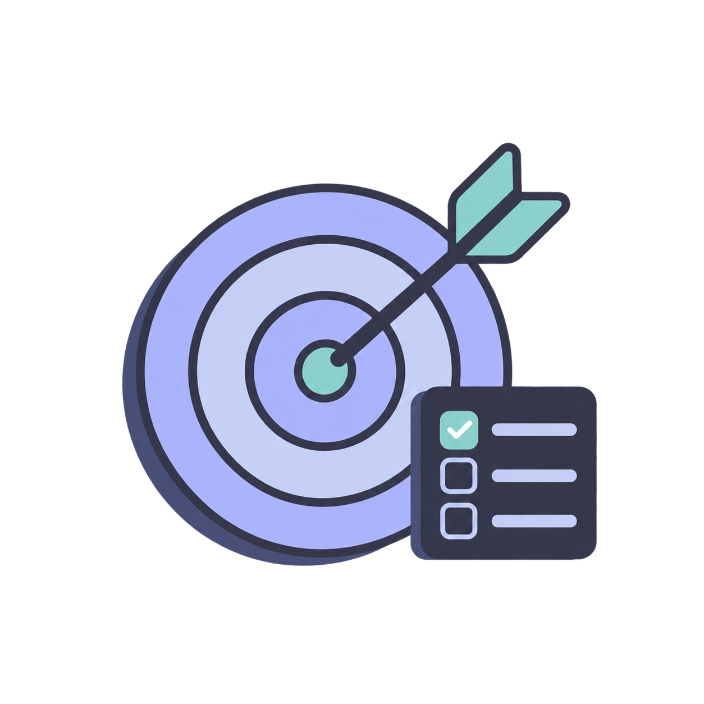{fig-alt="Zielscheibe mit Pfeil und Checkliste"}

{fig-alt="Drei Dokumente fließen in eine Ablage"}

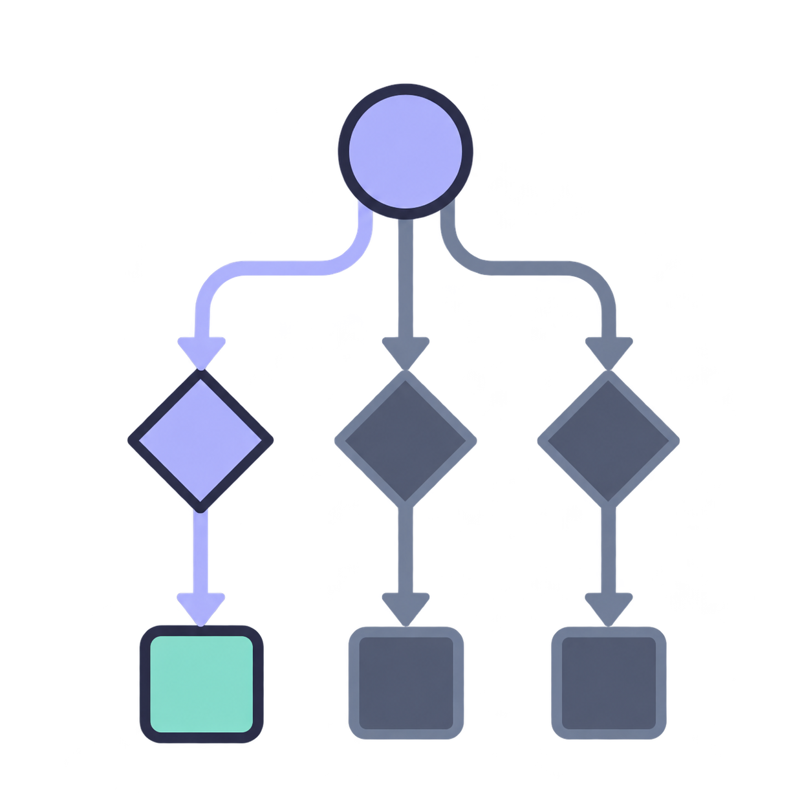{fig-alt="Entscheidungsbaum mit einem hervorgehobenen Weg"}

{fig-alt="Befehlsfenster mit Pfeil zu einem Kalender"}

{fig-alt="Zwei Pfeile bilden einen Kreis, in der Mitte ein Haken"}
:::

Für die Beschwerde heißt das: Der Agent liest die Beschwerde, stellt fest, dass ihm der Stand der Reparatur fehlt, durchsucht den Ordner, findet keinen Auftrag, schreibt den Entwurf mit einer Lücke für den Stand und meldet am Ende, was er getan hat. Der folgende Nachbau spielt diesen Ablauf Schritt für Schritt ab. An der Rückfrage entscheiden wir selbst, ob der Agent die Datei anlegen darf.

```{=html}
<iframe class="muster-agent" src="widgets/01-agent-schleife.html" title="Nachbau eines Agenten: fünf Stationen an einer Kundenbeschwerde" loading="lazy" style="width:100%;height:600px;border:0"></iframe>
<script>if(!window.__maResize){window.__maResize=1;addEventListener('message',function(e){if(!e.data||e.data.type!=='claude-widget-height')return;document.querySelectorAll('iframe.muster-agent').forEach(function(f){if(f.contentWindow===e.source)f.style.height=(e.data.height+8)+'px';});});}</script>
```

Zum Vergleich: Der Chat gleicht einem externen Berater am Telefon, dem wir jedes Mal alles vorlesen. Der Agent gleicht einem neuen Mitarbeiter am eigenen Schreibtisch mit Zugang zur Ablage. Vor wichtigen Schritten fragt er nach. An einer Stelle hinkt der Vergleich: Der Agent erinnert sich nicht von selbst an gestern. Jede neue Unterhaltung mit ihm beginnt ohne Erinnerung an die vorige. Darum steht in diesem Buch alles Wichtige als Datei im Ordner.

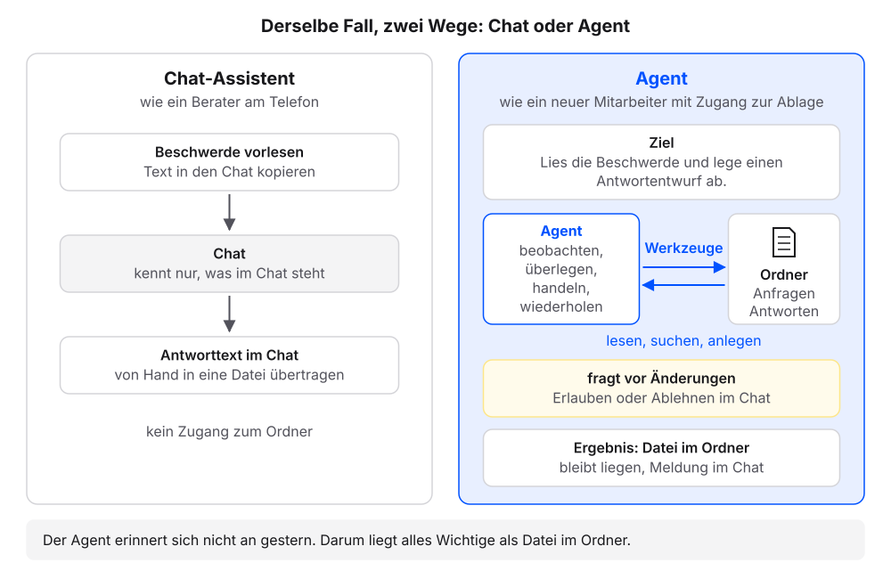{fig-alt="Zwei Wege für dieselbe Beschwerde. Links der Chat-Assistent wie ein Berater am Telefon: Text in den Chat kopieren, der Chat kennt nur, was im Chat steht, der Antworttext wird von Hand in eine Datei übertragen. Rechts der Agent wie ein neuer Mitarbeiter mit Zugang zur Ablage: Er bekommt ein Ziel, arbeitet mit Werkzeugen im Ordner, fragt vor Änderungen und legt das Ergebnis als Datei ab."}

## Welcher Agent hier gemeint ist

Agenten gibt es in Chat-Apps im Netz, in automatischen Abläufen und auf dem eigenen Rechner. Die Schleife ist überall dieselbe. In diesem Buch geht es um die Form auf dem eigenen Rechner: den **Coding-Agenten**. Seine Werkzeuge lesen, anlegen und ändern Dateien in einem Ordner. Gebaut wurde er für Programmcode. Er arbeitet aber mit jeder Textdatei, also auch mit Kundenanfragen, Protokollen oder Konzepten, und wir brauchen dafür keine Programmierkenntnisse. Beispiele sind Claude Code (Anthropic), Codex (OpenAI) und Antigravity (Google); Cursor arbeitet ähnlich.

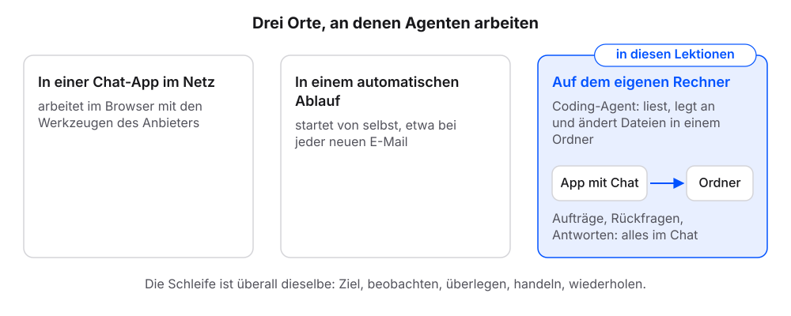{fig-alt="Drei Karten: Agenten in einer Chat-App im Netz, in einem automatischen Ablauf und auf dem eigenen Rechner. Die dritte Karte ist hervorgehoben: Der Coding-Agent liest, legt an und ändert Dateien in einem Ordner, bedient wird er über den Chat der App. Die Schleife ist an allen drei Orten dieselbe."}

Am schnellsten gelingt der Einstieg mit dem Agenten, der im eigenen Abo bereits enthalten ist: Codex in ChatGPT Plus und höher, Claude Code in Claude Pro und höher. Ohne Abo empfiehlt sich Antigravity, weil Google ein begrenztes Kontingent kostenlos bereitstellt; dafür genügt ein privates Google-Konto.

| Werkzeug | Anbieter | Zugang | App | Anleitung |
|---|---|---|---|---|
| Codex | OpenAI | im ChatGPT-Abo (Plus oder höher) | [Codex-App](https://learn.chatgpt.com/docs/app) | [Codex-Dokumentation](https://learn.chatgpt.com/docs) |
| Claude Code | Anthropic | im Claude-Abo (Pro oder höher) | [Claude-Desktop-App](https://claude.com/download), Bereich „Code“ | [Claude Code in der Desktop-App](https://code.claude.com/docs/en/desktop) |
| Antigravity | Google | kostenlos mit privatem Google-Konto, begrenztes Kontingent | [Antigravity-App](https://antigravity.google/download) | [Antigravity-Dokumentation](https://antigravity.google/docs) |
| Cursor | Anysphere | eigenes Abo, kostenloser Einstieg | [Cursor-App](https://cursor.com/download) | [Cursor-Dokumentation](https://cursor.com/docs) |

: Stand: 18.10.2026. Abos und Grenzen ändern sich, maßgeblich sind die Seiten der Anbieter.

Wir arbeiten in der **App** des jeweiligen Werkzeugs, dem Programm auf dem Rechner. In jeder dieser Apps steht der Chat im Mittelpunkt: Dort geben wir Aufträge, dort erscheinen Rückfragen, Hinweise auf geänderte Dateien und Antworten. Die weiteren Bereiche der Apps braucht das Buch nicht. Die Apps sind englisch beschriftet; die Begriffe in Anführungszeichen stehen so in der App.

Jeder Schritt hat ab hier denselben Aufbau: eine Anleitung, ein Kasten „Das sollten wir jetzt sehen“, eine kurze Erklärung und ein Abschnitt „Wenn es anders aussieht“.

[^kaggle-agents]: Wiesinger, Marlow und Vuskovic, Agents, Kaggle-Whitepaper (2025): <https://www.kaggle.com/whitepaper-agents>

## Schritt 1: App installieren und Ordner wählen {#app-einrichten}

**Voraussetzung:** Zugang zu einem der Werkzeuge aus der Tabelle oben.

1. Die App des eigenen Werkzeugs aus der Tabelle oben herunterladen.
2. Die App wie jedes andere Programm installieren. Bei Fragen hilft die Anleitung des Herstellers aus der Tabelle.
3. In der App anmelden. Je nach App öffnet sich dafür der Browser. Nach der Anmeldung zurück zur App wechseln.
4. Im Ordner `Dokumente` einen leeren Ordner `agent-test` anlegen. Finder: Menü „Ablage“, dann „Neuer Ordner“. Windows-Explorer: „Neu“, dann „Ordner“.
5. Den Ordner `agent-test` in der App wählen. Je App geht das so (die Beschriftungen hängen von der Sprache der App ab):
   - **Claude-Desktop-App:** auf [Claude Code öffnen](claude://code/new) klicken. Fragt der Browser, ob er die App öffnen darf: erlauben. Die App öffnet den Bereich „Code“. Ohne Link: oben rechts auf das Code-Symbol (`</>`) klicken, links daneben liegt die Sprechblase für den Chat. Vor der ersten Nachricht unter dem Eingabefeld auf die Umgebung klicken (etwa „Dieser Computer“), dann auf „Neue Umgebung“. Im Reiter „Lokal“ als Name `agent-test` eintragen. Bei „Ordner“ auf „Hinzufügen“ und „Auswählen …“ klicken, `Dokumente/agent-test` wählen und auf „Umgebung erstellen“ klicken.

     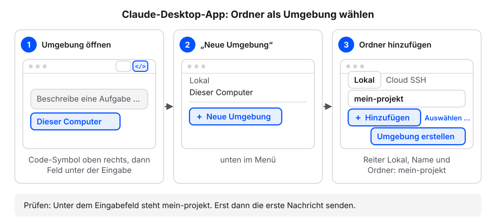{fig-alt="Drei Schritte in der Claude-Desktop-App. 1: Oben rechts neben der Sprechblase für den Chat auf das Code-Symbol klicken, alternativ über den Button in der Lektion. Danach unter dem Eingabefeld auf die Umgebung klicken, etwa Dieser Computer. 2: Unten im Menü auf Neue Umgebung klicken. 3: Im Reiter Lokal den Namen agent-test eintragen, bei Ordner über Hinzufügen und Auswählen den Ordner agent-test wählen und auf Umgebung erstellen klicken. Prüfen: Unter dem Eingabefeld steht agent-test."}
   - **Codex-App:** auf [Codex öffnen](codex://threads/new) klicken. Fragt der Browser, ob er die App öffnen darf: erlauben. Die App öffnet einen neuen Thread. Über dem Eingabefeld auf „Projekt auswählen“ klicken, dann auf „Neues Projekt“. Als Projektname `agent-test` eintragen. Unter „Quellordner“ auf „Hinzufügen“ klicken, `agent-test` wählen und auf „Projekt erstellen“ klicken.

     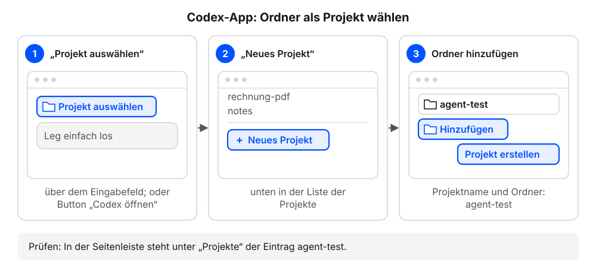{fig-alt="Drei Schritte in der Codex-App. 1: Über dem Eingabefeld auf Projekt auswählen klicken. 2: Unten in der Liste der Projekte auf Neues Projekt klicken. 3: Projektname agent-test eintragen, mit Hinzufügen den Ordner agent-test wählen und auf Projekt erstellen klicken. Prüfen: In der Seitenleiste steht unter Projekte der Eintrag agent-test."}
   - **Antigravity-App:** in der linken Seitenleiste auf „New Project“ (Ordner mit Plus) klicken, dann auf „Add Folder“. `agent-test` wählen und auf „Create“ klicken.

     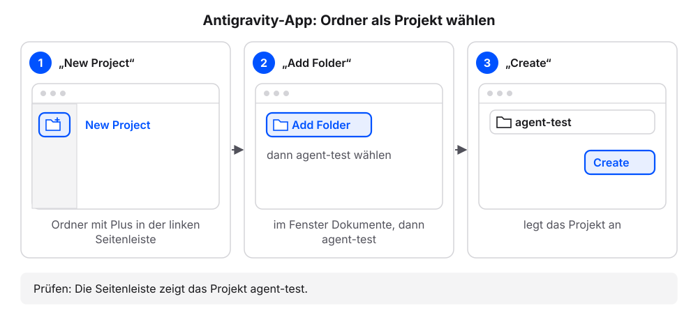{fig-alt="Drei Schritte in der Antigravity-App. 1: In der linken Seitenleiste auf das Ordnersymbol mit Plus, New Project, klicken. 2: Auf Add Folder klicken und agent-test aus Dokumente wählen. 3: Auf Create klicken. Prüfen: Die Seitenleiste zeigt das Projekt agent-test."}
6. Fragt der Rechner, ob die App auf den Ordner „Dokumente“ zugreifen darf: den Zugriff erlauben.
7. Prüfen: Die App zeigt den Namen `agent-test`, in Claude unter dem Eingabefeld, in Codex und Antigravity in der Seitenleiste. Der Chat ist leer.

### Das sollten wir jetzt sehen

Schema einer App, kein echtes Produkt:

```{=html}
<div style="max-width:620px;border:1px solid #dcd9d2;border-radius:12px;overflow:hidden;background:#fbfaf7;color:#1f2430;margin:0 0 1rem;line-height:1.45">

<div style="padding:12px;display:grid;gap:8px">
<div style="color:#5b6170;font-size:13px;padding:18px 0;text-align:center">Noch keine Nachrichten</div>
</div>
<div style="margin:4px 12px 12px;border:1px solid #dcd9d2;border-radius:999px;padding:7px 12px;color:#5b6170;font-size:13px">Auftrag eingeben …</div>
</div>
```


Oben der gewählte Ordner, darunter der Chat mit dem Eingabefeld. Weitere Bereiche der App brauchen wir in diesem Buch nicht.

### Was gerade passiert ist

Wir haben den Arbeitsplatz des Agenten festgelegt: Er arbeitet in dem Ordner, den wir gewählt haben. Die Ordnerwahl war die einzige Bedienung der App selbst. Ab jetzt läuft alles über den Chat, auch das Anlegen von Ordnern und Dateien. Der **Chat** ist der Bereich der App, in dem wir Aufträge senden; hier erscheinen die Antworten des Agenten, seine Rückfragen vor Änderungen und Hinweise auf angelegte oder geänderte Dateien.

Auch was im Ordner liegt, erfahren wir im Chat: „Liste die Dateien in diesem Ordner auf.“ Wer eine Datei selbst sehen will, klickt im Chat auf den Dateipfad oder öffnet den Ordner `agent-test` im Finder oder Explorer.

Welches Werkzeug wir nutzen, ist für dieses Buch unerheblich. Es muss drei Dinge können:

1. Es arbeitet in einem Ordner auf dem eigenen Rechner: Dateien lesen, anlegen und ändern.
2. Es fragt vor Änderungen und vor dem Ausführen von Befehlen nach oder zeigt die Änderungen zur Prüfung.
3. Es liest eine Anweisungsdatei (eine Datei mit Regeln) im Projektordner.

Schritt 2 prüft die ersten beiden Punkte, Schritt 3 den dritten.

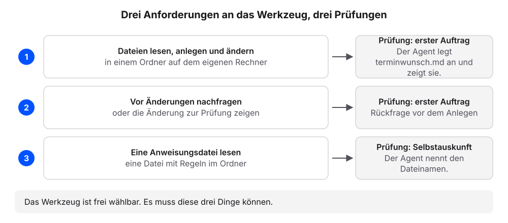{fig-alt="Drei nummerierte Anforderungen mit Pfeil zur jeweiligen Prüfung: Dateien in einem Ordner lesen, anlegen und ändern (erster Auftrag); vor Änderungen nachfragen oder die Änderung zeigen (erster Auftrag); eine Anweisungsdatei im Ordner lesen (Selbstauskunft)."}

::: {.callout-note title="Wenn es anders aussieht"}
- Der Rechner fragt, ob die App auf den Ordner „Dokumente“ oder „Dateien und Ordner“ zugreifen darf: den Zugriff erlauben. Ohne ihn sieht der Agent den Ordner nicht.
- Die Anmeldung öffnet den Browser, und danach passiert in der App nichts: zurück zur App wechseln. Je nach App dauert es einen Moment, bis sie die Anmeldung übernimmt.
- Die Anmeldung bei Antigravity mit einem Firmen- oder Hochschulkonto schlägt fehl: Ein solches Konto kann für Antigravity gesperrt sein. Ein privates Google-Konto nutzen.
- Die Claude-Desktop-App zeigt nur einen Chat ohne Ordnerwahl: Das ist der normale Chat. Oben rechts auf das Code-Symbol (`</>`) klicken.
- Die App zeigt neben dem Chat weitere Bereiche, etwa Dateien oder Änderungen: unbeachtet lassen. Für das Buch genügt der Chat.
- Die App fragt nach einem Projekt oder Arbeitsbereich: Gemeint ist der Ordner. `agent-test` wählen.
- Die App verlangt ein Abo, das wir nicht haben: Antigravity mit einem privaten Google-Konto nutzen.
:::

## Schritt 2: Der erste Auftrag {#erster-auftrag}

Mit diesem Selbsttest prüfen wir, ob das eigene Werkzeug die ersten beiden Anforderungen erfüllt. Den Ordner `agent-test` nutzen wir im Kapitel [Markdown](markdown.qmd) weiter.

**Voraussetzung:** Der leere Ordner `agent-test` ist in der App gewählt.

1. Diesen Auftrag senden:

   ```text
   Lege in diesem Ordner die Datei hallo.md an. Inhalt: eine Überschrift „Test“ und ein Satz, welches Datum heute ist. Frage vorher, ob du die Datei anlegen darfst.
   ```

2. Prüfen: Der Agent fragt vor dem Anlegen nach oder zeigt die Änderung zur Freigabe.
3. Das Anlegen freigeben.
4. Prüfen: Der Chat meldet die neue Datei, etwa mit einer Zeile „hallo.md angelegt“ oder einer Anzeige wie „+3“ für drei neue Zeilen.
5. Diese Frage senden:

   ```text
   Liste die Dateien in diesem Ordner auf. Zeig mir dann den Inhalt von hallo.md genau so, wie er in der Datei steht, mit allen Zeichen.
   ```

6. Prüfen: Die Liste nennt `hallo.md`. Zeile 1 des Inhalts beginnt mit `#`. Darunter steht ein Satz mit dem heutigen Datum.

### Das sollten wir jetzt sehen

Der Verlauf im Chat, sinngemäß; das Datum ist das eigene:

```{=html}
<div style="max-width:620px;border:1px solid #dcd9d2;border-radius:12px;overflow:hidden;background:#fbfaf7;color:#1f2430;margin:0 0 1rem;line-height:1.45">

<div style="padding:12px;display:grid;gap:8px">
<div style="justify-self:end;max-width:94%;border-radius:10px;padding:8px 11px;background:#dfe6f3"><span style="display:block;font-size:11.5px;color:#5b6170;margin-bottom:2px">Wir</span>Lege in diesem Ordner die Datei hallo.md an. Inhalt: eine Überschrift „Test“ und ein Satz, welches Datum heute ist. Frage vorher, ob du die Datei anlegen darfst.</div>
<div style="justify-self:stretch;border:1px solid #d9b26a;border-radius:10px;padding:8px 11px;background:#fbf3e3"><span style="display:block;font-size:11.5px;color:#5b6170;margin-bottom:2px">Agent</span>Ich lege die Datei <code>hallo.md</code> mit einer Überschrift und dem heutigen Datum an. Darf ich?<br><span style="display:inline-block;margin:6px 6px 0 0;padding:2px 10px;border:1px solid #23417a;color:#23417a;border-radius:999px;font-size:12.5px;font-weight:600">Erlauben</span><span style="display:inline-block;margin:6px 6px 0 0;padding:2px 10px;border:1px solid #dcd9d2;border-radius:999px;font-size:12.5px">Ablehnen</span></div>
<div style="justify-self:start;font-family:ui-monospace,SFMono-Regular,Menlo,monospace;font-size:12px;color:#5b6170;padding:0 4px"><span style="color:#b8862b;font-weight:700">› </span>hallo.md angelegt</div>
<div style="justify-self:start;max-width:94%;border-radius:10px;padding:8px 11px;background:#f4f2ed;border:1px solid #dcd9d2"><span style="display:block;font-size:11.5px;color:#5b6170;margin-bottom:2px">Agent</span>Fertig. Eine Datei angelegt (<code>hallo.md</code>), keine geändert.</div>
<div style="justify-self:end;max-width:94%;border-radius:10px;padding:8px 11px;background:#dfe6f3"><span style="display:block;font-size:11.5px;color:#5b6170;margin-bottom:2px">Wir</span>Liste die Dateien in diesem Ordner auf. Zeig mir dann den Inhalt von hallo.md genau so, wie er in der Datei steht, mit allen Zeichen.</div>
<div style="justify-self:start;max-width:94%;border-radius:10px;padding:8px 11px;background:#f4f2ed;border:1px solid #dcd9d2"><span style="display:block;font-size:11.5px;color:#5b6170;margin-bottom:2px">Agent</span>Im Ordner liegt eine Datei: <code>hallo.md</code>. Inhalt:<pre style="margin:6px 0 0;padding:8px 10px;border:1px solid #dcd9d2;border-radius:8px;background:#fbfaf7;font-family:ui-monospace,SFMono-Regular,Menlo,monospace;font-size:.85rem;line-height:1.6;white-space:pre-wrap;word-break:break-word"><i style="color:#23417a;font-style:normal;font-weight:700">#</i> Test

Heute ist der 18. Oktober 2026.</pre></div>
</div>
</div>
```


Wortlaut, Datum und Beschriftung der Buttons unterscheiden sich je App. Manche Apps zeigen die Freigabe als Änderungsansicht statt als Frage.

### Was gerade passiert ist

Wir haben einen Satz geschrieben. Der Agent hat nachgefragt und dann die Datei `hallo.md` in unserem Ordner angelegt. Das Ergebnis liegt als Datei auf unserem Rechner, und der Agent hat es uns auf Nachfrage im Chat gezeigt.

Das war die Schleife aus dem Abschnitt [Was ein KI-Agent tut](#was-ein-ki-agent-tut) am eigenen Ergebnis. Unser Auftrag war das Ziel. Der Agent hat den leeren Ordner beobachtet, den Inhalt überlegt und mit dem Werkzeug „Datei anlegen“ gehandelt. Den Text hat der Agent geschrieben. Angelegt hat die Datei die App, und sie hat uns vorher gefragt. Eine Zeile wie „hallo.md angelegt“ im Chat zeigt das ausgeführte Werkzeug. Mit einem Chat-Assistenten hätten wir den Text erhalten und `hallo.md` selbst angelegt.

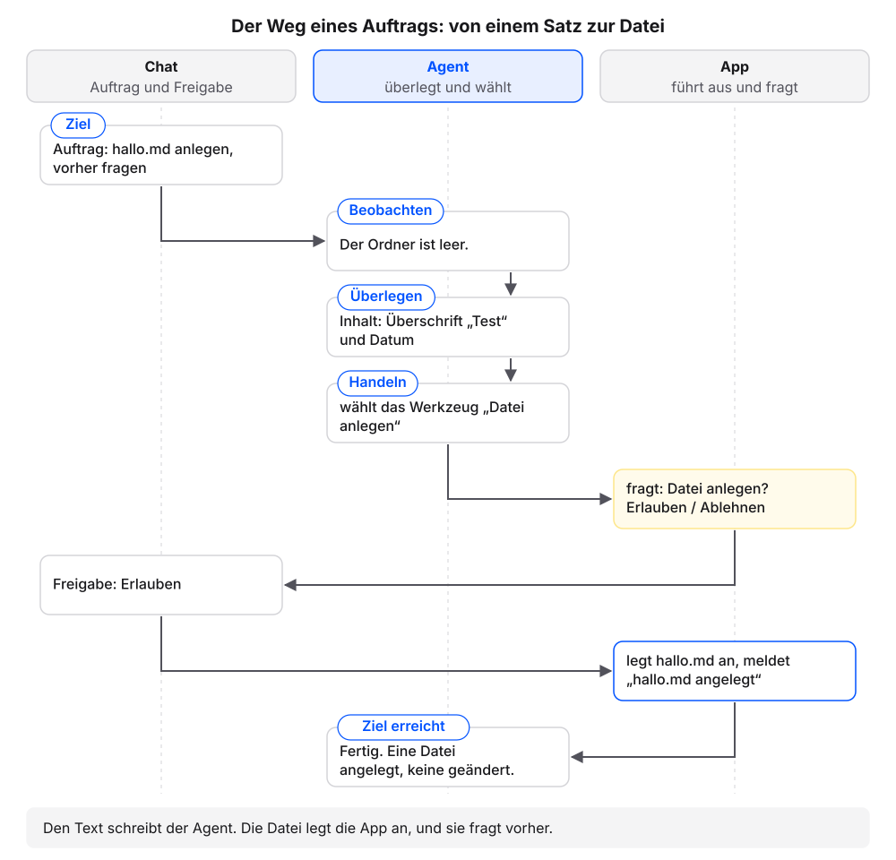{fig-alt="Drei Bahnen Chat, Agent und App. Der Auftrag im Chat setzt das Ziel. Der Agent beobachtet den leeren Ordner, überlegt den Inhalt und wählt das Werkzeug Datei anlegen. Die App fragt um Erlaubnis, im Chat wird freigegeben, die App legt hallo.md an und meldet es. Der Agent meldet: Fertig, eine Datei angelegt."}

`hallo.md` ist eine **Markdown**-Datei. Markdown ist reiner Text mit wenigen Zeichen für die Gliederung: `#` am Zeilenanfang macht eine Überschrift, `-` einen Listenpunkt. Die Dateien enden auf `.md`. Fast alle Dateien in diesem Buch sind Markdown-Dateien, weil Mensch und Agent dieselbe Datei ohne Spezialprogramm lesen und jede geänderte Zeile sichtbar ist. Im Kapitel [Markdown: Text, den Mensch und Agent lesen](markdown.qmd) legen wir Schritt für Schritt weitere Markdown-Dateien an und sehen dort auch, was eine Word-Datei davon unterscheidet.

::: {.callout-note title="Wenn es anders aussieht"}
- Der Agent legt die Datei ohne Rückfrage an: Die App läuft in einem Modus ohne Rückfragen. In der Claude-Desktop-App neben dem Senden-Button den Modus „Manual“ wählen. In anderen Apps steht die Einstellung in der Anleitung des Herstellers. Erst weiterarbeiten, wenn der Agent vor Änderungen fragt.
- Statt einer Frage erscheint eine Änderungsansicht: links die Dateiliste, rechts die neuen Zeilen, dazu Buttons zum Annehmen oder Ablehnen. Das ist die Freigabe. Die Zeilen prüfen und annehmen.
- Der Agent fragt auch vor dem Lesen oder vor einem Befehl: Das ist in Ordnung. Freigeben, was zum Auftrag passt.
- Der Agent antwortet nur mit Text und legt nichts an: prüfen, ob der Ordner `agent-test` gewählt ist (Schritt 1). Manche Apps haben zusätzlich einen Umschalter für den Arbeitsmodus, etwa „Chat“ / „Work“ über dem Eingabefeld der Codex-App.
- Die Liste in Schritt 5 nennt `hallo.md` nicht: „Wo hast du hallo.md angelegt? Nenne den vollständigen Pfad.“
:::

### So sieht es mit echtem Material aus

Der folgende Nachbau zeigt dasselbe Prinzip mit drei Kundenanfragen im Ordner `kundenanfragen`, den wir im Kapitel [Der Projektordner](projektordner.qmd) selbst anlegen. Er stellt einen Chatverlauf nach, kein echtes Produkt: Der Agent liest die Anfragen selbst, fragt vor dem Anlegen und zeigt die fertige Übersicht auf Nachfrage im Chat.

```{=html}
<div style="max-width:620px;border:1px solid #dcd9d2;border-radius:12px;overflow:hidden;background:#fbfaf7;color:#1f2430;margin:0 0 1rem;line-height:1.45">

<div style="padding:12px;display:grid;gap:8px">
<div style="justify-self:end;max-width:94%;border-radius:10px;padding:8px 11px;background:#dfe6f3"><span style="display:block;font-size:11.5px;color:#5b6170;margin-bottom:2px">Wir</span>Sortiere die Anfragen im Ordner anfragen nach Dringlichkeit und schreibe das Ergebnis in die Datei UEBERSICHT.md.</div>
<div style="justify-self:start;font-family:ui-monospace,SFMono-Regular,Menlo,monospace;font-size:12px;color:#5b6170;padding:0 4px"><span style="color:#b8862b;font-weight:700">› </span>liest anfragen/2026-10-05-terminwunsch.md</div>
<div style="justify-self:start;font-family:ui-monospace,SFMono-Regular,Menlo,monospace;font-size:12px;color:#5b6170;padding:0 4px"><span style="color:#b8862b;font-weight:700">› </span>liest anfragen/2026-10-06-preisfrage.md</div>
<div style="justify-self:start;font-family:ui-monospace,SFMono-Regular,Menlo,monospace;font-size:12px;color:#5b6170;padding:0 4px"><span style="color:#b8862b;font-weight:700">› </span>liest anfragen/2026-10-07-beschwerde.md</div>
<div style="justify-self:stretch;border:1px solid #d9b26a;border-radius:10px;padding:8px 11px;background:#fbf3e3"><span style="display:block;font-size:11.5px;color:#5b6170;margin-bottom:2px">Agent</span>Ich lege <code>UEBERSICHT.md</code> an: eine Tabelle mit den drei Anfragen, dringendste zuerst. Darf ich?<br><span style="display:inline-block;margin:6px 6px 0 0;padding:2px 10px;border:1px solid #23417a;color:#23417a;border-radius:999px;font-size:12.5px;font-weight:600">Erlauben</span><span style="display:inline-block;margin:6px 6px 0 0;padding:2px 10px;border:1px solid #dcd9d2;border-radius:999px;font-size:12.5px">Ablehnen</span></div>
<div style="justify-self:start;font-family:ui-monospace,SFMono-Regular,Menlo,monospace;font-size:12px;color:#5b6170;padding:0 4px"><span style="color:#b8862b;font-weight:700">› </span>UEBERSICHT.md angelegt</div>
<div style="justify-self:start;max-width:94%;border-radius:10px;padding:8px 11px;background:#f4f2ed;border:1px solid #dcd9d2"><span style="display:block;font-size:11.5px;color:#5b6170;margin-bottom:2px">Agent</span>Fertig. Eine Datei angelegt (<code>UEBERSICHT.md</code>), keine geändert. Dringendste Anfrage ist die Beschwerde vom 7.10.: Die Reparatur war für Freitag zugesagt, die Kundin hat keine Nachricht.</div>
<div style="justify-self:end;max-width:94%;border-radius:10px;padding:8px 11px;background:#dfe6f3"><span style="display:block;font-size:11.5px;color:#5b6170;margin-bottom:2px">Wir</span>Zeig mir den Inhalt von UEBERSICHT.md.</div>
<div style="justify-self:start;max-width:94%;border-radius:10px;padding:8px 11px;background:#f4f2ed;border:1px solid #dcd9d2"><span style="display:block;font-size:11.5px;color:#5b6170;margin-bottom:2px">Agent</span><div style="font-size:1.2rem;font-weight:700;margin:4px 0 6px">Übersicht der Anfragen</div><p>Sortiert nach Dringlichkeit, dringendste zuerst.</p><table style="border-collapse:collapse;font-size:.9rem;margin-top:4px"><thead><tr><th style="border:1px solid #dcd9d2;padding:4px 8px;text-align:left;background:#f4f2ed">Rang</th><th style="border:1px solid #dcd9d2;padding:4px 8px;text-align:left;background:#f4f2ed">Anfrage</th><th style="border:1px solid #dcd9d2;padding:4px 8px;text-align:left;background:#f4f2ed">Anliegen</th><th style="border:1px solid #dcd9d2;padding:4px 8px;text-align:left;background:#f4f2ed">Grund</th></tr></thead><tbody><tr><td style="border:1px solid #dcd9d2;padding:4px 8px;text-align:left">1</td><td style="border:1px solid #dcd9d2;padding:4px 8px;text-align:left">Beschwerde vom 7.10.</td><td style="border:1px solid #dcd9d2;padding:4px 8px;text-align:left">Reparatur nicht fertig</td><td style="border:1px solid #dcd9d2;padding:4px 8px;text-align:left">für Freitag zugesagt, keine Nachricht</td></tr><tr><td style="border:1px solid #dcd9d2;padding:4px 8px;text-align:left">2</td><td style="border:1px solid #dcd9d2;padding:4px 8px;text-align:left">Terminwunsch vom 5.10.</td><td style="border:1px solid #dcd9d2;padding:4px 8px;text-align:left">Termin für eine Reparatur</td><td style="border:1px solid #dcd9d2;padding:4px 8px;text-align:left">Termin nächste Woche gewünscht</td></tr><tr><td style="border:1px solid #dcd9d2;padding:4px 8px;text-align:left">3</td><td style="border:1px solid #dcd9d2;padding:4px 8px;text-align:left">Preisfrage vom 6.10.</td><td style="border:1px solid #dcd9d2;padding:4px 8px;text-align:left">Preis für eine Reparatur</td><td style="border:1px solid #dcd9d2;padding:4px 8px;text-align:left">keine Frist genannt</td></tr></tbody></table></div>
</div>
</div>
```

Mit einem Chat-Assistenten hieße das: jede Anfrage öffnen, den Text kopieren, in den Chat einfügen, um eine Sortierung bitten und die Antwort danach von Hand in eine Datei übertragen. Beim nächsten Mal beginnt das Kopieren von vorn. Dem Agenten genügt ein Satz: „Sortiere die Anfragen im Ordner `anfragen` nach Dringlichkeit und schreibe das Ergebnis in die Datei `UEBERSICHT.md`.“

Vier Dinge fallen auf. Der Auftrag nennt nur den Ordner und die Zieldatei; niemand kopiert eine Anfrage in den Chat. Der Agent öffnet jede der drei Anfragen selbst und liest die Zeile mit dem Anliegen. Bevor er etwas anlegt, fragt er. Und das Ergebnis steht danach als Datei im Ordner: Der Agent hat die Datei `UEBERSICHT.md` neu angelegt, so wie es der Auftrag verlangt. Sie liegt jetzt neben dem Ordner mit den Anfragen und hat diesen Inhalt:

```{.markdown filename="UEBERSICHT.md"}
# Übersicht der Anfragen

Sortiert nach Dringlichkeit, dringendste zuerst.

| Rang | Anfrage | Anliegen | Grund |
|---|---|---|---|
| 1 | Beschwerde vom 7.10. | Reparatur nicht fertig | für Freitag zugesagt, keine Nachricht |
| 2 | Terminwunsch vom 5.10. | Termin für eine Reparatur | Termin nächste Woche gewünscht |
| 3 | Preisfrage vom 6.10. | Preis für eine Reparatur | keine Frist genannt |
```


Auf die Frage „Zeig mir den Inhalt von UEBERSICHT.md“ gibt der Agent dieselbe Datei im Chat formatiert wieder, wie im Nachbau oben: Aus `#` wird eine Überschrift, aus den Zeilen mit senkrechten Strichen eine Tabelle. Diese formatierte Darstellung im Chat ist die Vorschau, mit der wir im Kapitel [Markdown](markdown.qmd) arbeiten.

Die Datei bleibt liegen. Kommt morgen eine vierte Anfrage, ergänzt der Agent dieselbe Übersicht, statt eine neue Liste im Chat zu erzeugen. Zum Schluss meldet er, was sich im Ordner geändert hat: eine Datei angelegt, keine geändert. Diese Meldung machen wir im Kapitel [AGENTS.md: die Hausordnung](agents-md.qmd) zur festen Regel.

| | Chat-Assistent | Agent im Ordner |
|---|---|---|
| **Woher kommt das Material?** | Wir kopieren es ins Eingabefeld. | Der Agent öffnet die Dateien im Ordner selbst. |
| **Wohin geht das Ergebnis?** | Es steht als Text im Chat und wird von Hand übertragen. | Es entsteht als Datei im Ordner. |
| **Was bleibt für das nächste Mal?** | Der Chatverlauf, sofern wir ihn wiederfinden. | Die Dateien im Ordner, für jede neue Unterhaltung lesbar. |
| **Wer behält die Kontrolle?** | Wir, weil nichts außerhalb des Chats passiert. | Wir, weil der Agent vor Änderungen fragt. |

Der Agent lohnt sich also, wenn das Material schon als Dateien vorliegt oder das Ergebnis als Datei entstehen soll. Für eine kurze Frage ohne Material reicht der Chat. Vier Aufgaben aus dem Büroalltag zeigen die Grenze:

| Aufgabe | Material als Dateien? | Ergebnis als Datei? | Passendes Werkzeug |
|---|---|---|---|
| Eine Betreffzeile für eine E-Mail formulieren | nein | nein | Chat |
| Einen Satz ins Englische übersetzen | nein | nein | Chat |
| Eine Begrüßung für die Website vorschlagen | nein | kurzer Text | Chat |
| 40 Anfragen aus einem Ordner in eine Tabelle übertragen | ja | ja | Agent |

Die Begrüßung für die Website klingt nach Arbeit an einer Datei. Sie ist aber ein kurzer Text ohne Material, den wir an einer Stelle einfügen. Bei den 40 Anfragen dagegen liest der Agent den Ordner selbst und schreibt die Tabelle, ohne dass wir vierzigmal kopieren.

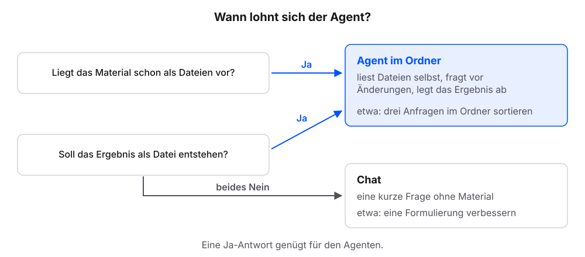{fig-alt="Zwei Fragen: Liegt das Material schon als Dateien vor? Soll das Ergebnis als Datei entstehen? Bei Ja führt der Pfeil zum Agenten im Ordner, der Dateien selbst liest, vor Änderungen fragt und das Ergebnis ablegt. Bei zweimal Nein führt der Pfeil zum Chat für eine kurze Frage ohne Material."}

## Schritt 3: Den Agenten nach sich selbst fragen {#selbstauskunft}

Einige Details hängen vom Werkzeug ab, etwa der Name der Anweisungsdatei. Statt sie nachzuschlagen, fragen wir den Agenten selbst.

**Voraussetzung:** Der Ordner `agent-test` ist in der App gewählt.

1. Diese Frage senden:

   ```text
   Welche Datei im Projektordner liest du automatisch als Anweisung? Nenne den Dateinamen und den Ort. Nur antworten, nichts ändern.
   ```

2. Prüfen: Die Antwort nennt einen Dateinamen, etwa `AGENTS.md` oder `CLAUDE.md`.

### Das sollten wir jetzt sehen

Eine Beispielantwort:

```{=html}
<div style="max-width:560px;border:1px solid #dcd9d2;border-radius:12px;overflow:hidden;background:#fbfaf7;color:#1f2430;margin:0 0 1rem">
<div style="padding:6px 12px;background:#f4f2ed;border-bottom:1px solid #dcd9d2;font-size:12px;color:#5b6170">Chat</div>
<div style="padding:10px 12px;line-height:1.45">
<div style="background:#f4f2ed;border:1px solid #dcd9d2;border-radius:10px;padding:8px 11px"><span style="display:block;font-size:11.5px;color:#5b6170">Agent</span>Ich lese automatisch die Datei <code>AGENTS.md</code> im geöffneten Ordner, hier also <code>agent-test/AGENTS.md</code>. Im Moment liegt dort keine solche Datei.</div>
</div>
</div>
```

Je nach Werkzeug nennt der Agent einen anderen Namen, etwa `CLAUDE.md`, und weitere Orte.

### Was gerade passiert ist

Der Agent hat über sich selbst Auskunft gegeben und nichts geändert; dafür sorgt der Zusatz „Nur antworten, nichts ändern“. Eine **Anweisungsdatei** ist eine Datei mit Regeln, die der Agent zu Beginn jeder Sitzung (Unterhaltung vom Start bis zum Schließen) von selbst öffnet: `AGENTS.md` oder der Name, den das Werkzeug dafür nutzt. Damit ist die dritte Anforderung geprüft. Den Namen brauchen wir im Kapitel [AGENTS.md: die Hausordnung](agents-md.qmd).

Diese **Selbstauskunft** ersetzt im Buch die Produktdokumentation. Hängt ein Detail vom Werkzeug ab, fragen wir den Agenten. Jedes Kapitel enthält dafür eine passende Frage zum Kopieren.

::: {.callout-note title="Wenn es anders aussieht"}
- Die Antwort nennt mehrere Dateien oder Orte: Das ist in Ordnung. Wichtig ist der Name der Datei im Projektordner.
- Der Agent nennt keine Anweisungsdatei: Die Dateinamen der verbreiteten Werkzeuge stehen im Kapitel [AGENTS.md: die Hausordnung](agents-md.qmd). Liest das Werkzeug keine Anweisungsdatei, erfüllt es die dritte Anforderung nicht.
:::

## Übersicht nach Werkzeug {#uebersicht-nach-werkzeug}

Die Tabelle nennt für drei verbreitete Agenten, was wir für den Einstieg brauchen: App, Zugang, Ordnerwahl und Rückfrage. Andere Werkzeuge funktionieren ebenso, wenn sie die drei Anforderungen oben erfüllen. Weitere Produktdetails stehen jeweils in dem Kapitel, in dem sie gebraucht werden, mit Stand-Datum: der Name der Anweisungsdatei in [AGENTS.md: die Hausordnung](agents-md.qmd), der Skills-Ordner in [Skills: Abläufe, die bleiben](skills.qmd), die MCP-Konfiguration in [MCP: Zugänge zu anderen Systemen](mcp.qmd), Plugins und Konnektoren in [Konnektoren und Plugins](konnektoren-plugins.qmd).

**Stand: 18. Oktober 2026.** Quelle ist jeweils die Dokumentation des Herstellers.

| Begriff | Claude Code | Codex | Antigravity |
|---|---|---|---|
| **App** | [Claude-Desktop-App](https://claude.com/download), Bereich „Code“ | [Codex-App](https://learn.chatgpt.com/docs/app) | [Antigravity-App](https://antigravity.google/download) |
| **Zugang** | Claude-Abo, Pro oder höher | ChatGPT-Abo, Plus oder höher | privates Google-Konto, begrenztes Kontingent kostenlos |
| **Ordner wählen** | Im Bereich „Code“ unter dem Eingabefeld die Umgebung anklicken, „Neue Umgebung“: Reiter „Lokal“, Ordner hinzufügen, „Umgebung erstellen“.[^cc-desktop] | „Projekt auswählen“, dann „Neues Projekt“: Ordner hinzufügen und „Projekt erstellen“.[^cx-app] | Seitenleiste „New Project“, dann „Add Folder“ und „Create“.[^ag-start] |
| **Rückfrage und Änderungen** | Modus „Manual“ neben dem Senden-Button fragt vor Änderungen. Eine Anzeige wie „+12 -1“ öffnet die Änderungsansicht.[^cc-desktop] | Rückfrage im Chat. Einstellungen zu Berechtigungen laut Anleitung des Herstellers.[^cx-app] | Änderungen erscheinen zur Prüfung, Zeile für Zeile. „Local mode“ arbeitet direkt im Ordner.[^ag-start] |

[^cc-desktop]: Claude Code, „Claude Code on desktop“: <https://code.claude.com/docs/en/desktop>
[^cx-app]: Codex, „Codex app“: <https://learn.chatgpt.com/docs/app>
[^ag-start]: Antigravity, „Getting started“: <https://antigravity.google/docs/getting-started>

::: {.callout-note title="Die Tabelle altert"}
Hersteller ändern Bezeichnungen und Speicherorte. Weicht der eigene Agent von einer Angabe ab, gilt seine Selbstauskunft. Die Kapitel dieses Buches nennen Produktdetails nur mit Stand-Datum und bleiben gültig, wenn sich eine Angabe ändert.
:::

## Vier Bausteine für die Arbeit mit einem Agenten

Damit ein Agent verlässlich arbeitet, braucht er mehr als einen Auftrag. Der neue Mitarbeiter vom Anfang des Kapitels ist fachlich fit, kennt aber unseren Betrieb nicht und erinnert sich nicht an gestern. Darum steht alles Wichtige schriftlich in seinem **Onboarding**, der Einarbeitung neuer Mitarbeitender. Vier Bausteine bilden seine Onboarding-Mappe und fassen zusammen, was die folgenden Kapitel aufbauen:

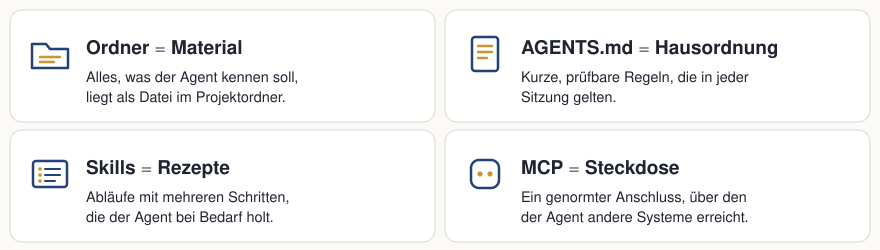{fig-alt="Vier Karten: Ordner gleich Arbeitsplatz mit Ablage, AGENTS.md gleich Hausordnung, Skills gleich Arbeitsanweisungen, MCP gleich Zugänge." width="100%"}

- **Ordner = Arbeitsplatz mit Ablage.** Alles, was der Agent kennen soll, liegt als Datei im Projektordner. Darum geht es in den Kapiteln [Der Projektordner](projektordner.qmd), [Kontext bereitstellen](kontext-bereitstellen.qmd), [PDFs als Quellen](pdf-als-quelle.qmd), [Excel-Tabellen als Quelle](excel-als-quelle.qmd) und [Laufend neue Dateien](laufend-neue-dateien.qmd).
- **AGENTS.md = Hausordnung.** Kurze, prüfbare Regeln, die der Agent zu Beginn jeder Sitzung zuerst liest. Eine **Sitzung** ist eine Unterhaltung mit dem Agenten vom Start bis zum Schließen. Siehe [AGENTS.md: die Hausordnung](agents-md.qmd).
- **Skills = Arbeitsanweisungen.** Abläufe mit mehreren Schritten, die der Agent bei Bedarf hervorholt. Siehe [Skills](skills.qmd).
- **MCP = Zugänge.** Zugänge zu anderen Systemen nach einem gemeinsamen Standard (MCP steht für Model Context Protocol). Siehe [MCP](mcp.qmd) und [Konnektoren und Plugins](konnektoren-plugins.qmd).

