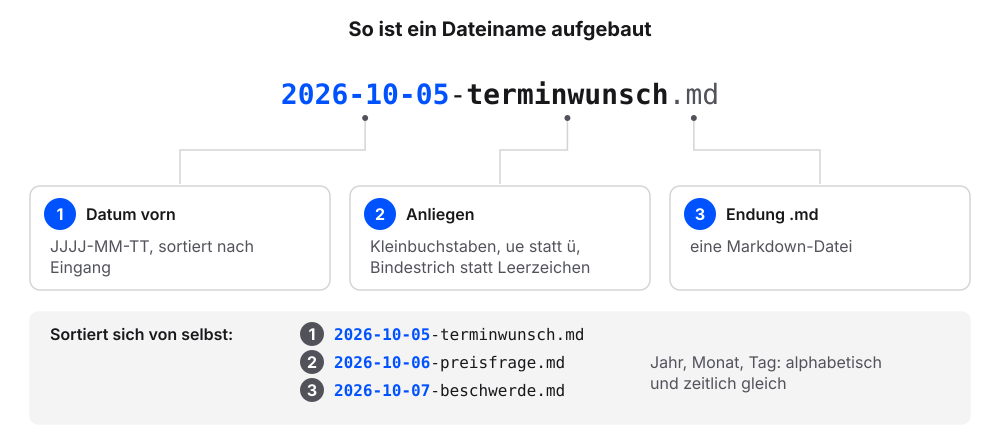
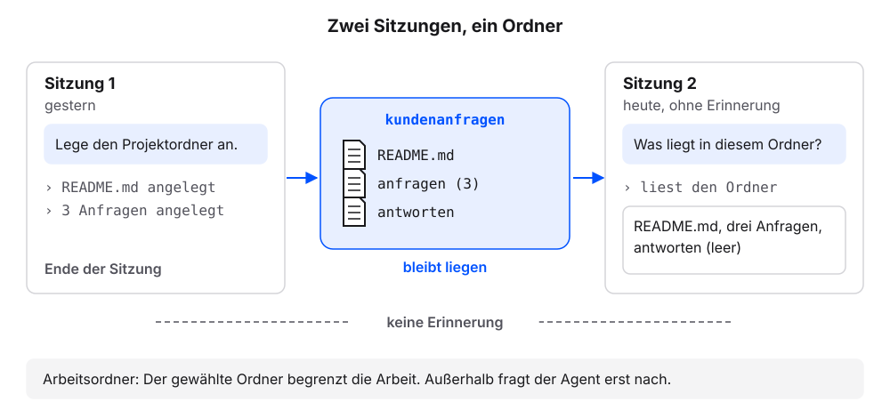

# Erstes Material und neue Sitzung

Der Projektordner aus dem Kapitel [Der Projektordner: das Interview](projektordner.qmd) ist noch leer. Jetzt kommen die ersten Dateien hinein, mit Namen nach einer festen Regel. Danach prüfen wir in einer neuen Sitzung, dass der Agent den Ordner selbst liest.

**Voraussetzung:** Der Projektordner mit `README.md` liegt vor. Zwei oder drei Dateien zum eigenen Vorhaben ohne vertrauliche Inhalte liegen bereit (siehe die Warnung im Kapitel [Der Projektordner: das Interview](projektordner.qmd)). Am besten eignen sich Textdateien, Notizen oder E-Mails als Text. PDFs und Excel-Dateien behandeln eigene Kapitel.

## Erstes Material ablegen

1. Im Finder (Mac) oder Explorer (Windows) den Projektordner öffnen und darin den Materialordner laut `README.md`.
2. Zwei oder drei Dateien hineinkopieren. In den Kopien Personennamen durch Rollen ersetzen, etwa „Kundin“.
3. Zur App wechseln.
4. Diesen Auftrag senden:

   ```text
   Benenne die Dateien im Materialordner laut README.md nach dieser Regel um: Datum vorn im Format JJJJ-MM-TT, dann das Anliegen in Kleinbuchstaben, Bindestriche statt Leerzeichen, keine Umlaute, Endung bleibt. Nimm das Datum aus dem Inhalt. Fehlt es, frag mich. Zeige mir vorher die Liste alt und neu und frage, bevor du umbenennst.
   ```

5. Prüfen: Der Agent zeigt die Liste alt und neu und fragt, bevor er umbenennt.
6. Die Umbenennung freigeben.
7. Prüfen: Jeder neue Name beginnt mit einem Datum im Format `JJJJ-MM-TT`.

Ohne eigene Dateien legt der Agent im Beispielfall drei Anfragen an. Die Schritte 1 bis 6 entfallen dann; stattdessen:

1. Diesen Auftrag für die Beispielanfragen senden:

   ```text
   Lege im Ordner anfragen drei Dateien an, jede mit genau diesem Inhalt. Erfinde nichts dazu.

   Datei 2026-10-05-terminwunsch.md:
   # Terminwunsch

   - Datum: 2026-10-05
   - Kanal: E-Mail
   - Anliegen: Termin für eine Reparatur

   Guten Tag, ich möchte einen Termin für eine Reparatur.
   Passt es nächste Woche am Dienstag oder Mittwoch vormittags?

   Datei 2026-10-06-preisfrage.md:
   # Preisfrage

   - Datum: 2026-10-06
   - Kanal: Kontaktformular
   - Anliegen: Preis für eine Reparatur

   Guten Tag, was kostet bei Ihnen eine Reparatur?
   Und kommt eine Anfahrt dazu, wenn Sie zu mir kommen?

   Datei 2026-10-07-beschwerde.md:
   # Beschwerde

   - Datum: 2026-10-07
   - Kanal: E-Mail
   - Anliegen: Reparatur nicht rechtzeitig fertig

   Guten Tag, die Reparatur war für Freitag zugesagt.
   Bis heute habe ich keine Nachricht. Bitte melden Sie sich.

   Frage, bevor du die Dateien anlegst.
   ```

2. Das Anlegen freigeben.
3. Diese Frage senden:

   ```text
   Liste die Dateien im Ordner anfragen auf. Zeig mir dann den Inhalt von anfragen/2026-10-07-beschwerde.md genau so, wie er in der Datei steht, mit allen Zeichen.
   ```

4. Prüfen: Die Liste nennt drei Dateien. Jeder Name beginnt mit einem Datum, etwa `2026-10-05-terminwunsch.md`.
5. Prüfen: Zeile 1 lautet `# Beschwerde`. Darunter stehen Datum, Kanal und Anliegen als Liste.

### So sieht es im Beispielfall aus

Unsere Namen weichen ab, die Prüfpunkte gelten.

```{=html}
<div style="max-width:620px;border:1px solid #dcd9d2;border-radius:12px;overflow:hidden;background:#fbfaf7;color:#1f2430;margin:0 0 1rem;line-height:1.45" role="group" aria-label="Chat: drei Anfragen angelegt, Dateiliste und Inhalt der Beschwerde">

<div style="padding:12px;display:grid;gap:8px">
<div style="justify-self:start;font-family:ui-monospace,SFMono-Regular,Menlo,monospace;font-size:12px;color:#5b6170;padding:0 4px"><span style="color:#b8862b;font-weight:700">› </span>anfragen/2026-10-05-terminwunsch.md angelegt</div>
<div style="justify-self:start;font-family:ui-monospace,SFMono-Regular,Menlo,monospace;font-size:12px;color:#5b6170;padding:0 4px"><span style="color:#b8862b;font-weight:700">› </span>anfragen/2026-10-06-preisfrage.md angelegt</div>
<div style="justify-self:start;font-family:ui-monospace,SFMono-Regular,Menlo,monospace;font-size:12px;color:#5b6170;padding:0 4px"><span style="color:#b8862b;font-weight:700">› </span>anfragen/2026-10-07-beschwerde.md angelegt</div>
<div style="justify-self:start;max-width:94%;border-radius:10px;padding:8px 11px;background:#f4f2ed;border:1px solid #dcd9d2"><span style="display:block;font-size:11.5px;color:#5b6170;margin-bottom:2px">Agent</span>Fertig. Drei Dateien angelegt, keine geändert.</div>
<div style="justify-self:end;max-width:94%;border-radius:10px;padding:8px 11px;background:#dfe6f3"><span style="display:block;font-size:11.5px;color:#5b6170;margin-bottom:2px">Wir</span>Liste die Dateien im Ordner anfragen auf. Zeig mir dann den Inhalt von anfragen/2026-10-07-beschwerde.md genau so, wie er in der Datei steht, mit allen Zeichen.</div>
<div style="justify-self:start;max-width:94%;border-radius:10px;padding:8px 11px;background:#f4f2ed;border:1px solid #dcd9d2"><span style="display:block;font-size:11.5px;color:#5b6170;margin-bottom:2px">Agent</span>Im Ordner <code>anfragen</code> liegen drei Dateien: <code>2026-10-05-terminwunsch.md</code>, <code>2026-10-06-preisfrage.md</code>, <code>2026-10-07-beschwerde.md</code>. Inhalt der Beschwerde:<pre style="margin:6px 0 0;padding:8px 10px;border:1px solid #dcd9d2;border-radius:8px;background:#fbfaf7;font-family:ui-monospace,SFMono-Regular,Menlo,monospace;font-size:.85rem;line-height:1.6;white-space:pre-wrap;word-break:break-word"><span style="color:#5b6170;opacity:.6;display:inline-block;width:22px">1</span><i style="color:#23417a;font-style:normal;font-weight:700">#</i> Beschwerde
<span style="color:#5b6170;opacity:.6;display:inline-block;width:22px">2</span>
<span style="color:#5b6170;opacity:.6;display:inline-block;width:22px">3</span><i style="color:#23417a;font-style:normal;font-weight:700">-</i> Datum: 2026-10-07
<span style="color:#5b6170;opacity:.6;display:inline-block;width:22px">4</span><i style="color:#23417a;font-style:normal;font-weight:700">-</i> Kanal: E-Mail
<span style="color:#5b6170;opacity:.6;display:inline-block;width:22px">5</span><i style="color:#23417a;font-style:normal;font-weight:700">-</i> Anliegen: Reparatur nicht rechtzeitig fertig
<span style="color:#5b6170;opacity:.6;display:inline-block;width:22px">6</span>
<span style="color:#5b6170;opacity:.6;display:inline-block;width:22px">7</span>Guten Tag, die Reparatur war für Freitag zugesagt.
<span style="color:#5b6170;opacity:.6;display:inline-block;width:22px">8</span>Bis heute habe ich keine Nachricht. Bitte melden Sie sich.</pre></div>
</div>
</div>
```


Die Liste nennt die Dateien in der Reihenfolge ihres Datums, weil das Datum vorn im Namen steht.

### Was gerade passiert ist

Der Agent hat die Namen nach einer festen Regel gebildet. Die Regel stand im Auftrag, getippt haben wir keinen Namen.

Die Dateinamen folgen einer **Namenskonvention**, einer festen Regel für Datei- und Ordnernamen. Für jeden Projektordner in diesem Buch gilt:

- nur Kleinbuchstaben
- keine Umlaute und kein ß (`ae`, `oe`, `ue`, `ss` statt `ä`, `ö`, `ü`, `ß`)
- keine Leerzeichen, Bindestrich statt Leerzeichen
- das Datum vorn im Format `JJJJ-MM-TT`, danach das Anliegen

Die Regeln haben praktische Gründe. Das Datum vorn sortiert die Dateien von selbst nach Eingang, weil Jahr, Monat und Tag in dieser Reihenfolge alphabetisch und zeitlich gleich sortieren. Leerzeichen und Umlaute machen Probleme in Links und bei vielen Programmen: Ein Leerzeichen trennt an vielen Stellen zwei Angaben, und ein `ü` wird auf manchen Systemen anders gespeichert als auf anderen.

{fig-alt="Der Dateiname 2026-10-05-terminwunsch.md in drei Teile zerlegt: 1 das Datum vorn im Format JJJJ-MM-TT, 2 das Anliegen in Kleinbuchstaben mit Bindestrichen, 3 die Endung .md. Darunter die drei Anfragen, die sich durch das Datum vorn von selbst nach Eingang sortieren."}

| Dateiname | Passt? | Grund |
|---|---|---|
| `2026-10-05-terminwunsch.md` | ja | Datum vorn, Kleinbuchstaben, Bindestriche |
| `2026-10-08-rueckruf.md` | ja | Umlaut als `ue` geschrieben |
| `Beschwerde vom Montag.md` | nein | Großbuchstabe, Leerzeichen, kein Datum |
| `preisfrage_okt.md` | nein | Unterstrich, kein vollständiges Datum |
| `rückruf-2026-10-09.md` | nein | Umlaut, Datum hinten, sortiert nicht nach Eingang |

Der letzte Name wird am häufigsten übersehen. Er sieht ordentlich aus, enthält aber ein `ü`, und weil das Datum hinten steht, sortiert sich die Datei nach dem Anliegen statt nach dem Eingang.

Unterordner sortieren wir nach der **Art des Materials**, so wie sie die `README.md` im Abschnitt Material festlegt. Im Beispielfall: ein Ordner für Anfragen, einer für Antwortentwürfe, später einer für Quellen. Ordner je Monat oder je Person führen in die Irre. Ein Kollege legt etwa pro Monat einen Ordner an (`oktober`, `november`, `dezember`) und speichert darin alles zusammen: Anfragen, Antwortentwürfe, Preislisten. Nach einem Jahr soll der Agent alle Beschwerden finden. Weil die Art des Materials nicht im Pfad steht, muss er alle zwölf Ordner durchsuchen und jede Datei erst einordnen. Bei einem Ordner je Art liegen alle Anfragen im Ordner `anfragen`, und jede Beschwerde trägt ihr Anliegen im Dateinamen. Ein Blick auf die Dateiliste reicht.

Die Namen müssen wir nicht selbst tippen. Es genügt, die Konvention im Auftrag zu nennen, etwa „Dateiname mit Datum vorn, JJJJ-MM-TT-anliegen.md“. Im Kapitel [AGENTS.md: die Hausordnung](agents-md.qmd) lernen wir, wie solche Regeln dauerhaft gelten, ohne dass wir sie wiederholen.

::: {.callout-note title="Wenn es anders aussieht"}
- Der Agent benennt um, ohne vorher zu fragen: die Liste der neuen Namen prüfen; bei Fehlern „Mach die letzte Umbenennung rückgängig.“
- Der Agent findet kein Datum im Inhalt: im Chat nennen, etwa „Nimm für angebot-mueller.docx den 2026-10-05.“
- Der Agent schlägt vor, Dateien umzuwandeln oder zusammenzufassen: ablehnen. Hier geht es nur um die Namen.
- Beispielfall: Der Agent ergänzt Text oder Namen: ablehnen und den Auftrag erneut senden. „Erfinde nichts dazu“ senkt das Risiko, schließt es aber nicht aus.
- Die Dateien liegen direkt in `kundenanfragen` statt in `anfragen`: „Verschiebe die drei Anfragen in den Ordner anfragen.“
- Die Liste nutzt `*` statt `-`: Das ist in Ordnung. Beide Zeichen machen einen Listenpunkt.
:::

## In einer neuen Sitzung prüfen

**Voraussetzung:** Der Projektordner enthält `README.md` und Dateien im Materialordner.

1. In der App direkt den Projektordner wählen (Beispielfall: `kundenanfragen`). Der Weg ist derselbe wie im Kapitel [Chat oder Agent?](chat-oder-agent.qmd#app-einrichten), Schritt 1, nur mit diesem Ordner.
2. In der App einen neuen Chat beginnen. Das ist eine neue Sitzung: Der Agent erinnert sich nicht an die vorigen Schritte.
3. Diese Frage senden:

   ```text
   Was liegt in diesem Ordner?
   ```

4. Prüfen: Die Antwort nennt `README.md` und die eigenen Dateien im Materialordner.
5. Diese Frage senden:

   ```text
   In welchem Ordner arbeitest du gerade, und kannst du Dateien außerhalb dieses Ordners lesen oder ändern? Nur antworten.
   ```

6. Prüfen: Die Antwort nennt den eigenen Projektordner.

**Prüfkriterium:** Der Projektordner enthält `README.md`, die Unterordner und die ersten Dateien.

### So sieht es im Beispielfall aus

Beispielantworten; Wortlaut und Zugriffsregeln unterscheiden sich je Werkzeug und Einstellung:

```{=html}
<div style="max-width:620px;border:1px solid #dcd9d2;border-radius:12px;overflow:hidden;background:#fbfaf7;color:#1f2430;margin:0 0 1rem;line-height:1.45" role="group" aria-label="Beispielantworten des Agenten in der neuen Sitzung">
<div style="display:flex;align-items:center;gap:8px;padding:7px 12px;background:#f4f2ed;border-bottom:1px solid #dcd9d2;font-size:12px;color:#5b6170">Neue Sitzung</div>
<div style="padding:12px;display:grid;gap:8px">
<div style="justify-self:end;max-width:94%;border-radius:10px;padding:8px 11px;background:#dfe6f3"><span style="display:block;font-size:11.5px;color:#5b6170;margin-bottom:2px">Wir</span>Was liegt in diesem Ordner?</div>
<div style="justify-self:start;max-width:94%;border-radius:10px;padding:8px 11px;background:#f4f2ed;border:1px solid #dcd9d2"><span style="display:block;font-size:11.5px;color:#5b6170;margin-bottom:2px">Agent</span>Im Ordner liegen <code>README.md</code> und zwei Unterordner. In <code>anfragen</code> liegen drei Anfragen: <code>2026-10-05-terminwunsch.md</code>, <code>2026-10-06-preisfrage.md</code> und <code>2026-10-07-beschwerde.md</code>. <code>antworten</code> ist leer.</div>
<div style="justify-self:end;max-width:94%;border-radius:10px;padding:8px 11px;background:#dfe6f3"><span style="display:block;font-size:11.5px;color:#5b6170;margin-bottom:2px">Wir</span>In welchem Ordner arbeitest du gerade, und kannst du Dateien außerhalb dieses Ordners lesen oder ändern? Nur antworten.</div>
<div style="justify-self:start;max-width:94%;border-radius:10px;padding:8px 11px;background:#f4f2ed;border:1px solid #dcd9d2"><span style="display:block;font-size:11.5px;color:#5b6170;margin-bottom:2px">Agent</span>Ich arbeite im Ordner <code>kundenanfragen</code>. Dateien außerhalb lese oder ändere ich nur nach Ihrer Freigabe.</div>
</div>
</div>
```

### Was gerade passiert ist

Der Agent kannte den Ordner, ohne dass wir ihm etwas erklärt haben. Er hat ihn in der neuen Sitzung selbst gelesen. Eine **Sitzung** ist eine Unterhaltung mit dem Agenten vom Start bis zum Schließen. Eine neue Sitzung beginnt ohne Erinnerung an die vorige. Was der Agent wissen soll, muss deshalb als Datei im Ordner liegen.

{fig-alt="Links Sitzung 1 von gestern: Der Agent legt den Projektordner und drei Anfragen an. In der Mitte der Ordner kundenanfragen mit README.md, anfragen und antworten, beschriftet „bleibt liegen“. Rechts Sitzung 2 von heute, die ohne Erinnerung beginnt: Der Agent liest den Ordner und nennt den Inhalt. Eine gestrichelte Linie zwischen den Sitzungen trägt „keine Erinnerung“. Merksatz: Der gewählte Ordner begrenzt die Arbeit, außerhalb fragt der Agent erst nach."}

Der **Arbeitsordner**, den wir in der App gewählt haben, begrenzt die Arbeit des Agenten. Die meisten Agenten arbeiten nur in diesem Ordner und fragen nach, bevor sie außerhalb etwas öffnen. Ein eigener Ordner je Vorhaben hält damit Fremdes außen vor, ohne dass wir es eigens verbieten müssen. Wie weit der Zugriff reicht, hängt vom Werkzeug und seinen Einstellungen ab; darum die zweite Frage. Sagt der Agent, dass er auch außerhalb lesen oder ändern kann, verdienen die Pfade in seinen Rückfragen besondere Aufmerksamkeit.

Nach diesem Kapitel enthält der Projektordner `README.md`, die Unterordner und die ersten Dateien (Beispielfall: drei Anfragen in `anfragen`, `antworten` leer). In den folgenden Kapiteln kommen die Hausordnung `AGENTS.md`, eine Übersichtsdatei, ein Ordner für Quellen und ein Eingangsordner für neue Dateien hinzu.

::: {.callout-important title="Ab jetzt im Projektordner arbeiten"}
Ab jetzt in der App immer direkt den Projektordner wählen. Ist der übergeordnete Ordner gewählt, sieht der Agent auch die übrigen Dokumente. Dann gelten die Regeln aus dem nächsten Kapitel nicht verlässlich.
:::

::: {.callout-note title="Wenn es anders aussieht"}
- Die Antwort nennt auch Dateien außerhalb des Projektordners: In der App ist noch der übergeordnete Ordner gewählt. Den Projektordner wählen und einen neuen Chat beginnen.
- Es gibt keinen Button für einen neuen Chat: Nach der Ordnerwahl ist der Chat meist leer. Das genügt als neue Sitzung.
- Der Agent sagt, er könne auch außerhalb lesen oder ändern: dann besonders auf die Pfade in seinen Rückfragen achten.
- Die Antwort erwähnt einen leeren Unterordner nicht: Leere Ordner übersehen manche Agenten. Das ist in Ordnung.
:::
