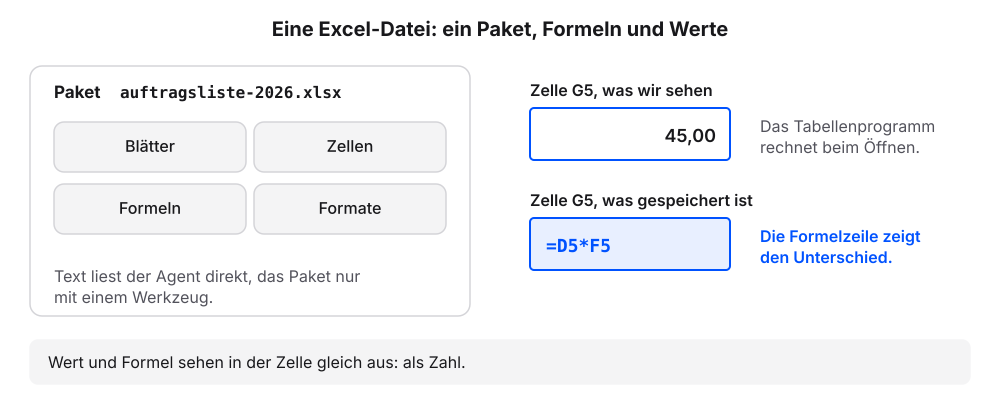
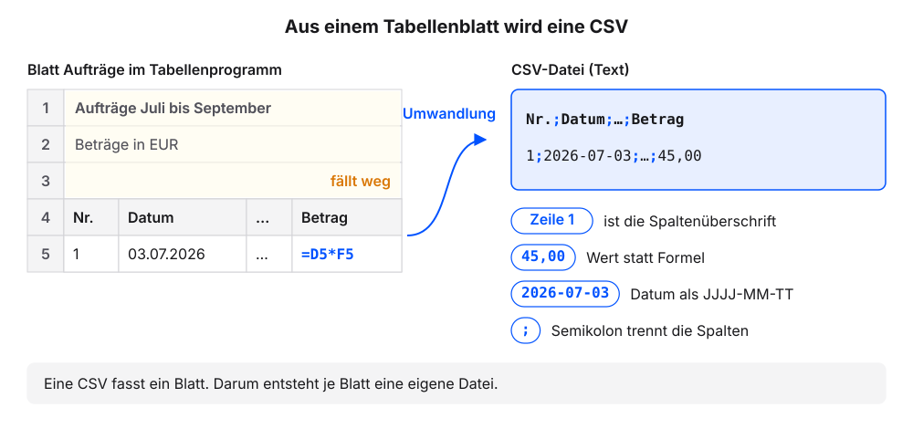
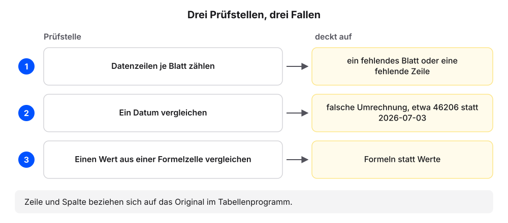
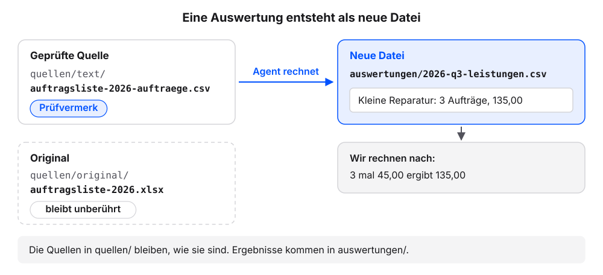

# Excel-Tabellen als Quelle

Neben PDFs liegen die Zahlen eines Betriebs meist in Excel-Dateien: Auftragslisten, Stundenzettel, Lagerbestände, Exporte aus der Buchhaltung. Eine Excel-Datei sieht wie eine Tabelle aus, ist aber keine Textdatei. Wir nehmen mit dem eigenen Agenten eine Excel-Datei nach dem Muster des Kapitels [PDFs als Quellen](pdf-als-quelle.qmd) als Quelle auf und lassen eine erste Auswertung erstellen. Zwei Dinge kommen hinzu, die es bei PDFs nicht gibt: mehrere Tabellenblätter in einer Datei und Zellen, in denen eine Formel steht statt einer Zahl. Die Erklärung folgt jeweils am eigenen Ergebnis.

Jeder Schritt hat denselben Aufbau: ein Auftrag zum Kopieren, ein Kasten „Das sollten wir jetzt sehen“, eine kurze Erklärung und ein Abschnitt „Wenn es anders aussieht“.

**Voraussetzungen:**

- Der Ordner `kundenanfragen` ist in der App des Agenten gewählt. `quellen/original/`, `quellen/text/` und `quellen/QUELLEN.md` sind vorhanden (Stand nach dem Kapitel [PDFs als Quellen](pdf-als-quelle.qmd)).
- Die [Beispiel-Auftragsliste als Excel-Datei](downloads/auftragsliste-2026.xlsx) ist heruntergeladen (zwei Tabellenblätter, eine Formelspalte, Titelzeile über der Tabelle). Alternativ eignet sich eine eigene Excel-Datei mit mindestens einer Formelspalte und ohne vertrauliche Daten; dann in den Aufträgen den Namen `auftragsliste-2026.xlsx` durch den Namen der eigenen Datei ersetzen. Die Datei liegt im Ordner `Downloads`.
- Ablegen und Ansehen der Datei laufen außerhalb der App: im Finder (Mac) oder Explorer (Windows) und im Tabellenprogramm. Tabellenprogramm heißt hier Excel, Numbers oder LibreOffice Calc.

## Schritt 1: Das Original ablegen

1. Diese Frage senden:

   ```text
   Kannst du Excel-Dateien (.xlsx) in diesem Ordner lesen? Welches Werkzeug nutzt du oder brauchst du dafür? Nur antworten, nichts ändern.
   ```

2. Prüfen: Der Agent sagt ja oder nennt ein Werkzeug.
3. Braucht der Agent ein Werkzeug: das Werkzeug nach der Anleitung des Herstellers einrichten.
4. Im Finder oder Explorer den Ordner `kundenanfragen/quellen/original` öffnen.
5. `auftragsliste-2026.xlsx` aus dem Ordner `Downloads` dorthin ziehen.
6. Die Datei mit einem Doppelklick öffnen. Sie erscheint im Tabellenprogramm.
7. Am unteren Rand auf das Blatt „Aufträge“ klicken.
8. Auf die Zelle G5 (Spalte Betrag) klicken.
9. Prüfen: Die Formelzeile über der Tabelle zeigt `=D5*F5`. Die Zelle selbst zeigt die Zahl 45,00.
10. Prüfen: Am unteren Rand stehen zwei Blätter: Aufträge und Monatssummen.
11. Die Datei schließen, ohne zu speichern.
12. Zur App wechseln.
13. Diese Frage senden:

   ```text
   Liste die Dateien in quellen/original/ auf.
   ```

14. Prüfen: Die Liste nennt `preisliste-2026.pdf` und `auftragsliste-2026.xlsx`.

### Das sollten wir jetzt sehen

Das Blatt Aufträge der Beispieldatei im Tabellenprogramm:

```{=html}
<div style="max-width:720px;border:1px solid #dcd9d2;border-radius:12px;overflow:hidden;background:#fbfaf7;color:#1f2430;margin:0 0 1rem">
<div style="padding:6px 12px;background:#f4f2ed;border-bottom:1px solid #dcd9d2;font-size:12px;color:#5b6170;font-family:ui-monospace,SFMono-Regular,Menlo,monospace">auftragsliste-2026.xlsx · Tabellenprogramm</div>
<div style="padding:10px 14px;overflow-x:auto">
<div style="font-family:ui-monospace,SFMono-Regular,Menlo,monospace;font-size:.82rem;margin:0 0 8px">G5 &nbsp; <b>=D5*F5</b></div>
<table style="border-collapse:collapse;font-size:.82rem">
<thead><tr style="background:#f4f2ed"><th style="border:1px solid #dcd9d2;padding:3px 6px"></th><th style="border:1px solid #dcd9d2;padding:3px 6px">A</th><th style="border:1px solid #dcd9d2;padding:3px 6px">B</th><th style="border:1px solid #dcd9d2;padding:3px 6px">C</th><th style="border:1px solid #dcd9d2;padding:3px 6px">D</th><th style="border:1px solid #dcd9d2;padding:3px 6px">E</th><th style="border:1px solid #dcd9d2;padding:3px 6px">F</th><th style="border:1px solid #dcd9d2;padding:3px 6px">G</th></tr></thead>
<tbody>
<tr><td style="border:1px solid #dcd9d2;padding:3px 6px;color:#5b6170">1</td><td colspan="7" style="border:1px solid #dcd9d2;padding:3px 6px;font-weight:700">Aufträge Juli bis September 2026</td></tr>
<tr><td style="border:1px solid #dcd9d2;padding:3px 6px;color:#5b6170">2</td><td colspan="7" style="border:1px solid #dcd9d2;padding:3px 6px">Beträge in EUR inklusive Umsatzsteuer. Preise laut Preisliste 2026.</td></tr>
<tr><td style="border:1px solid #dcd9d2;padding:3px 6px;color:#5b6170">3</td><td colspan="7" style="border:1px solid #dcd9d2;padding:3px 6px">&nbsp;</td></tr>
<tr style="font-weight:600"><td style="border:1px solid #dcd9d2;padding:3px 6px;color:#5b6170;font-weight:400">4</td><td style="border:1px solid #dcd9d2;padding:3px 6px">Nr.</td><td style="border:1px solid #dcd9d2;padding:3px 6px">Datum</td><td style="border:1px solid #dcd9d2;padding:3px 6px">Leistung</td><td style="border:1px solid #dcd9d2;padding:3px 6px">Menge</td><td style="border:1px solid #dcd9d2;padding:3px 6px">Einheit</td><td style="border:1px solid #dcd9d2;padding:3px 6px">Einzelpreis</td><td style="border:1px solid #dcd9d2;padding:3px 6px">Betrag</td></tr>
<tr><td style="border:1px solid #dcd9d2;padding:3px 6px;color:#5b6170">5</td><td style="border:1px solid #dcd9d2;padding:3px 6px">1</td><td style="border:1px solid #dcd9d2;padding:3px 6px">03.07.2026</td><td style="border:1px solid #dcd9d2;padding:3px 6px">Kleine Reparatur</td><td style="border:1px solid #dcd9d2;padding:3px 6px">1</td><td style="border:1px solid #dcd9d2;padding:3px 6px">pauschal</td><td style="border:1px solid #dcd9d2;padding:3px 6px">45,00</td><td style="border:2px solid #23417a;padding:3px 6px">45,00</td></tr>
<tr><td style="border:1px solid #dcd9d2;padding:3px 6px;color:#5b6170">6</td><td style="border:1px solid #dcd9d2;padding:3px 6px">2</td><td style="border:1px solid #dcd9d2;padding:3px 6px">08.07.2026</td><td style="border:1px solid #dcd9d2;padding:3px 6px">Reparatur nach Aufwand</td><td style="border:1px solid #dcd9d2;padding:3px 6px">2,5</td><td style="border:1px solid #dcd9d2;padding:3px 6px">Stunde</td><td style="border:1px solid #dcd9d2;padding:3px 6px">68,00</td><td style="border:1px solid #dcd9d2;padding:3px 6px">170,00</td></tr>
<tr><td style="border:1px solid #dcd9d2;padding:3px 6px;color:#5b6170">7</td><td style="border:1px solid #dcd9d2;padding:3px 6px">3</td><td style="border:1px solid #dcd9d2;padding:3px 6px">15.07.2026</td><td style="border:1px solid #dcd9d2;padding:3px 6px">Anfahrt</td><td style="border:1px solid #dcd9d2;padding:3px 6px">18</td><td style="border:1px solid #dcd9d2;padding:3px 6px">km</td><td style="border:1px solid #dcd9d2;padding:3px 6px">1,20</td><td style="border:1px solid #dcd9d2;padding:3px 6px">21,60</td></tr>
<tr><td style="border:1px solid #dcd9d2;padding:3px 6px;color:#5b6170">…</td><td colspan="7" style="border:1px solid #dcd9d2;padding:3px 6px;color:#5b6170">acht weitere Aufträge</td></tr>
<tr><td style="border:1px solid #dcd9d2;padding:3px 6px;color:#5b6170">16</td><td style="border:1px solid #dcd9d2;padding:3px 6px">12</td><td style="border:1px solid #dcd9d2;padding:3px 6px">23.09.2026</td><td style="border:1px solid #dcd9d2;padding:3px 6px">Anfahrt</td><td style="border:1px solid #dcd9d2;padding:3px 6px">12</td><td style="border:1px solid #dcd9d2;padding:3px 6px">km</td><td style="border:1px solid #dcd9d2;padding:3px 6px">1,20</td><td style="border:1px solid #dcd9d2;padding:3px 6px">14,40</td></tr>
</tbody></table>
<div style="margin:8px 0 0;font-size:.82rem"><b>Aufträge</b> &nbsp;|&nbsp; Monatssummen</div>
</div>
</div>
```

Die Tabelle beginnt erst in Zeile 4. Darüber liegen ein Titel in einer verbundenen Zelle (eine Zelle, die über mehrere Spalten reicht), ein Untertitel und eine Leerzeile. Die Spalte Betrag (G) rechnet Menge mal Einzelpreis.

### Was gerade passiert ist

Die Datei sieht im Tabellenprogramm wie eine Tabelle aus. Für den Agenten ist sie kein Text.

Eine **Excel-Datei (.xlsx)** ist ein gepacktes Dateiformat. Blätter, Zellen, Formeln und Formate liegen in mehreren Dateien, die zu einem Paket verpackt sind. Text liest ein Agent direkt, dieses Paket nur mit einem Werkzeug, das es auspackt. Deshalb die Frage aus Schritt 1. Der Agent kann die Datei nicht als Text zeigen, das Tabellenprogramm zeigt sie als Tabelle.

Eine Zelle enthält entweder einen eingetragenen **Wert** (45,00) oder eine **Formel** (=D5*F5), die das Programm beim Öffnen ausrechnet. Wir sehen in beiden Fällen eine Zahl. Erst die Formelzeile zeigt, was wirklich in der Zelle steht.

{fig-alt="Links ein Paket mit der Aufschrift auftragsliste-2026.xlsx, darin vier kleine Kästen: Blätter, Zellen, Formeln, Formate; darunter der Satz: Text liest der Agent direkt, das Paket nur mit einem Werkzeug. Rechts die Zelle G5 zweimal: oben, was wir sehen (45,00), unten, was gespeichert ist (die Formel =D5*F5); daneben der Hinweis: Die Formelzeile zeigt den Unterschied."}

::: {.callout-note title="Wenn es anders aussieht"}
- Die Formelzeile zeigt eine Zahl statt einer Formel: Die gewählte Zelle liegt außerhalb der Spalte Betrag, oder die eigene Datei enthält dort Werte. Eine Zelle der Spalte Betrag wählen.
- Numbers zeigt keine Formelzeile: auf die Zelle G5 doppelklicken. Dann erscheint die Formel.
- Das Tabellenprogramm fragt beim Schließen, ob es speichern soll: „Nicht speichern“ wählen. So bleibt das Original unverändert.
- Der Agent sagt, er braucht ein Werkzeug, und nennt keins: „Welches Werkzeug empfiehlst du für .xlsx-Dateien?“
- Das Tabellenprogramm zeigt das Datum anders, etwa 7/3/26: Die Anzeige hängt von den Einstellungen des Programms ab. Der Wert in der Datei ist derselbe.
- Die Liste nennt die Excel-Datei nicht: im Finder oder Explorer prüfen, ob die Datei im Ordner `original` liegt. Die Frage danach erneut senden.
:::

## Schritt 2: Je Blatt eine CSV

**Voraussetzung:** `auftragsliste-2026.xlsx` liegt in `quellen/original/`.

1. Diesen Auftrag senden:

   ```text
   Lies quellen/original/auftragsliste-2026.xlsx. Lege für jedes Tabellenblatt eine CSV-Datei unter quellen/text/ an, Name auftragsliste-2026-<blattname>.csv, Blattname klein und ohne Umlaute. Die erste Zeile jeder CSV ist die Spaltenüberschrift; Titelzeilen und Leerzeilen darüber lässt du weg. Übernimm Werte, keine Formeln. Datum als JJJJ-MM-TT, Trennzeichen Semikolon. Nenne mir danach je Blatt die Zahl der Datenzeilen und drei Werte mit Blatt, Zeile und Spalte: ein Datum, einen Wert aus einer Formelzelle und einen weiteren.
   ```

2. Das Anlegen freigeben, wenn der Agent fragt.
3. Prüfen: Die Antwort nennt je Blatt die Zahl der Datenzeilen und drei Werte mit Blatt, Zeile und Spalte.
4. Diese Frage senden:

   ```text
   Liste die Dateien in quellen/text/ auf. Zeig mir dann den Inhalt von quellen/text/auftragsliste-2026-auftraege.csv genau so, wie er in der Datei steht, mit allen Zeichen.
   ```

5. Prüfen: Die Liste nennt zwei CSV-Dateien.
6. Prüfen: Zeile 1 der Datei beginnt mit `Nr.;Datum;Leistung`. In der letzten Spalte stehen Zahlen, kein `=`.

### Das sollten wir jetzt sehen

```{=html}
<div style="max-width:620px;border:1px solid #dcd9d2;border-radius:12px;overflow:hidden;background:#fbfaf7;color:#1f2430;margin:0 0 1rem;line-height:1.45"><div style="display:flex;align-items:center;gap:8px;padding:7px 12px;background:#f4f2ed;border-bottom:1px solid #dcd9d2;font-size:12px;color:#5b6170">Ordner: <b style="color:#1f2430;font-weight:600;font-family:ui-monospace,SFMono-Regular,Menlo,monospace">kundenanfragen</b><span style="margin-left:auto">Chat</span></div><div style="padding:12px;display:grid;gap:8px"><div style="justify-self:end;max-width:94%;border-radius:10px;padding:8px 11px;background:#dfe6f3"><span style="display:block;font-size:11.5px;color:#5b6170;margin-bottom:2px">Wir</span>Lies quellen/original/auftragsliste-2026.xlsx. Lege für jedes Tabellenblatt eine CSV-Datei unter quellen/text/ an, Name auftragsliste-2026-<blattname>.csv, Blattname klein und ohne Umlaute. Die erste Zeile jeder CSV ist die Spaltenüberschrift; Titelzeilen und Leerzeilen darüber lässt du weg. Übernimm Werte, keine Formeln. Datum als JJJJ-MM-TT, Trennzeichen Semikolon. Nenne mir danach je Blatt die Zahl der Datenzeilen und drei Werte mit Blatt, Zeile und Spalte: ein Datum, einen Wert aus einer Formelzelle und einen weiteren.</div>
<div style="justify-self:start;font-family:ui-monospace,SFMono-Regular,Menlo,monospace;font-size:12px;color:#5b6170;padding:0 4px"><span style="color:#b8862b;font-weight:700">› </span>liest quellen/original/auftragsliste-2026.xlsx</div>
<div style="justify-self:stretch;border:1px solid #d9b26a;border-radius:10px;padding:8px 11px;background:#fbf3e3"><span style="display:block;font-size:11.5px;color:#5b6170;margin-bottom:2px">Agent</span>Die Datei hat zwei Blätter. Ich lege in <code>quellen/text/</code> zwei Dateien an: <code>auftragsliste-2026-auftraege.csv</code> (12 Datenzeilen) und <code>auftragsliste-2026-monatssummen.csv</code> (4 Datenzeilen), mit Werten statt Formeln. Darf ich?<br><span style="display:inline-block;margin:6px 6px 0 0;padding:2px 10px;border:1px solid #23417a;color:#23417a;border-radius:999px;font-size:12.5px;font-weight:600">Erlauben</span><span style="display:inline-block;margin:6px 6px 0 0;padding:2px 10px;border:1px solid #dcd9d2;border-radius:999px;font-size:12.5px">Ablehnen</span></div>
<div style="justify-self:start;font-family:ui-monospace,SFMono-Regular,Menlo,monospace;font-size:12px;color:#5b6170;padding:0 4px"><span style="color:#b8862b;font-weight:700">› </span>quellen/text/auftragsliste-2026-auftraege.csv angelegt</div>
<div style="justify-self:start;font-family:ui-monospace,SFMono-Regular,Menlo,monospace;font-size:12px;color:#5b6170;padding:0 4px"><span style="color:#b8862b;font-weight:700">› </span>quellen/text/auftragsliste-2026-monatssummen.csv angelegt</div>
<div style="justify-self:start;max-width:94%;border-radius:10px;padding:8px 11px;background:#f4f2ed;border:1px solid #dcd9d2"><span style="display:block;font-size:11.5px;color:#5b6170;margin-bottom:2px">Agent</span><p style="margin:0 0 4px">Fertig. Zwei Dateien angelegt, keine geändert. Aufträge: 12 Datenzeilen. Monatssummen: 4 Datenzeilen (Juli, August, September, Gesamt). Drei Werte zum Vergleich:</p><ul style="margin:0;padding-left:20px"><li>Blatt Aufträge, Zeile 5, Spalte Datum: 2026-07-03</li><li>Blatt Aufträge, Zeile 11, Spalte Betrag: 35,00</li><li>Blatt Monatssummen, Zeile 5, Spalte Summe: 210,80</li></ul></div>
<div style="justify-self:end;max-width:94%;border-radius:10px;padding:8px 11px;background:#dfe6f3"><span style="display:block;font-size:11.5px;color:#5b6170;margin-bottom:2px">Wir</span>Liste die Dateien in quellen/text/ auf. Zeig mir dann den Inhalt von quellen/text/auftragsliste-2026-auftraege.csv genau so, wie er in der Datei steht, mit allen Zeichen.</div>
<div style="justify-self:start;max-width:94%;border-radius:10px;padding:8px 11px;background:#f4f2ed;border:1px solid #dcd9d2"><span style="display:block;font-size:11.5px;color:#5b6170;margin-bottom:2px">Agent</span><p style="margin:0 0 4px">In <code>quellen/text/</code> liegen drei Dateien: <code>preisliste-2026.md</code>, <code>auftragsliste-2026-auftraege.csv</code>, <code>auftragsliste-2026-monatssummen.csv</code>. Inhalt der ersten CSV:</p><pre style="margin:6px 0 0;padding:8px 10px;border:1px solid #dcd9d2;border-radius:8px;background:#fbfaf7;font-family:ui-monospace,SFMono-Regular,Menlo,monospace;font-size:.85rem;line-height:1.6;white-space:pre-wrap;word-break:break-word">Nr.;Datum;Leistung;Menge;Einheit;Einzelpreis;Betrag
1;2026-07-03;Kleine Reparatur;1;pauschal;45,00;45,00
2;2026-07-08;Reparatur nach Aufwand;2,5;Stunde;68,00;170,00
3;2026-07-15;Anfahrt;18;km;1,20;21,60
4;2026-07-15;Beratung vor Ort;1;Termin;89,00;89,00
5;2026-08-04;Kleine Reparatur;1;pauschal;45,00;45,00
6;2026-08-11;Reparatur nach Aufwand;1,5;Stunde;68,00;102,00
7;2026-08-11;Eilzuschlag;1;pauschal;35,00;35,00
8;2026-08-25;Anfahrt;24;km;1,20;28,80
9;2026-09-02;Beratung vor Ort;1;Termin;89,00;89,00
10;2026-09-09;Reparatur nach Aufwand;3;Stunde;68,00;204,00
11;2026-09-16;Kleine Reparatur;1;pauschal;45,00;45,00
12;2026-09-23;Anfahrt;12;km;1,20;14,40</pre></div></div></div>
```

So sieht es mit der Beispieldatei aus. Der Agent schreibt Zahlen vielleicht ohne Nachkommastellen (45 statt 45,00) und nennt andere Werte. Das ist in Ordnung. Zeile und Spalte in der Antwort beziehen sich auf das Original im Tabellenprogramm.

Die zweite Datei, `auftragsliste-2026-monatssummen.csv`, zeigt der Agent auf dieselbe Frage hin mit allen Zeichen so:

```text
Monat;Aufträge;Summe
Juli 2026;4;325,60
August 2026;4;210,80
September 2026;4;352,40
Gesamt;12;888,80
```

### Was gerade passiert ist

Der Agent hat die Excel-Datei ausgepackt und jedes Blatt als Text neu geschrieben. Titel und Leerzeilen über der Tabelle sind weggefallen.

Die Textfassung einer Tabelle ist eine **CSV** (Comma-separated values): eine Tabelle als reiner Text, eine Zeile je Tabellenzeile, die Spalten durch ein Trennzeichen getrennt. Eine CSV fasst immer nur ein Blatt. Je Blatt entsteht deshalb eine eigene Datei, und der Dateiname trägt den Blattnamen: `auftragsliste-2026-auftraege.csv` und `auftragsliste-2026-monatssummen.csv`. Beide liegen in `quellen/text/` neben der Textfassung der Preisliste.

{fig-alt="Links das Blatt Aufträge als kleine Tabelle mit Zeilennummern: Zeile 1 Titel, Zeile 2 Untertitel, Zeile 3 leer, Zeile 4 Spaltenüberschrift, ab Zeile 5 die Aufträge, in Spalte G die Formel =D5*F5. Ein Pfeil mit der Beschriftung Umwandlung führt rechts zur CSV: Zeile 1 ist die Spaltenüberschrift, die drei Zeilen darüber fallen weg, aus der Formel wird der Wert 45,00, das Datum steht als 2026-07-03, die Spalten trennt ein Semikolon."}

In einer CSV rechnet niemand. Übernimmt das Werkzeug die Formel statt des Ergebnisses, sieht die Textfassung vollständig aus, hat aber in dieser Spalte keinen einzigen Betrag. Eine spätere Frage nach „der Summe im August“ bleibt dann ohne Antwort oder bekommt eine erfundene. Deshalb sagt der Auftrag ausdrücklich „Übernimm Werte, keine Formeln“, dazu „Datum als JJJJ-MM-TT“ und „Trennzeichen Semikolon“, weil das Dezimalkomma (1,20) sonst mit dem Komma als Trennzeichen kollidiert. Ohne diese Sätze entscheidet das Werkzeug des Agenten, was in der CSV landet.

Der Rest läuft wie bei der PDF: Original unverändert in `original/`, Textfassung in `text/`, danach Stichprobe und Eintrag mit Prüfvermerk.

::: {.callout-note title="Wenn es anders aussieht"}
Diese Abweichungen sind die typischen Fallen bei Excel-Dateien. Die Beispiel-Auftragsliste enthält die ersten drei absichtlich.

- In der Spalte Betrag steht `=D5*F5`: Der Agent hat Formeln statt Werte übernommen. „Ersetze in der Spalte Betrag die Formeln durch die Werte.“
- Zeile 1 lautet „Aufträge Juli bis September 2026“: Die Titelzeile aus der verbundenen Zelle wurde übernommen. Die echte Spaltenüberschrift rutscht nach unten, und jedes Werkzeug, das die erste Zeile als Überschrift liest, ordnet die Spalten falsch zu. „Entferne die Titel- und Leerzeilen über der Spaltenüberschrift.“
- Es gibt nur eine CSV: Manche Werkzeuge lesen nur das erste Blatt. „Lege auch für das Blatt Monatssummen eine CSV an.“
- In der Spalte Datum steht eine Zahl wie 46206: So speichert das Tabellenprogramm ein Datum intern (Tage seit dem Jahr 1900). Der Auftrag verlangt deshalb JJJJ-MM-TT. Den Agenten die Spalte als JJJJ-MM-TT neu schreiben lassen und die Stichprobe wiederholen. Das Original umzuformatieren verändert den Beleg.
- Eine Spalte, die im Tabellenprogramm nicht zu sehen ist: Ausgeblendete Zeilen und Spalten sind in der Datei vorhanden und landen in der CSV, auch eine Spalte mit internen Bemerkungen. In Schritt 3 auch die Zahl der Spalten vergleichen.
:::

## Schritt 3: Die Stichprobe gegen das Original

**Voraussetzung:** Die Antwort aus Schritt 2 mit Zeilenzahlen und drei Werten steht im Chat.

1. Im Finder oder Explorer den Ordner `kundenanfragen/quellen/original` öffnen.
2. `auftragsliste-2026.xlsx` mit einem Doppelklick im Tabellenprogramm öffnen.
3. Je Blatt die Datenzeilen unter der Spaltenüberschrift zählen.
4. Prüfen: Die Zeilenzahl stimmt (Beispieldatei: 12 und 4).
5. Die drei Werte an Blatt, Zeile und Spalte aus der Antwort suchen.
6. Prüfen: Alle drei Werte stimmen überein. Das Datum steht in der CSV als JJJJ-MM-TT.
7. Die Datei schließen, ohne zu speichern.
8. Weicht etwas ab: dem Agenten Blatt, Zeile und Spalte nennen und korrigieren lassen.

### Das sollten wir jetzt sehen

```{=html}
<div style="max-width:640px;border:1px solid #dcd9d2;border-radius:12px;overflow:hidden;background:#fbfaf7;color:#1f2430;margin:0 0 1rem">
<div style="padding:6px 12px;background:#f4f2ed;border-bottom:1px solid #dcd9d2;font-size:12px;color:#5b6170;font-family:ui-monospace,SFMono-Regular,Menlo,monospace">Stichprobe: Original und CSV</div>
<div style="padding:10px 14px;overflow-x:auto">
<table style="border-collapse:collapse;font-size:.88rem;width:100%">
<thead><tr style="border-bottom:2px solid #dcd9d2;text-align:left"><th style="padding:5px 8px">Prüfstelle</th><th style="padding:5px 8px">Original (Tabellenprogramm)</th><th style="padding:5px 8px">CSV</th></tr></thead>
<tbody>
<tr style="border-bottom:1px solid #dcd9d2"><td style="padding:5px 8px">Datenzeilen Blatt Aufträge</td><td style="padding:5px 8px;background:#e7edf7">12 (Zeile 5 bis 16)</td><td style="padding:5px 8px;background:#e7edf7">12</td></tr>
<tr style="border-bottom:1px solid #dcd9d2"><td style="padding:5px 8px">Datenzeilen Blatt Monatssummen</td><td style="padding:5px 8px;background:#e7edf7">4 (Zeile 4 bis 7)</td><td style="padding:5px 8px;background:#e7edf7">4</td></tr>
<tr style="border-bottom:1px solid #dcd9d2"><td style="padding:5px 8px">Aufträge, Zeile 5, Datum</td><td style="padding:5px 8px;background:#e7edf7">03.07.2026</td><td style="padding:5px 8px;background:#e7edf7">2026-07-03</td></tr>
<tr style="border-bottom:1px solid #dcd9d2"><td style="padding:5px 8px">Aufträge, Zeile 11, Betrag (Formelzelle)</td><td style="padding:5px 8px;background:#e7edf7">35,00</td><td style="padding:5px 8px;background:#e7edf7">35,00</td></tr>
<tr><td style="padding:5px 8px">Monatssummen, Zeile 5, Summe</td><td style="padding:5px 8px;background:#e7edf7">210,80</td><td style="padding:5px 8px;background:#e7edf7">210,80</td></tr>
</tbody></table>
</div>
</div>
```

Diese Werte müssen übereinstimmen. Zeile und Spalte beziehen sich auf das Original. Nennt der Agent andere Zellen, prüfen wir diese im Tabellenprogramm.

### Was gerade passiert ist

Wir haben dieselbe Stichprobe gemacht wie bei der PDF, angepasst an Tabellen. Die **Stichprobe bei Tabellen** umfasst je Blatt die Zahl der Datenzeilen und drei Werte mit Blatt, Zeile und Spalte: ein Datum, einen Wert aus einer Formelzelle und einen weiteren. Zeile und Spalte beziehen sich auf das Original, damit wir die Zelle im Tabellenprogramm direkt finden.

Jede Prüfstelle deckt eine Falle ab. Die Zeilenzahl je Blatt zeigt, ob ein Blatt oder eine Zeile fehlt. Das Datum zeigt, ob die Umrechnung geklappt hat. Die Formelzelle zeigt, ob Werte statt Formeln übernommen wurden. Wie bei einem neuen Mitarbeiter gilt das Vier-Augen-Prinzip aus dem Kapitel [PDFs als Quellen](pdf-als-quelle.qmd): Der Agent bringt die Tabelle in eine lesbare Form, wir lesen gegen.

{fig-alt="Drei nummerierte Zeilen, je eine Prüfstelle mit Pfeil zur Falle, die sie aufdeckt: Datenzeilen je Blatt zählen deckt ein fehlendes Blatt oder eine fehlende Zeile auf; ein Datum vergleichen deckt eine falsche Umrechnung auf, etwa 46206 statt 2026-07-03; einen Wert aus einer Formelzelle vergleichen deckt Formeln statt Werte auf. Merksatz: Zeile und Spalte beziehen sich auf das Original."}

::: {.callout-note title="Wenn es anders aussieht"}
- Die Zeilenzahl ist um eins zu hoch: Der Agent hat die Kopfzeile mitgezählt. Im Original nur die Zeilen unter der Spaltenüberschrift zählen.
- Die Zeilennummer passt nicht zum Original: Der Agent hat die Zeilen der CSV gezählt. „Welche Zeile ist das im Original?“
- Die Zahl der Spalten weicht ab: im Tabellenprogramm prüfen, ob Spalten ausgeblendet sind.
:::

## Schritt 4: Eintragen und auswerten

::: {.callout-warning title="Regeln sind keine Garantie"}
Regel 4 der `AGENTS.md` senkt das Risiko, dass der Agent das Original überschreibt. Sie schließt es nicht aus. Nach jedem Auftrag, der Dateien in `quellen/` berührt, im Chat fragen: „Nenne mir das Änderungsdatum von quellen/original/auftragsliste-2026.xlsx mit Uhrzeit.“ Ändert sich die Angabe von Auftrag zu Auftrag, hat der Agent die Datei gespeichert. Eine Summe, die wir nicht nachgerechnet haben, gilt als ungeprüft.
:::

{fig-alt="Zwei Ebenen untereinander. Obere Ebene, Regel: Regel 4 der AGENTS.md, Ergebnisse als neue Datei, bestehende Dateien nur nach Rückfrage; Beschriftung: senkt das Risiko, meist. Untere Ebene, Prüfung nach jedem Auftrag in quellen/: das Änderungsdatum des Originals im Chat erfragen und eine Summe selbst nachrechnen. Merksatz: Regel plus Prüfung, keine Garantie."}

**Voraussetzung:** Die Stichprobe aus Schritt 3 ist bestanden.

1. Diesen Auftrag senden:

   ```text
   Trage beide CSV-Dateien in quellen/QUELLEN.md ein, Herkunft: Auftragsliste des Betriebs mit Blattname, Original in original/. Prüfung: heutiges Datum, „drei Werte geprüft“. Ergänze die neuen Dateien in UEBERSICHT.md.
   ```

2. Freigeben, wenn der Agent fragt.
3. Diese Frage senden:

   ```text
   Zeig mir den Inhalt von quellen/QUELLEN.md mit allen Zeichen.
   ```

4. Prüfen: Die Tabelle hat je CSV eine Zeile mit heutigem Datum und „drei Werte geprüft“.
5. Diesen Auftrag senden:

   ```text
   Lege den Ordner auswertungen an. Erstelle aus quellen/text/auftragsliste-2026-auftraege.csv die Datei auswertungen/2026-q3-leistungen.csv mit den Spalten Leistung, Aufträge, Summe: je Leistung die Zahl der Aufträge und die Summe der Beträge. Ändere keine Datei in quellen/. Nenne mir die Summe für Kleine Reparatur.
   ```

6. Das Anlegen freigeben, wenn der Agent fragt.
7. Diese Frage senden:

   ```text
   Zeig mir den Inhalt von auswertungen/2026-q3-leistungen.csv mit allen Zeichen.
   ```

8. Die genannte Summe selbst nachrechnen: Zahl der Aufträge mal Einzelpreis (Beispieldatei: 3 mal 45,00).
9. Prüfen: Die Summe in der Datei stimmt mit der eigenen Rechnung überein (Beispieldatei: 135,00).
10. Diese Frage senden:

   ```text
   Nenne mir das Änderungsdatum von quellen/original/auftragsliste-2026.xlsx mit Uhrzeit.
   ```

11. Prüfen: Das Änderungsdatum liegt vor unseren Aufträgen aus diesem Kapitel.

### Das sollten wir jetzt sehen

```{=html}
<div style="max-width:620px;border:1px solid #dcd9d2;border-radius:12px;overflow:hidden;background:#fbfaf7;color:#1f2430;margin:0 0 1rem;line-height:1.45"><div style="display:flex;align-items:center;gap:8px;padding:7px 12px;background:#f4f2ed;border-bottom:1px solid #dcd9d2;font-size:12px;color:#5b6170">Ordner: <b style="color:#1f2430;font-weight:600;font-family:ui-monospace,SFMono-Regular,Menlo,monospace">kundenanfragen</b><span style="margin-left:auto">Chat</span></div><div style="padding:12px;display:grid;gap:8px"><div style="justify-self:end;max-width:94%;border-radius:10px;padding:8px 11px;background:#dfe6f3"><span style="display:block;font-size:11.5px;color:#5b6170;margin-bottom:2px">Wir</span>Trage beide CSV-Dateien in quellen/QUELLEN.md ein, Herkunft: Auftragsliste des Betriebs mit Blattname, Original in original/. Prüfung: heutiges Datum, „drei Werte geprüft“. Ergänze die neuen Dateien in UEBERSICHT.md.</div>
<div style="justify-self:stretch;border:1px solid #d9b26a;border-radius:10px;padding:8px 11px;background:#fbf3e3"><span style="display:block;font-size:11.5px;color:#5b6170;margin-bottom:2px">Agent</span>Ich ergänze zwei Zeilen in <code>quellen/QUELLEN.md</code> und zwei in <code>UEBERSICHT.md</code>:<pre style="margin:6px 0 0;padding:8px 10px;border:1px solid #dcd9d2;border-radius:8px;background:#fbfaf7;font-family:ui-monospace,SFMono-Regular,Menlo,monospace;font-size:.85rem;line-height:1.6;white-space:pre-wrap;word-break:break-word"><span style="display:block;background:#d9e4f5">+ | text/auftragsliste-2026-auftraege.csv | Auftragsliste des Betriebs, Blatt Aufträge, Original in original/ | Juli bis September 2026 | 2026-10-17 drei Werte geprüft |</span><span style="display:block;background:#d9e4f5">+ | text/auftragsliste-2026-monatssummen.csv | Auftragsliste des Betriebs, Blatt Monatssummen, Original in original/ | Juli bis September 2026 | 2026-10-17 drei Werte geprüft |</span></pre>Darf ich?<br><span style="display:inline-block;margin:6px 6px 0 0;padding:2px 10px;border:1px solid #23417a;color:#23417a;border-radius:999px;font-size:12.5px;font-weight:600">Erlauben</span><span style="display:inline-block;margin:6px 6px 0 0;padding:2px 10px;border:1px solid #dcd9d2;border-radius:999px;font-size:12.5px">Ablehnen</span></div>
<div style="justify-self:start;font-family:ui-monospace,SFMono-Regular,Menlo,monospace;font-size:12px;color:#5b6170;padding:0 4px"><span style="color:#b8862b;font-weight:700">› </span>quellen/QUELLEN.md geändert</div>
<div style="justify-self:start;font-family:ui-monospace,SFMono-Regular,Menlo,monospace;font-size:12px;color:#5b6170;padding:0 4px"><span style="color:#b8862b;font-weight:700">› </span>UEBERSICHT.md geändert</div>
<div style="justify-self:start;max-width:94%;border-radius:10px;padding:8px 11px;background:#f4f2ed;border:1px solid #dcd9d2"><span style="display:block;font-size:11.5px;color:#5b6170;margin-bottom:2px">Agent</span>Fertig. Zwei Dateien geändert, keine angelegt.</div>
<div style="justify-self:end;max-width:94%;border-radius:10px;padding:8px 11px;background:#dfe6f3"><span style="display:block;font-size:11.5px;color:#5b6170;margin-bottom:2px">Wir</span>Lege den Ordner auswertungen an. Erstelle aus quellen/text/auftragsliste-2026-auftraege.csv die Datei auswertungen/2026-q3-leistungen.csv mit den Spalten Leistung, Aufträge, Summe: je Leistung die Zahl der Aufträge und die Summe der Beträge. Ändere keine Datei in quellen/. Nenne mir die Summe für Kleine Reparatur.</div>
<div style="justify-self:start;font-family:ui-monospace,SFMono-Regular,Menlo,monospace;font-size:12px;color:#5b6170;padding:0 4px"><span style="color:#b8862b;font-weight:700">› </span>liest quellen/text/auftragsliste-2026-auftraege.csv</div>
<div style="justify-self:stretch;border:1px solid #d9b26a;border-radius:10px;padding:8px 11px;background:#fbf3e3"><span style="display:block;font-size:11.5px;color:#5b6170;margin-bottom:2px">Agent</span>Ich lege den Ordner <code>auswertungen</code> an und darin <code>2026-q3-leistungen.csv</code> mit fünf Leistungen. In <code>quellen/</code> ändere ich nichts. Darf ich?<br><span style="display:inline-block;margin:6px 6px 0 0;padding:2px 10px;border:1px solid #23417a;color:#23417a;border-radius:999px;font-size:12.5px;font-weight:600">Erlauben</span><span style="display:inline-block;margin:6px 6px 0 0;padding:2px 10px;border:1px solid #dcd9d2;border-radius:999px;font-size:12.5px">Ablehnen</span></div>
<div style="justify-self:start;font-family:ui-monospace,SFMono-Regular,Menlo,monospace;font-size:12px;color:#5b6170;padding:0 4px"><span style="color:#b8862b;font-weight:700">› </span>auswertungen angelegt</div>
<div style="justify-self:start;font-family:ui-monospace,SFMono-Regular,Menlo,monospace;font-size:12px;color:#5b6170;padding:0 4px"><span style="color:#b8862b;font-weight:700">› </span>auswertungen/2026-q3-leistungen.csv angelegt</div>
<div style="justify-self:start;max-width:94%;border-radius:10px;padding:8px 11px;background:#f4f2ed;border:1px solid #dcd9d2"><span style="display:block;font-size:11.5px;color:#5b6170;margin-bottom:2px">Agent</span>Fertig. Eine Datei angelegt. Kleine Reparatur: 3 Aufträge, Summe 135,00.</div>
<div style="justify-self:end;max-width:94%;border-radius:10px;padding:8px 11px;background:#dfe6f3"><span style="display:block;font-size:11.5px;color:#5b6170;margin-bottom:2px">Wir</span>Zeig mir den Inhalt von auswertungen/2026-q3-leistungen.csv mit allen Zeichen.</div>
<div style="justify-self:start;max-width:94%;border-radius:10px;padding:8px 11px;background:#f4f2ed;border:1px solid #dcd9d2"><span style="display:block;font-size:11.5px;color:#5b6170;margin-bottom:2px">Agent</span>Inhalt von <code>auswertungen/2026-q3-leistungen.csv</code>:<pre style="margin:6px 0 0;padding:8px 10px;border:1px solid #dcd9d2;border-radius:8px;background:#fbfaf7;font-family:ui-monospace,SFMono-Regular,Menlo,monospace;font-size:.85rem;line-height:1.6;white-space:pre-wrap;word-break:break-word">Leistung;Aufträge;Summe
Kleine Reparatur;3;135,00
Reparatur nach Aufwand;3;476,00
Anfahrt;3;64,80
Beratung vor Ort;2;178,00
Eilzuschlag;1;35,00</pre></div>
<div style="justify-self:end;max-width:94%;border-radius:10px;padding:8px 11px;background:#dfe6f3"><span style="display:block;font-size:11.5px;color:#5b6170;margin-bottom:2px">Wir</span>Nenne mir das Änderungsdatum von quellen/original/auftragsliste-2026.xlsx mit Uhrzeit.</div>
<div style="justify-self:start;max-width:94%;border-radius:10px;padding:8px 11px;background:#f4f2ed;border:1px solid #dcd9d2"><span style="display:block;font-size:11.5px;color:#5b6170;margin-bottom:2px">Agent</span><code>quellen/original/auftragsliste-2026.xlsx</code>: zuletzt geändert am 17.10.2026 um 09:12 Uhr.</div></div></div>
```

Das Prüfdatum ist das heutige Datum, das Änderungsdatum der Zeitpunkt des Downloads. Die Reihenfolge der Leistungen kann abweichen. Zusammen ergeben die Summen 888,80, wie die Zeile Gesamt im Blatt Monatssummen.

### Was gerade passiert ist

Der Agent hat die Quellenliste ergänzt und aus der geprüften CSV eine neue Datei berechnet. Jede CSV hat eine eigene Zeile in der Quellenliste, denn jede kann für sich geprüft oder ungeprüft sein.

Eine **Auswertung** ist ein Ergebnis, das der Agent aus einer Quelle berechnet: Summen je Leistung, Aufträge je Monat, eine Liste offener Posten. Sie entsteht als neue Datei in `auswertungen/`, als CSV oder, wenn der Agent es kann, als Excel-Datei, nie als neues Blatt im Original. Regel 4 unserer `AGENTS.md` verlangt das ohnehin: Ergebnisse als neue Datei, bestehende Dateien nur nach Rückfrage.

{fig-alt="Von links nach rechts: die geprüfte CSV in quellen/text mit Prüfvermerk, ein Pfeil mit der Beschriftung „Agent rechnet“ zur neuen Datei auswertungen/2026-q3-leistungen.csv mit der Zeile Kleine Reparatur, 3 Aufträge, 135,00. Darunter die eigene Nachrechnung: 3 mal 45,00 ergibt 135,00. Links unten das Original in quellen/original mit der Beschriftung: bleibt unberührt."}

Fragt der Agent, ob er die Auswertung als neues Blatt in `quellen/original/auftragsliste-2026.xlsx` anlegen soll, „damit alles in einer Datei bleibt“, lautet die Antwort nein. Das Original ist der Beleg für die CSV-Fassungen und ihren Prüfvermerk. Sobald der Agent in der Datei schreibt, auch nur in einem neuen Blatt, ist nicht mehr sicher, dass der Rest unverändert ist. Die CSV ersetzt das Original nicht: Sie ist daraus abgeleitet, und jede spätere Prüfung braucht die Quelle. Auch eine datierte Kopie des Originals hilft nicht; sie füllt `original/` mit zwei fast gleichen Dateien, und beim nächsten Auftrag ist unklar, welche gilt.

Das Vier-Augen-Prinzip gilt auch für Ergebnisse. Ein Agent kann beim Zusammenrechnen eine Zeile vergessen oder doppelt zählen. Darum rechnen wir eine Zahl selbst nach: drei Aufträge „Kleine Reparatur“ zu 45,00 EUR, in der Auswertung 135,00.

::: {.callout-note title="Wenn es anders aussieht"}
- Die Summe weicht ab: „Welche Zeilen hast du für Kleine Reparatur gezählt?“ Die Liste mit dem Original vergleichen.
- Das Änderungsdatum des Originals ist neu: Der Agent hat die Datei gespeichert. Die heruntergeladene Datei im Finder oder Explorer erneut nach `quellen/original/` ziehen und die Stichprobe wiederholen.
- Die Auswertung liegt nicht in `auswertungen/`: den Agenten sie dorthin verschieben lassen.
- Der Agent kann das Änderungsdatum nicht nennen: den Ordner `quellen/original` im Finder oder Explorer öffnen. Dort steht das Datum neben dem Dateinamen.
:::

Damit kennt der Ordner zwei Arten von Quellen: Dokumente als Markdown und Tabellen als CSV, beide mit Original und Prüfvermerk. Wie neue Dateien beider Arten ohne Handarbeit an den richtigen Ort gelangen, zeigt das Kapitel [Laufend neue Dateien](laufend-neue-dateien.qmd).
