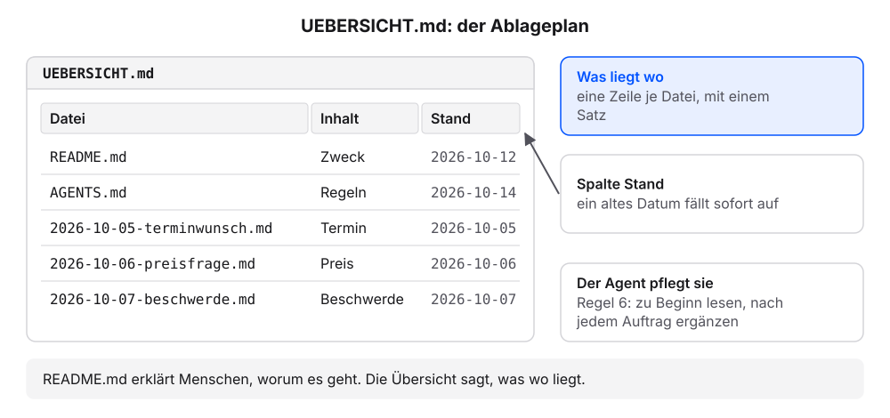
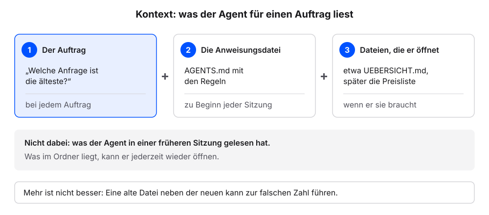

# Kontext bereitstellen

Ein Agent weiß für einen Auftrag nur das, was er dafür liest. Ob eine Antwort stimmt, entscheidet sich deshalb oft schon vor dem Auftrag: bei der Frage, welche Dateien im Projektordner liegen, wie sie heißen und ob der Agent die richtige davon findet. Wir legen mit dem eigenen Agenten einen Ablageplan für den Ordner an und prüfen in einer neuen Sitzung, ob er ihn von selbst liest. Die Erklärung folgt jeweils am eigenen Ergebnis.

Jeder Schritt hat denselben Aufbau: ein Auftrag zum Kopieren, ein Kasten „Das sollten wir jetzt sehen“, eine kurze Erklärung und ein Abschnitt „Wenn es anders aussieht“.

**Voraussetzung:** Der Ordner `kundenanfragen` ist in der App gewählt, mit dem Stand aus dem Kapitel [AGENTS.md: die Hausordnung](agents-md.qmd): `README.md`, `AGENTS.md` mit fünf Regeln und drei Anfragen in `anfragen`.

## Schritt 1: Die Übersicht anlegen

1. Diesen Auftrag senden:

   ```text
   Lege die Datei UEBERSICHT.md an: eine Tabelle mit den Spalten Datei, Inhalt, Stand. Trage README.md, AGENTS.md und alle Dateien in anfragen ein, je mit einem Satz. Ergänze dann in AGENTS.md die Regel 6: „Lies zu Beginn UEBERSICHT.md. Ergänze sie nach jedem Auftrag, wenn neue Dateien entstanden sind.“ Zeige mir beide Änderungen vor dem Speichern.
   ```

2. Prüfen: Der Agent zeigt beide Änderungen und fragt vor dem Speichern.
3. Beide Änderungen freigeben.
4. Diese Frage senden:

   ```text
   Gib den Inhalt von UEBERSICHT.md formatiert wieder, so wie ein Leser ihn sehen soll.
   ```

5. Prüfen: Die Antwort zeigt eine Tabelle mit den Spalten Datei, Inhalt, Stand und mindestens fünf Zeilen.
6. Diese Frage senden:

   ```text
   Zeig mir die Regeln aus AGENTS.md genau so, wie sie in der Datei stehen.
   ```

7. Prüfen: Die Antwort zeigt sechs Regeln. Regel 6 nennt `UEBERSICHT.md`.

### Das sollten wir jetzt sehen

Der Verlauf im Chat, sinngemäß:

```{=html}
<div style="max-width:620px;border:1px solid #dcd9d2;border-radius:12px;overflow:hidden;background:#fbfaf7;color:#1f2430;margin:0 0 1rem;line-height:1.45" role="group" aria-label="Chat: beide Änderungen zur Freigabe, Speichern und die Übersicht formatiert">

<div style="padding:12px;display:grid;gap:8px">
<div style="justify-self:end;max-width:94%;border-radius:10px;padding:8px 11px;background:#dfe6f3"><span style="display:block;font-size:11.5px;color:#5b6170;margin-bottom:2px">Wir</span>Lege die Datei UEBERSICHT.md an: eine Tabelle mit den Spalten Datei, Inhalt, Stand. Trage README.md, AGENTS.md und alle Dateien in anfragen ein, je mit einem Satz. Ergänze dann in AGENTS.md die Regel 6: „Lies zu Beginn UEBERSICHT.md. Ergänze sie nach jedem Auftrag, wenn neue Dateien entstanden sind.“ Zeige mir beide Änderungen vor dem Speichern.</div>
<div style="justify-self:stretch;border:1px solid #d9b26a;border-radius:10px;padding:8px 11px;background:#fbf3e3"><span style="display:block;font-size:11.5px;color:#5b6170;margin-bottom:2px">Agent</span>Zwei Änderungen. Neu: <code>UEBERSICHT.md</code>:<pre style="margin:6px 0 0;padding:8px 10px;border:1px solid #dcd9d2;border-radius:8px;background:#fbfaf7;font-family:ui-monospace,SFMono-Regular,Menlo,monospace;font-size:.85rem;line-height:1.6;white-space:pre-wrap;word-break:break-word"><i style="color:#23417a;font-style:normal;font-weight:700">#</i> Übersicht

<i style="color:#23417a;font-style:normal;font-weight:700">|</i> Datei <i style="color:#23417a;font-style:normal;font-weight:700">|</i> Inhalt <i style="color:#23417a;font-style:normal;font-weight:700">|</i> Stand <i style="color:#23417a;font-style:normal;font-weight:700">|</i>
<i style="color:#23417a;font-style:normal;font-weight:700">|---|---|---|</i>
<i style="color:#23417a;font-style:normal;font-weight:700">|</i> README.md <i style="color:#23417a;font-style:normal;font-weight:700">|</i> Zweck des Ordners, für Menschen <i style="color:#23417a;font-style:normal;font-weight:700">|</i> 2026-10-12 <i style="color:#23417a;font-style:normal;font-weight:700">|</i>
<i style="color:#23417a;font-style:normal;font-weight:700">|</i> AGENTS.md <i style="color:#23417a;font-style:normal;font-weight:700">|</i> Regeln für den Agenten <i style="color:#23417a;font-style:normal;font-weight:700">|</i> 2026-10-14 <i style="color:#23417a;font-style:normal;font-weight:700">|</i>
<i style="color:#23417a;font-style:normal;font-weight:700">|</i> anfragen/2026-10-05-terminwunsch.md <i style="color:#23417a;font-style:normal;font-weight:700">|</i> Terminwunsch für eine Reparatur <i style="color:#23417a;font-style:normal;font-weight:700">|</i> 2026-10-05 <i style="color:#23417a;font-style:normal;font-weight:700">|</i>
<i style="color:#23417a;font-style:normal;font-weight:700">|</i> anfragen/2026-10-06-preisfrage.md <i style="color:#23417a;font-style:normal;font-weight:700">|</i> Frage nach Preis und Anfahrt <i style="color:#23417a;font-style:normal;font-weight:700">|</i> 2026-10-06 <i style="color:#23417a;font-style:normal;font-weight:700">|</i>
<i style="color:#23417a;font-style:normal;font-weight:700">|</i> anfragen/2026-10-07-beschwerde.md <i style="color:#23417a;font-style:normal;font-weight:700">|</i> Beschwerde über eine verspätete Reparatur <i style="color:#23417a;font-style:normal;font-weight:700">|</i> 2026-10-07 <i style="color:#23417a;font-style:normal;font-weight:700">|</i></pre><p style="margin-top:8px">Geändert: <code>AGENTS.md</code>, eine neue Zeile unter Regel 5:</p><pre style="margin:6px 0 0;padding:8px 10px;border:1px solid #dcd9d2;border-radius:8px;background:#fbfaf7;font-family:ui-monospace,SFMono-Regular,Menlo,monospace;font-size:.85rem;line-height:1.6;white-space:pre-wrap;word-break:break-word">  5. Nenne am Ende jedes Auftrags, welche Dateien du angelegt oder geändert hast.
<span style="display:block;background:#d9e4f5">+ 6. Lies zu Beginn UEBERSICHT.md. Ergänze sie nach jedem Auftrag, wenn neue Dateien entstanden sind.</span></pre>Darf ich beides speichern?<br><span style="display:inline-block;margin:6px 6px 0 0;padding:2px 10px;border:1px solid #23417a;color:#23417a;border-radius:999px;font-size:12.5px;font-weight:600">Erlauben</span><span style="display:inline-block;margin:6px 6px 0 0;padding:2px 10px;border:1px solid #dcd9d2;border-radius:999px;font-size:12.5px">Ablehnen</span></div>
<div style="justify-self:start;font-family:ui-monospace,SFMono-Regular,Menlo,monospace;font-size:12px;color:#5b6170;padding:0 4px"><span style="color:#b8862b;font-weight:700">› </span>UEBERSICHT.md angelegt</div>
<div style="justify-self:start;font-family:ui-monospace,SFMono-Regular,Menlo,monospace;font-size:12px;color:#5b6170;padding:0 4px"><span style="color:#b8862b;font-weight:700">› </span>AGENTS.md geändert</div>
<div style="justify-self:start;max-width:94%;border-radius:10px;padding:8px 11px;background:#f4f2ed;border:1px solid #dcd9d2"><span style="display:block;font-size:11.5px;color:#5b6170;margin-bottom:2px">Agent</span>Fertig. Eine Datei angelegt (<code>UEBERSICHT.md</code>), eine geändert (<code>AGENTS.md</code>, Regel 6).</div>
<div style="justify-self:end;max-width:94%;border-radius:10px;padding:8px 11px;background:#dfe6f3"><span style="display:block;font-size:11.5px;color:#5b6170;margin-bottom:2px">Wir</span>Gib den Inhalt von UEBERSICHT.md formatiert wieder, so wie ein Leser ihn sehen soll.</div>
<div style="justify-self:start;max-width:94%;border-radius:10px;padding:8px 11px;background:#f4f2ed;border:1px solid #dcd9d2"><span style="display:block;font-size:11.5px;color:#5b6170;margin-bottom:2px">Agent</span><div style="font-size:1.2rem;font-weight:700;margin:4px 0 6px">Übersicht</div><table style="border-collapse:collapse;font-size:.9rem;margin-top:4px"><thead><tr><th style="border:1px solid #dcd9d2;padding:4px 8px;text-align:left;background:#f4f2ed">Datei</th><th style="border:1px solid #dcd9d2;padding:4px 8px;text-align:left;background:#f4f2ed">Inhalt</th><th style="border:1px solid #dcd9d2;padding:4px 8px;text-align:left;background:#f4f2ed">Stand</th></tr></thead><tbody><tr><td style="border:1px solid #dcd9d2;padding:4px 8px;text-align:left">README.md</td><td style="border:1px solid #dcd9d2;padding:4px 8px;text-align:left">Zweck des Ordners, für Menschen</td><td style="border:1px solid #dcd9d2;padding:4px 8px;text-align:left">2026-10-12</td></tr><tr><td style="border:1px solid #dcd9d2;padding:4px 8px;text-align:left">AGENTS.md</td><td style="border:1px solid #dcd9d2;padding:4px 8px;text-align:left">Regeln für den Agenten</td><td style="border:1px solid #dcd9d2;padding:4px 8px;text-align:left">2026-10-14</td></tr><tr><td style="border:1px solid #dcd9d2;padding:4px 8px;text-align:left">anfragen/2026-10-05-terminwunsch.md</td><td style="border:1px solid #dcd9d2;padding:4px 8px;text-align:left">Terminwunsch für eine Reparatur</td><td style="border:1px solid #dcd9d2;padding:4px 8px;text-align:left">2026-10-05</td></tr><tr><td style="border:1px solid #dcd9d2;padding:4px 8px;text-align:left">anfragen/2026-10-06-preisfrage.md</td><td style="border:1px solid #dcd9d2;padding:4px 8px;text-align:left">Frage nach Preis und Anfahrt</td><td style="border:1px solid #dcd9d2;padding:4px 8px;text-align:left">2026-10-06</td></tr><tr><td style="border:1px solid #dcd9d2;padding:4px 8px;text-align:left">anfragen/2026-10-07-beschwerde.md</td><td style="border:1px solid #dcd9d2;padding:4px 8px;text-align:left">Beschwerde über eine verspätete Reparatur</td><td style="border:1px solid #dcd9d2;padding:4px 8px;text-align:left">2026-10-07</td></tr></tbody></table></div>
</div>
</div>
```


Inhalt und Stand formuliert der Agent mit eigenen Worten. Entscheidend sind eine Zeile je Datei und die neue Regel 6.

### Was gerade passiert ist

Der Agent hat jede Datei im Ordner geöffnet und in einem Satz beschrieben. Das Ergebnis ist eine Datei, die ihm künftig den Weg zeigt.

Die **Übersichtsdatei** heißt bei uns `UEBERSICHT.md` und liegt im Projektordner. Sie nennt jede wichtige Datei mit einem Satz und ihrem Stand. Für den neuen Mitarbeiter ist sie der Ablageplan: was liegt wo. Die Spalte „Stand“ hilft zusätzlich, denn ein altes Datum fällt in der Tabelle sofort auf.

Eine Übersicht nützt nur, solange sie vollständig ist. Deshalb pflegt der Agent sie selbst: Regel 6 hält ihn an, sie zu Beginn jeder Sitzung zu lesen und nach jedem Auftrag neue Dateien einzutragen. Die `README.md` bleibt daneben bestehen. Sie erklärt Menschen, worum es im Ordner geht. Die Übersicht sagt, was wo liegt.

{fig-alt="Links die Datei UEBERSICHT.md als Tabelle mit den Spalten Datei, Inhalt und Stand und fünf Zeilen für README.md, AGENTS.md und die drei Anfragen. Rechts drei Hinweise: Was liegt wo, eine Zeile je Datei; die Spalte Stand, in der ein altes Datum sofort auffällt; Regel 6, der Agent liest die Übersicht zu Beginn und ergänzt sie nach jedem Auftrag. Merksatz: README.md erklärt, worum es geht, die Übersicht sagt, was wo liegt."}

::: {.callout-note title="Wenn es anders aussieht"}
- Der Agent schreibt eine Liste statt einer Tabelle: „Schreibe UEBERSICHT.md als Tabelle mit den Spalten Datei, Inhalt, Stand.“
- Die Antwort auf Frage 4 zeigt Striche `|` statt einer Tabelle: „Gib den Text ohne Codeblock wieder, damit der Chat ihn formatiert.“
- Die Tabelle hat mehr als fünf Zeilen: In `anfragen` liegen eigene Dateien. Das ist in Ordnung.
- Bei `README.md` und `AGENTS.md` steht ein anderer Stand als im Kasten: Der Agent nimmt das Datum, an dem die Dateien angelegt wurden.
- Regel 6 fehlt in `AGENTS.md`: Vermutlich wurde nur eine der beiden Änderungen freigegeben. Den Auftrag erneut senden.
:::

## Schritt 2: Eine neue Sitzung fragt nach

**Voraussetzung:** `UEBERSICHT.md` liegt im Ordner, `AGENTS.md` enthält Regel 6.

1. Eine neue Sitzung starten: in der App einen neuen Chat im Ordner `kundenanfragen` beginnen.
2. Diese Frage senden:

   ```text
   Welche Anfrage ist die älteste? Antworte mit Dateiname und Datum.
   ```

3. Prüfen: Die Antwort nennt `2026-10-05-terminwunsch.md` (oder die älteste eigene Datei) und das Datum aus dem Dateinamen.
4. Diese Frage senden:

   ```text
   Welche Dateien hast du für diese Antwort gelesen? Nenne die Dateinamen in der Reihenfolge, in der du sie geöffnet hast.
   ```

5. Prüfen: Die Liste nennt `UEBERSICHT.md` als erste Datei oder direkt nach `AGENTS.md`.

### Das sollten wir jetzt sehen

```{=html}
<div style="max-width:620px;border:1px solid #dcd9d2;border-radius:12px;overflow:hidden;background:#fbfaf7;color:#1f2430;margin:0 0 1rem;line-height:1.45" role="group" aria-label="Antworten des Agenten in der neuen Sitzung">
<div style="display:flex;align-items:center;gap:8px;padding:7px 12px;background:#f4f2ed;border-bottom:1px solid #dcd9d2;font-size:12px;color:#5b6170">Neue Sitzung</div>
<div style="padding:12px;display:grid;gap:8px">
<div style="justify-self:end;max-width:94%;border-radius:10px;padding:8px 11px;background:#dfe6f3"><span style="display:block;font-size:11.5px;color:#5b6170;margin-bottom:2px">Wir</span>Welche Anfrage ist die älteste? Antworte mit Dateiname und Datum.</div>
<div style="justify-self:start;max-width:94%;border-radius:10px;padding:8px 11px;background:#f4f2ed;border:1px solid #dcd9d2"><span style="display:block;font-size:11.5px;color:#5b6170;margin-bottom:2px">Agent</span>Die älteste Anfrage ist <code>anfragen/2026-10-05-terminwunsch.md</code> vom 5. Oktober 2026.</div>
<div style="justify-self:end;max-width:94%;border-radius:10px;padding:8px 11px;background:#dfe6f3"><span style="display:block;font-size:11.5px;color:#5b6170;margin-bottom:2px">Wir</span>Welche Dateien hast du für diese Antwort gelesen? Nenne die Dateinamen in der Reihenfolge, in der du sie geöffnet hast.</div>
<div style="justify-self:start;max-width:94%;border-radius:10px;padding:8px 11px;background:#f4f2ed;border:1px solid #dcd9d2"><span style="display:block;font-size:11.5px;color:#5b6170;margin-bottom:2px">Agent</span><ol style="margin:2px 0 4px;padding-left:20px"><li><code>AGENTS.md</code></li><li><code>UEBERSICHT.md</code></li></ol></div>
</div>
</div>
```


Manche Agenten öffnen zusätzlich die Anfrage selbst. Entscheidend ist, dass `UEBERSICHT.md` früh in der Liste steht.

### Was gerade passiert ist

Die neue Sitzung begann ohne Erinnerung an Schritt 1. Der Agent wusste nur, was er in dieser Sitzung gelesen hat: zuerst die Hausordnung, dann die Übersicht.

**Kontext** nennen wir alles, was der Agent für einen Auftrag liest. Das sind drei Dinge:

| Teil des Kontexts | Beispiel | Wann der Agent ihn liest |
|---|---|---|
| Der Auftrag | „Welche Anfrage ist die älteste?“ | bei jedem Auftrag |
| Die Anweisungsdatei | `AGENTS.md` mit den Regeln des Ordners | zu Beginn jeder Sitzung |
| Die Dateien, die er öffnet | `UEBERSICHT.md`, später die Preisliste | wenn er sie für den Auftrag braucht |

Was der Agent in einer früheren Sitzung gelesen hat, gehört nicht dazu. Was im Ordner liegt, kann er dagegen jederzeit wieder öffnen. Die Antwort auf unsere Frage stammt deshalb aus der Übersicht, nicht aus Schritt 1.

{fig-alt="Drei Karten mit Pluszeichen dazwischen: der Auftrag, bei jedem Auftrag; die Anweisungsdatei AGENTS.md, zu Beginn jeder Sitzung; die Dateien, die der Agent öffnet, etwa UEBERSICHT.md, wenn er sie braucht. Darunter: Nicht dabei ist, was der Agent in einer früheren Sitzung gelesen hat; was im Ordner liegt, kann er jederzeit wieder öffnen. Merksatz: Mehr ist nicht besser, eine alte Datei neben der neuen kann zur falschen Zahl führen."}

Mehr Kontext führt nicht automatisch zu besseren Antworten. Liegt die Preisliste vom Vorjahr neben der aktuellen, kann der Agent den alten Betrag nehmen. Er hat dann korrekt gelesen, nur die falsche Datei. Doppelte und veraltete Dateien sind deshalb eine häufige Ursache für Antworten, die plausibel klingen und trotzdem falsch sind. Bevor eine Datei in den Projektordner kommt, stellen wir drei Fragen:

| Prüffrage | Was wir prüfen | Gut | Ungünstig |
|---|---|---|---|
| **Relevant?** | Braucht der Agent die Datei für die nächsten Aufträge? | Vorlage für Antwort-E-Mails | Präsentation vom Betriebsausflug |
| **Aktuell?** | Ist das der gültige Stand, oder liegt eine neuere Fassung woanders? | Preisliste mit Stand 1. Januar 2026 | Preisliste von 2025 neben der aktuellen |
| **Auffindbar?** | Sagen Name und Ort, was in der Datei steht? | `quellen/text/preisliste-2026.md` | `Dokument1 (final).md` im Hauptordner |

::: {.callout-note title="Wenn es anders aussieht"}
- `UEBERSICHT.md` fehlt in der Liste: prüfen, ob Regel 6 in `AGENTS.md` gespeichert ist. Danach erneut eine neue Sitzung starten.
- Der Agent hat alle drei Anfragen geöffnet: Bei drei Dateien ist das normal. Bei fünfzig Dateien hilft die Übersicht, nur die nötigen zu öffnen.
- Die Antwort nennt ein anderes Datum als den Dateinamen: „Aus welcher Datei stammt das Datum?“ Maßgeblich ist das Datum vorn im Dateinamen.
:::

## Ausblick: Verweis statt Kopie

Der folgende Nachbau zeigt einen Auftrag aus dem nächsten Kapitel. Die Preisliste liegt dann in `quellen/text/`, und der Auftrag nennt nur ihren Ort:

```text
Nutze die aktuelle Preisliste in quellen/text/ und beantworte die Preisfrage vom 6.10.
```

Wir sehen, wie der Agent über Regel 6 zuerst die Übersicht öffnet, dann die Preisliste und die Anfrage liest, vor dem Anlegen des Antwortentwurfs fragt und am Ende die Übersicht um eine Zeile ergänzt. Die gelesenen Dateien zeigt der Nachbau im Chat, gekürzt auf die Zeilen, die zählen. Mit „Weiter“ klicken wir uns Schritt für Schritt durch die Sitzung.

```{=html}
<iframe class="muster-agent" src="widgets/05-verweis-statt-kopie.html" title="Nachbau eines Agenten: Verweis statt Kopie" loading="lazy" style="width:100%;height:640px;border:0"></iframe>
<script>if(!window.__maResize){window.__maResize=1;addEventListener('message',function(e){if(!e.data||e.data.type!=='claude-widget-height')return;document.querySelectorAll('iframe.muster-agent').forEach(function(f){if(f.contentWindow===e.source)f.style.height=(e.data.height+8)+'px';});});}</script>
```

### Was die zwei Schritte gezeigt haben

Im Chat liegt es nahe, die Preisliste einfach in den Auftrag zu kopieren. Das funktioniert genau einmal. Mit der nächsten Preisänderung ist die Kopie veraltet, und niemand sieht ihr das an. Wir setzen deshalb auf **Verweis statt Kopie**: Ein Verweis ist eine Angabe, wo eine Information liegt, etwa ein Dateiname oder ein Ordner. Ersetzt die neue Preisliste die alte Datei, führt derselbe Verweis zum neuen Stand. Bei einem neuen Mitarbeiter wäre das der Hinweis auf das Fach in der Ablage, in dem die Preisliste liegt. Den Weg zu diesem Fach findet der Agent über die Übersicht aus Schritt 1, wie die Antwort in Schritt 2 gezeigt hat.

| | Kopie im Auftrag | Verweis auf die Datei |
|---|---|---|
| Nach einer Preisänderung | veraltet, ohne dass es auffällt | zeigt auf den neuen Stand |
| Länge des Auftrags | eine Textwand | eine Zeile |
| Nachprüfbar | nur im Chatverlauf | jederzeit im Ordner |
| Für andere Aufträge nutzbar | nein, jedes Mal neu einfügen | ja, jeder Auftrag kann darauf verweisen |

Zwei Alternativen wirken naheliegend und führen trotzdem zu Problemen. Ein Link auf die Preisseite der Website liegt außerhalb des Ordners. Ob der Agent die Seite abrufen kann, hängt vom Werkzeug ab, und welcher Stand dort gerade steht, ist nicht belegt. Preise als Regel in die `AGENTS.md` zu schreiben, vermischt Regeln und Unterlagen. Die Hausordnung wird lang und muss jedes Quartal geändert werden.

Die drei Prüffragen aus Schritt 2 zeigen sich an typischen Unterlagen. Die aktuelle Preisliste und die Vorlage für Antwort-E-Mails braucht der Agent für die nächsten Antworten, beide kommen in den Ordner. Die Preisliste von 2025 ist veraltet. Wird sie als Nachweis gebraucht, archivieren wir sie mit Datum außerhalb des Projektordners. Der schwierigste Fall ist ein Chatverlauf mit einer Kundin, in dem ihr voller Name und ihre Telefonnummer stehen. Das Anliegen kann relevant sein, Name und Telefonnummer sind es nicht. Das Anliegen kommt deshalb ohne Personendaten als neue Datei nach `anfragen/`. Das entspricht Regel 3 unserer `AGENTS.md`: keine Personennamen in neue Dateien.

Im Nachbau lohnen zwei Details einen zweiten Blick. Der Entwurf nennt am Ende seine Quelle mit Datei und Stand, so lässt sich jeder Betrag nachprüfen. Und der Chat zeigt bei `UEBERSICHT.md` „ändert“ statt „legt an“, weil die Datei schon vorhanden war.

Nach diesem Kapitel hat der Ordner eine Übersicht, und Regel 6 hält den Agenten an, neue Dateien dort einzutragen. Im nächsten Kapitel, [PDFs als Quellen](pdf-als-quelle.qmd), kommt die Preisliste dazu, auf die der Auftrag im Nachbau schon verweist.
