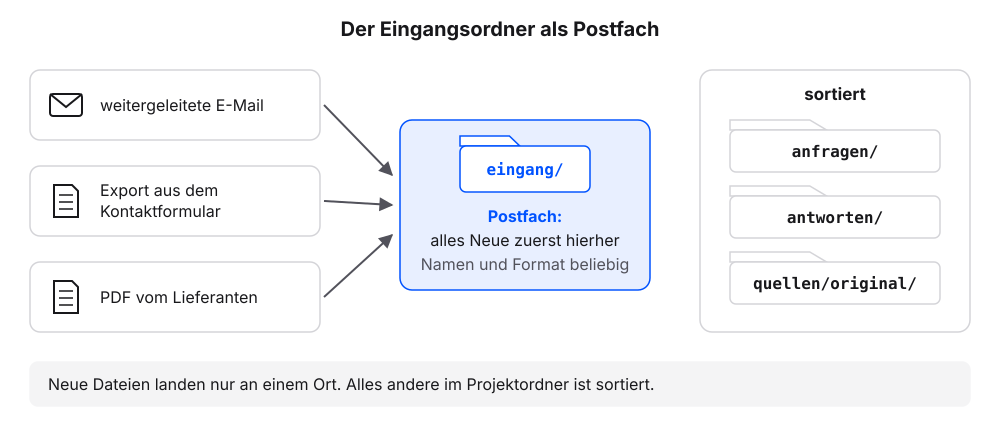
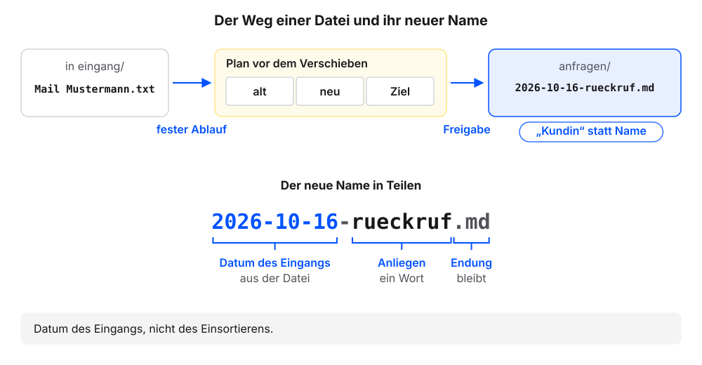
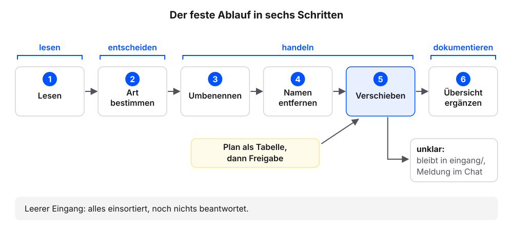

# Laufend neue Dateien

Ein Projektordner bleibt nur so lange brauchbar, wie neue Unterlagen denselben Weg nehmen. Im Alltag kommen Anfragen als weitergeleitete E-Mail, als Export aus dem Kontaktformular oder als PDF eines Lieferanten. Wir richten mit dem eigenen Agenten einen Ordner ein, in dem alles Neue landet, und leeren ihn mit einem Auftrag, der immer gleich lautet. Die Erklärung folgt jeweils am eigenen Ergebnis.

Jeder Schritt hat denselben Aufbau: ein Auftrag zum Kopieren, ein Kasten „Das sollten wir jetzt sehen“, eine kurze Erklärung und ein Abschnitt „Wenn es anders aussieht“.

**Voraussetzung:** Der Ordner `kundenanfragen` ist in der App des Agenten gewählt. `AGENTS.md` enthält sechs Regeln, `UEBERSICHT.md` und der Ordner `quellen/` liegen im Ordner (Stand nach dem Kapitel [Excel-Tabellen als Quelle](excel-als-quelle.qmd)).

## Schritt 1: Den Eingang anlegen

1. Diese Frage senden:

   ```text
   Kannst du Dateien innerhalb dieses Ordners umbenennen und verschieben? Fragst du vorher, oder muss ich das in AGENTS.md festlegen? Nur antworten, nichts ändern.
   ```

2. Prüfen: Der Agent sagt, ob er umbenennen und verschieben kann und ob er vorher fragt. Fragt er nicht von selbst, verlangt der Auftrag in Schritt 2 einen Plan vor dem Verschieben.
3. Diesen Auftrag senden:

   ```text
   Lege den Ordner eingang an und darin zwei Beispielanfragen mit unordentlichen Dateinamen, etwa mit Leerzeichen oder ohne Datum. Eine Anfrage enthält einen erfundenen Personennamen im Text, zum Beispiel Erika Mustermann.
   ```

4. Das Anlegen freigeben, wenn der Agent fragt.
5. Diese Frage senden:

   ```text
   Liste die Dateien in eingang/ auf. Zeig mir dann den Inhalt beider Dateien mit allen Zeichen.
   ```

6. Prüfen: Die Liste nennt zwei Dateien. Eine davon nennt im Text einen Personennamen.

### Das sollten wir jetzt sehen

```{=html}
<div style="max-width:620px;border:1px solid #dcd9d2;border-radius:12px;overflow:hidden;background:#fbfaf7;color:#1f2430;margin:0 0 1rem;line-height:1.45"><div style="display:flex;align-items:center;gap:8px;padding:7px 12px;background:#f4f2ed;border-bottom:1px solid #dcd9d2;font-size:12px;color:#5b6170">Ordner: <b style="color:#1f2430;font-weight:600;font-family:ui-monospace,SFMono-Regular,Menlo,monospace">kundenanfragen</b><span style="margin-left:auto">Chat</span></div><div style="padding:12px;display:grid;gap:8px"><div style="justify-self:end;max-width:94%;border-radius:10px;padding:8px 11px;background:#dfe6f3"><span style="display:block;font-size:11.5px;color:#5b6170;margin-bottom:2px">Wir</span>Kannst du Dateien innerhalb dieses Ordners umbenennen und verschieben? Fragst du vorher, oder muss ich das in AGENTS.md festlegen? Nur antworten, nichts ändern.</div>
<div style="justify-self:start;max-width:94%;border-radius:10px;padding:8px 11px;background:#f4f2ed;border:1px solid #dcd9d2"><span style="display:block;font-size:11.5px;color:#5b6170;margin-bottom:2px">Agent</span>Ja, ich kann Dateien in diesem Ordner umbenennen und verschieben. Ob ich vorher frage, hängt von den Einstellungen der App ab. Steht im Auftrag, dass ich zuerst einen Plan zeigen soll, zeige ich ihn vor dem Verschieben.</div>
<div style="justify-self:end;max-width:94%;border-radius:10px;padding:8px 11px;background:#dfe6f3"><span style="display:block;font-size:11.5px;color:#5b6170;margin-bottom:2px">Wir</span>Lege den Ordner eingang an und darin zwei Beispielanfragen mit unordentlichen Dateinamen, etwa mit Leerzeichen oder ohne Datum. Eine Anfrage enthält einen erfundenen Personennamen im Text, zum Beispiel Erika Mustermann.</div>
<div style="justify-self:stretch;border:1px solid #d9b26a;border-radius:10px;padding:8px 11px;background:#fbf3e3"><span style="display:block;font-size:11.5px;color:#5b6170;margin-bottom:2px">Agent</span>Ich lege <code>eingang/</code> an und darin zwei Dateien: <code>Mail Mustermann.txt</code> und <code>anfrage_formular(2).md</code>. Darf ich?<br><span style="display:inline-block;margin:6px 6px 0 0;padding:2px 10px;border:1px solid #23417a;color:#23417a;border-radius:999px;font-size:12.5px;font-weight:600">Erlauben</span><span style="display:inline-block;margin:6px 6px 0 0;padding:2px 10px;border:1px solid #dcd9d2;border-radius:999px;font-size:12.5px">Ablehnen</span></div>
<div style="justify-self:start;font-family:ui-monospace,SFMono-Regular,Menlo,monospace;font-size:12px;color:#5b6170;padding:0 4px"><span style="color:#b8862b;font-weight:700">› </span>eingang angelegt</div>
<div style="justify-self:start;font-family:ui-monospace,SFMono-Regular,Menlo,monospace;font-size:12px;color:#5b6170;padding:0 4px"><span style="color:#b8862b;font-weight:700">› </span>eingang/Mail Mustermann.txt angelegt</div>
<div style="justify-self:start;font-family:ui-monospace,SFMono-Regular,Menlo,monospace;font-size:12px;color:#5b6170;padding:0 4px"><span style="color:#b8862b;font-weight:700">› </span>eingang/anfrage_formular(2).md angelegt</div>
<div style="justify-self:start;max-width:94%;border-radius:10px;padding:8px 11px;background:#f4f2ed;border:1px solid #dcd9d2"><span style="display:block;font-size:11.5px;color:#5b6170;margin-bottom:2px">Agent</span>Fertig. Ein Ordner und zwei Dateien angelegt.</div>
<div style="justify-self:end;max-width:94%;border-radius:10px;padding:8px 11px;background:#dfe6f3"><span style="display:block;font-size:11.5px;color:#5b6170;margin-bottom:2px">Wir</span>Liste die Dateien in eingang/ auf. Zeig mir dann den Inhalt beider Dateien mit allen Zeichen.</div>
<div style="justify-self:start;max-width:94%;border-radius:10px;padding:8px 11px;background:#f4f2ed;border:1px solid #dcd9d2"><span style="display:block;font-size:11.5px;color:#5b6170;margin-bottom:2px">Agent</span><p style="margin:0 0 4px">In <code>eingang/</code> liegen zwei Dateien: <code>Mail Mustermann.txt</code> und <code>anfrage_formular(2).md</code>.</p><p style="margin:0 0 4px">Inhalt von <code>Mail Mustermann.txt</code>:</p><pre style="margin:6px 0 0;padding:8px 10px;border:1px solid #dcd9d2;border-radius:8px;background:#fbfaf7;font-family:ui-monospace,SFMono-Regular,Menlo,monospace;font-size:.85rem;line-height:1.6;white-space:pre-wrap;word-break:break-word">Von: Erika Mustermann
Datum: 16.10.2026
Betreff: Rückruf

Guten Tag, bitte rufen Sie mich wegen der Reparatur zurück.
Viele Grüße
Erika Mustermann</pre><p style="margin:0 0 4px">Inhalt von <code>anfrage_formular(2).md</code>:</p><pre style="margin:6px 0 0;padding:8px 10px;border:1px solid #dcd9d2;border-radius:8px;background:#fbfaf7;font-family:ui-monospace,SFMono-Regular,Menlo,monospace;font-size:.85rem;line-height:1.6;white-space:pre-wrap;word-break:break-word">Anfrage über das Kontaktformular
Eingegangen: 17.10.2026

Was kostet eine Beratung vor Ort? Gern mit Angabe der Anfahrtskosten.</pre></div></div></div>
```

Ein mögliches Ergebnis. Die Antwort auf die erste Frage ist je Werkzeug verschieden. Dateinamen und Inhalte wählt der Agent selbst. Entscheidend sind unordentliche Namen und ein Personenname im Text.

### Was gerade passiert ist

Der Agent hat zwei Dateien angelegt, die nach keiner Regel benannt sind. Das ist Absicht: So sieht neues Material aus, bevor es sortiert ist. Legen wir solche Dateien einzeln von Hand ab, wächst die Unordnung mit jeder Woche.

Der **Eingangsordner** heißt bei uns `eingang/`. Er ist der einzige Ort im Projektordner, an dem neue Dateien landen, egal in welchem Format und mit welchem Namen. Alles andere im Ordner ist sortiert. Der Eingangsordner entspricht dem Postfach eines neuen Mitarbeiters: Alles, was für ihn hereinkommt, landet zuerst dort. Die Trennung hat zwei Vorteile. Wir müssen beim Ablegen nicht nachdenken: Eine weitergeleitete E-Mail und ein Formularexport kommen beide zuerst nach `eingang/`. Und der Zustand des Ordners ist auf einen Blick erkennbar.

{fig-alt="Links drei Quellen neuer Dateien: eine weitergeleitete E-Mail, ein Export aus dem Kontaktformular, ein PDF vom Lieferanten. Pfeile führen in die Mitte zum Ordner eingang/, beschriftet als Postfach: alles Neue zuerst hierher, Namen und Format beliebig. Rechts die sortierten Ordner anfragen/, antworten/ und quellen/original/, beschriftet: alles andere ist sortiert."}

::: {.callout-note title="Wenn es anders aussieht"}
- Die Dateien haben schon ordentliche Namen: „Benenne eine der beiden Dateien in Mail Mustermann.txt um.“
- Kein Personenname im Text: „Ergänze in einer der beiden Dateien den Namen Erika Mustermann als Absenderin.“
- Der Agent sagt, er kann nicht umbenennen oder verschieben: Er schreibt die Datei dann unter dem neuen Namen neu. Nach Schritt 2 prüfen, ob die alte Datei aus `eingang/` verschwunden ist.
:::

## Schritt 2: Der feste Ablauf

**Voraussetzung:** In `eingang/` liegen die zwei Beispielanfragen aus Schritt 1.

1. Den festen Ablauf senden:

   ```text
   Sortiere alle Dateien in eingang/ ein: 1. Lies jede Datei. 2. Bestimme die Art (Anfrage, Antwort, Quelle, sonstiges). 3. Benenne um nach JJJJ-MM-TT-anliegen.md mit dem Datum aus der Datei, sonst heute. PDF und andere Dateien, die kein Text sind, behalten ihre Endung. 4. Entferne Personennamen und ersetze sie durch „Kundin“ oder „Kunde“. 5. Verschiebe nach anfragen/, antworten/ oder quellen/original/; unklare Dateien bleiben in eingang/ und werden mir gemeldet. 6. Ergänze UEBERSICHT.md. Zeige mir den Plan als Tabelle (alt, neu, Ziel), bevor du verschiebst.
   ```

2. Prüfen: Der Plan nennt für jede Datei den alten Namen, den neuen Namen und den Zielordner.
3. Den Plan freigeben.
4. Diese Frage senden:

   ```text
   Liste die Dateien in eingang/ und anfragen/ auf. Zeig mir die zwei neuen Dateien in anfragen/ mit allen Zeichen und die neuen Zeilen in UEBERSICHT.md.
   ```

5. Prüfen: Die Liste nennt für `eingang/` keine Datei. `anfragen/` hat zwei Dateien mehr als vorher.
6. Prüfen: In keiner neuen Datei steht ein Personenname. `UEBERSICHT.md` hat zwei neue Zeilen.

### Das sollten wir jetzt sehen

```{=html}
<div style="max-width:620px;border:1px solid #dcd9d2;border-radius:12px;overflow:hidden;background:#fbfaf7;color:#1f2430;margin:0 0 1rem;line-height:1.45"><div style="display:flex;align-items:center;gap:8px;padding:7px 12px;background:#f4f2ed;border-bottom:1px solid #dcd9d2;font-size:12px;color:#5b6170">Ordner: <b style="color:#1f2430;font-weight:600;font-family:ui-monospace,SFMono-Regular,Menlo,monospace">kundenanfragen</b><span style="margin-left:auto">Chat</span></div><div style="padding:12px;display:grid;gap:8px"><div style="justify-self:end;max-width:94%;border-radius:10px;padding:8px 11px;background:#dfe6f3"><span style="display:block;font-size:11.5px;color:#5b6170;margin-bottom:2px">Wir</span>Sortiere alle Dateien in eingang/ ein: 1. Lies jede Datei. 2. Bestimme die Art (Anfrage, Antwort, Quelle, sonstiges). 3. Benenne um nach JJJJ-MM-TT-anliegen.md mit dem Datum aus der Datei, sonst heute. PDF und andere Dateien, die kein Text sind, behalten ihre Endung. 4. Entferne Personennamen und ersetze sie durch „Kundin“ oder „Kunde“. 5. Verschiebe nach anfragen/, antworten/ oder quellen/original/; unklare Dateien bleiben in eingang/ und werden mir gemeldet. 6. Ergänze UEBERSICHT.md. Zeige mir den Plan als Tabelle (alt, neu, Ziel), bevor du verschiebst.</div>
<div style="justify-self:start;font-family:ui-monospace,SFMono-Regular,Menlo,monospace;font-size:12px;color:#5b6170;padding:0 4px"><span style="color:#b8862b;font-weight:700">› </span>liest eingang/Mail Mustermann.txt</div>
<div style="justify-self:start;font-family:ui-monospace,SFMono-Regular,Menlo,monospace;font-size:12px;color:#5b6170;padding:0 4px"><span style="color:#b8862b;font-weight:700">› </span>liest eingang/anfrage_formular(2).md</div>
<div style="justify-self:stretch;border:1px solid #d9b26a;border-radius:10px;padding:8px 11px;background:#fbf3e3"><span style="display:block;font-size:11.5px;color:#5b6170;margin-bottom:2px">Agent</span><p style="margin:0 0 4px">Plan, bevor ich verschiebe:</p><table style="border-collapse:collapse;font-size:.9rem;margin-top:4px"><thead><tr><th style="border:1px solid #dcd9d2;padding:4px 8px;text-align:left;background:#f4f2ed">alt</th><th style="border:1px solid #dcd9d2;padding:4px 8px;text-align:left;background:#f4f2ed">neu</th><th style="border:1px solid #dcd9d2;padding:4px 8px;text-align:left;background:#f4f2ed">Ziel</th></tr></thead><tbody><tr><td style="border:1px solid #dcd9d2;padding:4px 8px;text-align:left"><code>Mail Mustermann.txt</code></td><td style="border:1px solid #dcd9d2;padding:4px 8px;text-align:left"><code>2026-10-16-rueckruf.md</code></td><td style="border:1px solid #dcd9d2;padding:4px 8px;text-align:left"><code>anfragen/</code></td></tr><tr><td style="border:1px solid #dcd9d2;padding:4px 8px;text-align:left"><code>anfrage_formular(2).md</code></td><td style="border:1px solid #dcd9d2;padding:4px 8px;text-align:left"><code>2026-10-17-preisfrage.md</code></td><td style="border:1px solid #dcd9d2;padding:4px 8px;text-align:left"><code>anfragen/</code></td></tr></tbody></table><p style="margin:0 0 4px">In der ersten Datei ersetze ich „Erika Mustermann“ durch „Kundin“. Danach ergänze ich zwei Zeilen in <code>UEBERSICHT.md</code>. Soll ich verschieben?</p><br><span style="display:inline-block;margin:6px 6px 0 0;padding:2px 10px;border:1px solid #23417a;color:#23417a;border-radius:999px;font-size:12.5px;font-weight:600">Erlauben</span><span style="display:inline-block;margin:6px 6px 0 0;padding:2px 10px;border:1px solid #dcd9d2;border-radius:999px;font-size:12.5px">Ablehnen</span></div>
<div style="justify-self:start;font-family:ui-monospace,SFMono-Regular,Menlo,monospace;font-size:12px;color:#5b6170;padding:0 4px"><span style="color:#b8862b;font-weight:700">› </span>eingang/Mail Mustermann.txt verschoben nach anfragen/2026-10-16-rueckruf.md</div>
<div style="justify-self:start;font-family:ui-monospace,SFMono-Regular,Menlo,monospace;font-size:12px;color:#5b6170;padding:0 4px"><span style="color:#b8862b;font-weight:700">› </span>eingang/anfrage_formular(2).md verschoben nach anfragen/2026-10-17-preisfrage.md</div>
<div style="justify-self:start;font-family:ui-monospace,SFMono-Regular,Menlo,monospace;font-size:12px;color:#5b6170;padding:0 4px"><span style="color:#b8862b;font-weight:700">› </span>anfragen/2026-10-16-rueckruf.md geändert</div>
<div style="justify-self:start;font-family:ui-monospace,SFMono-Regular,Menlo,monospace;font-size:12px;color:#5b6170;padding:0 4px"><span style="color:#b8862b;font-weight:700">› </span>UEBERSICHT.md geändert</div>
<div style="justify-self:start;max-width:94%;border-radius:10px;padding:8px 11px;background:#f4f2ed;border:1px solid #dcd9d2"><span style="display:block;font-size:11.5px;color:#5b6170;margin-bottom:2px">Agent</span>Fertig. <code>eingang/</code> ist leer. Zwei Dateien umbenannt und nach <code>anfragen/</code> verschoben, ein Personenname durch „Kundin“ ersetzt, zwei Zeilen in <code>UEBERSICHT.md</code> ergänzt.</div>
<div style="justify-self:end;max-width:94%;border-radius:10px;padding:8px 11px;background:#dfe6f3"><span style="display:block;font-size:11.5px;color:#5b6170;margin-bottom:2px">Wir</span>Liste die Dateien in eingang/ und anfragen/ auf. Zeig mir die zwei neuen Dateien in anfragen/ mit allen Zeichen und die neuen Zeilen in UEBERSICHT.md.</div>
<div style="justify-self:start;max-width:94%;border-radius:10px;padding:8px 11px;background:#f4f2ed;border:1px solid #dcd9d2"><span style="display:block;font-size:11.5px;color:#5b6170;margin-bottom:2px">Agent</span><p style="margin:0 0 4px"><code>eingang/</code>: keine Dateien.</p><p style="margin:0 0 4px"><code>anfragen/</code>: 2026-10-05-terminwunsch.md, 2026-10-06-preisfrage.md, 2026-10-07-beschwerde.md, 2026-10-16-rueckruf.md, 2026-10-17-preisfrage.md.</p><p style="margin:0 0 4px">Inhalt von <code>anfragen/2026-10-16-rueckruf.md</code>:</p><pre style="margin:6px 0 0;padding:8px 10px;border:1px solid #dcd9d2;border-radius:8px;background:#fbfaf7;font-family:ui-monospace,SFMono-Regular,Menlo,monospace;font-size:.85rem;line-height:1.6;white-space:pre-wrap;word-break:break-word"><i style="color:#23417a;font-style:normal;font-weight:700">#</i> Rückruf

<i style="color:#23417a;font-style:normal;font-weight:700">-</i> Datum: 2026-10-16
<i style="color:#23417a;font-style:normal;font-weight:700">-</i> Kanal: E-Mail
<i style="color:#23417a;font-style:normal;font-weight:700">-</i> Anliegen: Rückruf wegen einer Reparatur

Die Kundin bittet um einen Rückruf wegen der Reparatur.</pre><p style="margin:0 0 4px">Neue Zeilen in <code>UEBERSICHT.md</code>:</p><pre style="margin:6px 0 0;padding:8px 10px;border:1px solid #dcd9d2;border-radius:8px;background:#fbfaf7;font-family:ui-monospace,SFMono-Regular,Menlo,monospace;font-size:.85rem;line-height:1.6;white-space:pre-wrap;word-break:break-word"><span style="display:block;background:#d9e4f5">+ | anfragen/2026-10-16-rueckruf.md | Rückruf wegen einer Reparatur | 2026-10-16 |</span><span style="display:block;background:#d9e4f5">+ | anfragen/2026-10-17-preisfrage.md | Preis für Beratung vor Ort | 2026-10-17 |</span></pre></div></div></div>
```

Namen und Daten der eigenen Dateien weichen ab. Entscheidend: Der Plan kommt vor dem Verschieben, `eingang/` ist danach leer, die neuen Dateien folgen dem Muster `JJJJ-MM-TT-anliegen.md`, und statt des Namens steht „Kundin“.

### Was gerade passiert ist

Ein einziger Auftrag hat beide Dateien gelesen, umbenannt, von Namen befreit, einsortiert und in die Übersicht eingetragen.

Ein **fester Ablauf** ist ein Auftrag, der immer gleich lautet, egal was im Eingang liegt. Er ist die Morgenroutine für dieses Postfach. Der Agent schaut aber nicht von selbst hinein: Wir senden ihm den Ablauf. So wurde `Mail Mustermann.txt` zu `anfragen/2026-10-16-rueckruf.md`, und im Text steht „Kundin“ statt des Namens (Regel 3 unserer `AGENTS.md`: keine Personennamen in neuen Dateien).

Die neuen Namen folgen der **Namenskonvention** aus dem Kapitel [Der Projektordner](projektordner.qmd): `JJJJ-MM-TT-anliegen.md`. Das Datum steht vorne, in der Reihenfolge Jahr, Monat, Tag. So sortiert jedes Dateiprogramm die Anfragen chronologisch. Danach folgt das Anliegen in einem oder zwei Wörtern, klein geschrieben und mit Bindestrichen verbunden. Das Datum ist der Tag des Eingangs, also das Datum aus der Datei selbst, nicht der Tag des Einsortierens. Sortieren wir am Montag drei Anfragen vom Freitag ein, tragen alle drei das Datum vom Freitag. Nur wenn die Datei kein Datum enthält, nimmt der Agent den heutigen Tag. PDF-Dateien und andere Dateien, die kein Text sind, behalten ihre Endung.

{fig-alt="Oben der Weg einer Datei: Mail Mustermann.txt im Eingang, Pfeil mit der Beschriftung fester Ablauf, dann der Plan als Tabelle mit alt, neu und Ziel, dann die Datei anfragen/2026-10-16-rueckruf.md mit dem Hinweis „Kundin“ statt Name. Unten der Dateiname in Teile zerlegt: 2026-10-16 ist das Datum des Eingangs aus der Datei, rueckruf das Anliegen, .md die Endung. Merksatz: Datum des Eingangs, nicht des Einsortierens."}

Bevor der Agent verschiebt, zeigt er uns den Plan als Tabelle. So sehen wir jede Änderung, bevor sie passiert, auch wenn das eigene Werkzeug beim Verschieben nicht von selbst nachfragt.

::: {.callout-note title="Wenn es anders aussieht"}
- Eine Datei bleibt in `eingang/`, und der Agent meldet sie: Der Ablauf konnte sie nicht zuordnen. Wohin sie gehört, entscheiden wir selbst.
- Die Liste nennt `eingang/` nicht mehr: Manche Werkzeuge lassen leere Ordner in Listen weg. „Gibt es den Ordner eingang/ noch, und ist er leer?“
- Ein Personenname steht noch im Text: „Ersetze in den neuen Dateien in anfragen/ alle Personennamen durch Kundin oder Kunde.“
- Der Agent hat ohne Plan verschoben: die neuen Dateien und `UEBERSICHT.md` im Chat prüfen. „Welche Dateien hast du umbenannt und verschoben?“
:::

## Rückblick: der Ablauf in sechs Schritten

Diese sechs Schritte stehen wörtlich im Auftrag aus Schritt 2:

| Schritt | Was der Agent tut | Warum an dieser Stelle |
|---|---|---|
| 1. Lesen | öffnet jede Datei in `eingang/` | Ohne den Inhalt kennt er weder Art noch Datum. |
| 2. Art bestimmen | Anfrage, Antwort, Quelle oder sonstiges | Die Art entscheidet über den Zielordner. |
| 3. Umbenennen | nach `JJJJ-MM-TT-anliegen.md` | Der neue Name braucht Datum und Anliegen aus Schritt 1 und 2. |
| 4. Namen entfernen | ersetzt Personennamen durch „Kundin“ oder „Kunde“ | Vor dem Verschieben, damit in `anfragen/` nie eine Datei mit Personennamen liegt (Regel 3). |
| 5. Verschieben | nach `anfragen/`, `antworten/` oder `quellen/original/` | Erst jetzt steht fest, wohin die Datei gehört. |
| 6. Übersicht ergänzen | je neue Datei eine Zeile in `UEBERSICHT.md` | Zuletzt, weil erst dann die endgültigen Namen und Orte feststehen. |

Die Reihenfolge folgt einer einfachen Logik: erst lesen, dann entscheiden, dann handeln, zuletzt dokumentieren. Wer die Schritte für den eigenen Eingang in anderen Worten beschreibt, sollte diese Reihenfolge beibehalten.

{fig-alt="Sechs nummerierte Kästen in einer Reihe, durch Pfeile verbunden: 1 Lesen, 2 Art bestimmen, 3 Umbenennen, 4 Namen entfernen, 5 Verschieben, 6 Übersicht ergänzen. Über den Kästen die Logik in vier Wörtern: lesen, entscheiden, handeln, dokumentieren. Von Kasten 5 zweigt ein Pfeil ab zu einem Kasten: unklar, bleibt in eingang/, Meldung im Chat. Unter der Reihe, vor Kasten 5, der Hinweis: Plan als Tabelle, dann Freigabe."}

Nicht jede Datei im Eingang passt in einen der drei Zielordner. Liegt dort etwa eine Rechnung, die der Betrieb an einen Kunden geschickt hat, gibt es im Projektordner keinen passenden Platz. Schritt 5 regelt diesen Fall: Unklare Dateien bleiben in `eingang/`, und der Agent meldet sie. Die Entscheidung liegt dann bei uns. Gehören Rechnungen überhaupt in diesen Projektordner? Wenn ja, legen wir bewusst einen Zielordner an und ergänzen den Ablauf. Zwei andere Reaktionen des Agenten wären problematisch. Ein selbst angelegter Ordner `rechnungen/` wirkt hilfsbereit, ändert aber ohne Auftrag die Ordnerstruktur. Eine Rechnung in `anfragen/` verfälscht die Übersicht der Anfragen. Löschen kommt in keinem Schritt des Ablaufs vor.

::: {.callout-note title="Eingang leer, Arbeit nicht fertig"}
Ein leerer Eingang bedeutet: Alle Dateien liegen am richtigen Ort und stehen in der Übersicht. Beantwortet ist damit noch keine Anfrage. Einsortieren und Bearbeiten sind getrennte Aufträge, und das hält beide kurz und prüfbar.
:::

Der Auftrag aus Schritt 2 ist lang, und wir brauchen ihn jede Woche wieder. Im Kapitel [Skills: Abläufe, die bleiben](skills.qmd) schreiben wir ihn einmal als Skill auf. Danach genügen zwei Wörter.
