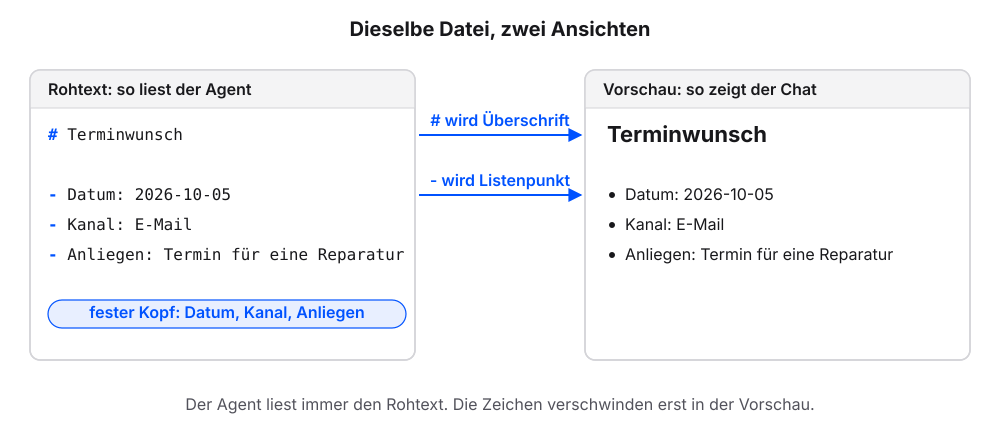
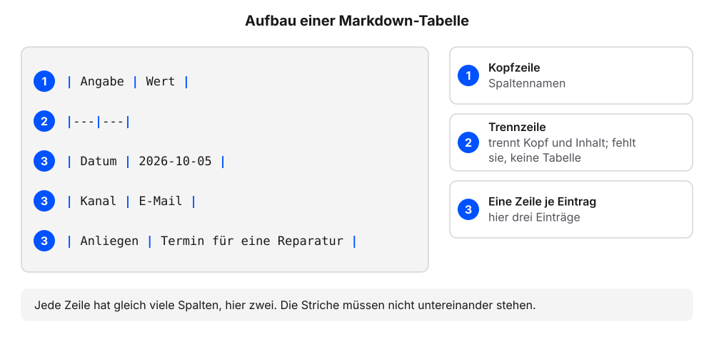
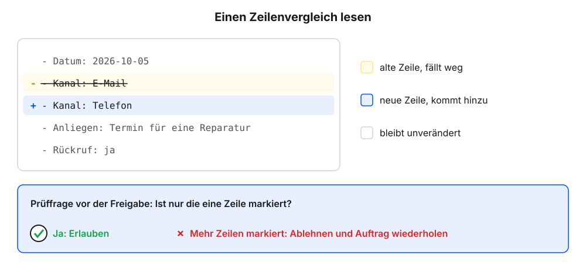
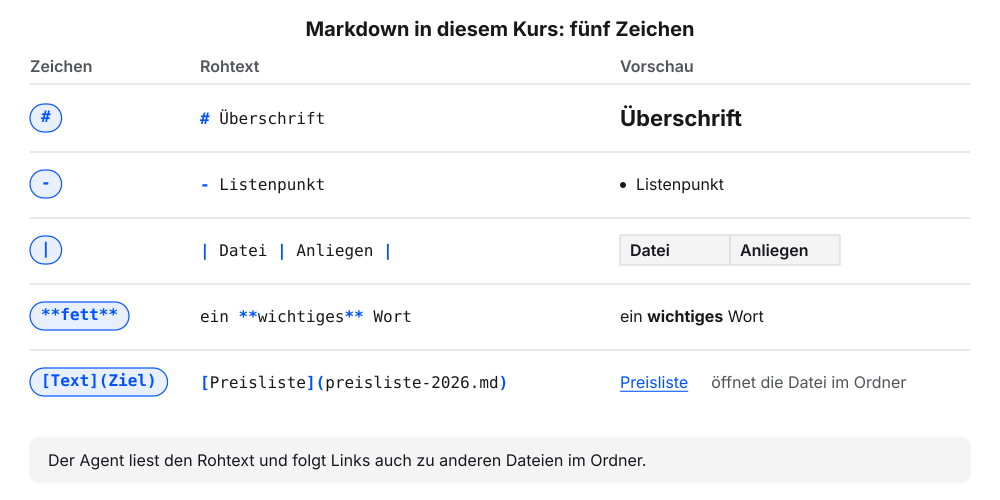

# Markdown: Text, den Mensch und Agent lesen

Agenten lesen und schreiben Markdown ohne Umweg. Fast alle Dateien, die in den folgenden Kapiteln entstehen, sind Markdown-Dateien: die Anfragen, die Antwortentwürfe, die Übersicht und die Hausordnung des Agenten. In diesem Kapitel arbeiten wir mit dem eigenen Agenten Schritt für Schritt an solchen Dateien. Die Erklärung folgt jeweils am eigenen Ergebnis.

Jeder Schritt hat denselben Aufbau: ein Auftrag zum Kopieren, ein Kasten „Das sollten wir jetzt sehen“, eine kurze Erklärung und ein Abschnitt „Wenn es anders aussieht“.

**Voraussetzung:** Der Ordner `agent-test` aus dem Kapitel [Chat oder Agent?](chat-oder-agent.qmd) ist in der App des Agenten gewählt. Darin liegt die Datei `terminwunsch.md` aus dem ersten Auftrag. Alle Aufträge und Prüfungen laufen im Chat; eine Datei zeigt uns der Agent auf Nachfrage mit allen Zeichen oder formatiert.

## Schritt 1: Dieselbe Datei als Vorschau

`terminwunsch.md` mit allen Zeichen haben wir im ersten Auftrag gesehen. Jetzt lassen wir dieselbe Datei formatiert zeigen.

1. Diese Frage senden:

   ```text
   Gib den Inhalt von terminwunsch.md jetzt formatiert wieder, so wie ein Leser ihn sehen soll.
   ```

2. Prüfen: Die Antwort zeigt eine Überschrift und drei Listenpunkte. Die Zeichen `#` und `-` sind nicht zu sehen.
3. Diese Frage senden:

   ```text
   Über welchen Kanal kam der Terminwunsch in terminwunsch.md? Nur antworten.
   ```

4. Prüfen: Die Antwort lautet „E-Mail“.

### Das sollten wir jetzt sehen

Dieselbe Datei formatiert, ohne die Zeichen `#` und `-`:

```{=html}
<div style="max-width:620px;border:1px solid #dcd9d2;border-radius:12px;overflow:hidden;background:#fbfaf7;color:#1f2430;margin:0 0 1rem;line-height:1.45">

<div style="padding:12px;display:grid;gap:8px">
<div style="justify-self:end;max-width:94%;border-radius:10px;padding:8px 11px;background:#dfe6f3"><span style="display:block;font-size:11.5px;color:#5b6170;margin-bottom:2px">Wir</span>Gib den Inhalt von terminwunsch.md jetzt formatiert wieder, so wie ein Leser ihn sehen soll.</div>
<div style="justify-self:start;max-width:94%;border-radius:10px;padding:8px 11px;background:#f4f2ed;border:1px solid #dcd9d2"><span style="display:block;font-size:11.5px;color:#5b6170;margin-bottom:2px">Agent</span><div style="font-size:1.2rem;font-weight:700;margin:4px 0 6px">Terminwunsch</div><ul style="margin:0;padding-left:20px"><li>Datum: 2026-10-05</li><li>Kanal: E-Mail</li><li>Anliegen: Termin für eine Reparatur</li></ul></div>
</div>
</div>
```


### Was gerade passiert ist

Im ersten Auftrag haben wir dem Agenten nur Überschrift und Liste genannt. Die Zeichen `#` und `-` hat er von selbst gesetzt. Das ist Markdown, das Dateiformat aus dem Kapitel [Chat oder Agent?](chat-oder-agent.qmd).

Der Inhalt der Datei genau so, wie er gespeichert ist, heißt **Rohtext**. `#` am Zeilenanfang macht eine Überschrift, `-` einen Listenpunkt. Der Agent liest immer den Rohtext: Für die Frage nach dem Kanal findet er die Zeile `- Kanal: E-Mail` und antwortet „E-Mail“. Die **Vorschau** ist die formatierte Ansicht desselben Textes: Die Zeichen `#` und `-` verschwinden, übrig bleiben Überschrift und Liste. Der Chat zeigt Markdown meist so an. Darum zeigt die Antwort die Vorschau unserer Datei.

{fig-alt="Links der Rohtext der Datei terminwunsch.md mit den Zeichen # und - am Zeilenanfang, rechts dieselbe Datei als Vorschau mit Überschrift und drei Listenpunkten. Pfeile zeigen: # wird Überschrift, - wird Listenpunkt. Die drei Listenzeilen Datum, Kanal und Anliegen bilden den festen Kopf."}

Die drei Listenzeilen bilden einen festen Kopf: Datum, Kanal, Anliegen. Diesen Aufbau nutzen alle Anfragen in den folgenden Kapiteln, weil der Agent die drei Angaben so direkt abliest.

::: {.callout-note title="Wenn es anders aussieht"}
- `*` statt `-` am Zeilenanfang: Beide Zeichen machen einen Listenpunkt. Die Vorschau zeigt dasselbe.
- Eine Leerzeile mehr oder weniger: In der Vorschau ändert sich meist nichts. Erst zwei Zeilenumbrüche hintereinander trennen Absätze.
- Die Antwort zeigt die Zeichen: „Gib den Text ohne Codeblock wieder, damit der Chat ihn formatiert.“ Ein Codeblock ist ein Kasten im Chat, der Text unverändert mit allen Zeichen zeigt.
- Wer die Datei selbst sehen will: im Chat auf den Dateipfad klicken oder den Ordner `agent-test` im Finder oder Explorer öffnen.
:::

## Schritt 2: Eine Tabelle

**Voraussetzung:** Im Ordner `agent-test` liegt `terminwunsch.md`.

1. Diesen Auftrag senden:

   ```text
   Lege in diesem Ordner die Datei uebersicht-test.md an. Inhalt: die Überschrift „Übersicht“, darunter eine Tabelle mit den Spalten „Angabe“ und „Wert“. Übernimm die drei Angaben aus terminwunsch.md als Zeilen. Frage, bevor du die Datei anlegst.
   ```

2. Das Anlegen freigeben.
3. Diese Frage senden:

   ```text
   Zeig mir den Inhalt von uebersicht-test.md zuerst mit allen Zeichen, so wie er in der Datei steht, und danach formatiert.
   ```

4. Prüfen: In der ersten Ansicht enthalten fünf Zeilen senkrechte Striche `|`. Die zweite davon besteht aus Strichen wie `|---|---|`.
5. Prüfen: Die zweite Ansicht zeigt eine Tabelle mit Kopfzeile und drei Zeilen.

### Das sollten wir jetzt sehen

```{=html}
<div style="max-width:620px;border:1px solid #dcd9d2;border-radius:12px;overflow:hidden;background:#fbfaf7;color:#1f2430;margin:0 0 1rem;line-height:1.45">

<div style="padding:12px;display:grid;gap:8px">
<div style="justify-self:end;max-width:94%;border-radius:10px;padding:8px 11px;background:#dfe6f3"><span style="display:block;font-size:11.5px;color:#5b6170;margin-bottom:2px">Wir</span>Zeig mir den Inhalt von uebersicht-test.md zuerst mit allen Zeichen, so wie er in der Datei steht, und danach formatiert.</div>
<div style="justify-self:start;max-width:94%;border-radius:10px;padding:8px 11px;background:#f4f2ed;border:1px solid #dcd9d2"><span style="display:block;font-size:11.5px;color:#5b6170;margin-bottom:2px">Agent</span>Mit allen Zeichen:<pre style="margin:6px 0 0;padding:8px 10px;border:1px solid #dcd9d2;border-radius:8px;background:#fbfaf7;font-family:ui-monospace,SFMono-Regular,Menlo,monospace;font-size:.85rem;line-height:1.6;white-space:pre-wrap;word-break:break-word"><span style="color:#5b6170;opacity:.6;display:inline-block;width:22px">1</span><i style="color:#23417a;font-style:normal;font-weight:700">#</i> Übersicht
<span style="color:#5b6170;opacity:.6;display:inline-block;width:22px">2</span>
<span style="color:#5b6170;opacity:.6;display:inline-block;width:22px">3</span><i style="color:#23417a;font-style:normal;font-weight:700">|</i> Angabe <i style="color:#23417a;font-style:normal;font-weight:700">|</i> Wert <i style="color:#23417a;font-style:normal;font-weight:700">|</i>
<span style="color:#5b6170;opacity:.6;display:inline-block;width:22px">4</span><i style="color:#23417a;font-style:normal;font-weight:700">|---|---|</i>
<span style="color:#5b6170;opacity:.6;display:inline-block;width:22px">5</span><i style="color:#23417a;font-style:normal;font-weight:700">|</i> Datum <i style="color:#23417a;font-style:normal;font-weight:700">|</i> 2026-10-05 <i style="color:#23417a;font-style:normal;font-weight:700">|</i>
<span style="color:#5b6170;opacity:.6;display:inline-block;width:22px">6</span><i style="color:#23417a;font-style:normal;font-weight:700">|</i> Kanal <i style="color:#23417a;font-style:normal;font-weight:700">|</i> E-Mail <i style="color:#23417a;font-style:normal;font-weight:700">|</i>
<span style="color:#5b6170;opacity:.6;display:inline-block;width:22px">7</span><i style="color:#23417a;font-style:normal;font-weight:700">|</i> Anliegen <i style="color:#23417a;font-style:normal;font-weight:700">|</i> Termin für eine Reparatur <i style="color:#23417a;font-style:normal;font-weight:700">|</i></pre><p style="margin-top:10px">Formatiert:</p><div style="font-size:1.2rem;font-weight:700;margin:4px 0 6px">Übersicht</div><table style="border-collapse:collapse;font-size:.9rem;margin-top:4px"><thead><tr><th style="border:1px solid #dcd9d2;padding:4px 8px;text-align:left;background:#f4f2ed">Angabe</th><th style="border:1px solid #dcd9d2;padding:4px 8px;text-align:left;background:#f4f2ed">Wert</th></tr></thead><tbody><tr><td style="border:1px solid #dcd9d2;padding:4px 8px;text-align:left">Datum</td><td style="border:1px solid #dcd9d2;padding:4px 8px;text-align:left">2026-10-05</td></tr><tr><td style="border:1px solid #dcd9d2;padding:4px 8px;text-align:left">Kanal</td><td style="border:1px solid #dcd9d2;padding:4px 8px;text-align:left">E-Mail</td></tr><tr><td style="border:1px solid #dcd9d2;padding:4px 8px;text-align:left">Anliegen</td><td style="border:1px solid #dcd9d2;padding:4px 8px;text-align:left">Termin für eine Reparatur</td></tr></tbody></table></div>
</div>
</div>
```


Zeile 4 ist die Trennzeile. Sie erscheint in der formatierten Ansicht nicht, macht aber aus den Zeilen mit Strichen eine Tabelle.

### Was gerade passiert ist

Der Agent hat aus der Liste in `terminwunsch.md` fünf Zeilen mit Strichen gemacht. Eine **Tabelle** besteht aus Zeilen mit senkrechten Strichen `|` zwischen den Spalten. Die erste Zeile ist der Kopf, danach folgt eine Zeile je Eintrag. Die **Trennzeile** aus Strichen, `|---|---|`, steht direkt unter dem Kopf und trennt ihn vom Inhalt. In der Vorschau erscheint sie nicht. Fehlt sie, zeigen die meisten Vorschauen keine Tabelle, sondern den Rohtext mit Strichen.

{fig-alt="Fünf Zeilen einer Markdown-Tabelle mit senkrechten Strichen, nummeriert: 1 Kopfzeile mit den Spaltennamen Angabe und Wert, 2 Trennzeile aus Strichen, 3 eine Zeile je Eintrag für Datum, Kanal und Anliegen. Jede Zeile hat zwei Spalten."}

Die Striche müssen nicht untereinander stehen. Wichtig ist, dass jede Zeile gleich viele Spalten hat. Tabellen eignen sich für Übersichten mit wenigen, kurzen Spalten: Datei und Anliegen, Datei und Stand, Regel und Prüfung. Für längere Texte je Eintrag ist eine Liste mit Unterüberschriften besser lesbar.

::: {.callout-note title="Wenn es anders aussieht"}
- Die Vorschau zeigt Striche statt einer Tabelle: Meist fehlt die Trennzeile. „Ergänze in uebersicht-test.md die Trennzeile direkt unter der Kopfzeile.“
- Die Trennzeile ist länger, etwa `|-----|-----|`, oder die Striche stehen nicht untereinander: Das ist in Ordnung.
- In einer Zeile fehlt eine Spalte: Die Vorschau zeigt die Zeile dann meist verschoben. Den Agenten die Spalte ergänzen lassen.
:::

## Schritt 3: Ändern lassen und die Änderung prüfen

**Voraussetzung:** `terminwunsch.md` liegt im Ordner `agent-test`.

1. Diesen Auftrag senden:

   ```text
   Ergänze in terminwunsch.md unter dem dritten Listenpunkt die Zeile „- Rückruf: ja“. Frage, bevor du speicherst.
   ```

2. Das Speichern freigeben.
3. Diesen Auftrag senden:

   ```text
   Ändere in terminwunsch.md den Kanal von E-Mail auf Telefon. Lass alle anderen Zeilen unverändert. Zeige mir die Änderung Zeile für Zeile und frage, bevor du speicherst.
   ```

4. Prüfen: Der Agent zeigt die Zeile mit dem Kanal alt und neu und fragt vor dem Speichern.
5. Das Speichern freigeben.
6. Diese Frage senden:

   ```text
   Zeig mir den Inhalt von terminwunsch.md mit allen Zeichen.
   ```

7. Prüfen: Die Zeile lautet `- Kanal: Telefon`. Die Zeile `- Rückruf: ja` steht noch in der Datei.

### Das sollten wir jetzt sehen

Die Änderung, wie der Agent sie vor dem Speichern zeigt, und die Datei danach:

```{=html}
<div style="max-width:620px;border:1px solid #dcd9d2;border-radius:12px;overflow:hidden;background:#fbfaf7;color:#1f2430;margin:0 0 1rem;line-height:1.45">

<div style="padding:12px;display:grid;gap:8px">
<div style="justify-self:end;max-width:94%;border-radius:10px;padding:8px 11px;background:#dfe6f3"><span style="display:block;font-size:11.5px;color:#5b6170;margin-bottom:2px">Wir</span>Ändere in terminwunsch.md den Kanal von E-Mail auf Telefon. Lass alle anderen Zeilen unverändert. Zeige mir die Änderung Zeile für Zeile und frage, bevor du speicherst.</div>
<div style="justify-self:stretch;border:1px solid #d9b26a;border-radius:10px;padding:8px 11px;background:#fbf3e3"><span style="display:block;font-size:11.5px;color:#5b6170;margin-bottom:2px">Agent</span>Eine Zeile ändert sich, alle anderen bleiben:<pre style="margin:6px 0 0;padding:8px 10px;border:1px solid #dcd9d2;border-radius:8px;background:#fbfaf7;font-family:ui-monospace,SFMono-Regular,Menlo,monospace;font-size:.85rem;line-height:1.6;white-space:pre-wrap;word-break:break-word">  - Datum: 2026-10-05
<span style="display:block;background:#f7e3c3;text-decoration:line-through;text-decoration-color:#5b6170">- - Kanal: E-Mail</span><span style="display:block;background:#d9e4f5">+ - Kanal: Telefon</span>  - Anliegen: Termin für eine Reparatur
  - Rückruf: ja</pre>Darf ich speichern?<br><span style="display:inline-block;margin:6px 6px 0 0;padding:2px 10px;border:1px solid #23417a;color:#23417a;border-radius:999px;font-size:12.5px;font-weight:600">Erlauben</span><span style="display:inline-block;margin:6px 6px 0 0;padding:2px 10px;border:1px solid #dcd9d2;border-radius:999px;font-size:12.5px">Ablehnen</span></div>
<div style="justify-self:start;font-family:ui-monospace,SFMono-Regular,Menlo,monospace;font-size:12px;color:#5b6170;padding:0 4px"><span style="color:#b8862b;font-weight:700">› </span>terminwunsch.md geändert</div>
<div style="justify-self:end;max-width:94%;border-radius:10px;padding:8px 11px;background:#dfe6f3"><span style="display:block;font-size:11.5px;color:#5b6170;margin-bottom:2px">Wir</span>Zeig mir den Inhalt von terminwunsch.md mit allen Zeichen.</div>
<div style="justify-self:start;max-width:94%;border-radius:10px;padding:8px 11px;background:#f4f2ed;border:1px solid #dcd9d2"><span style="display:block;font-size:11.5px;color:#5b6170;margin-bottom:2px">Agent</span><pre style="margin:6px 0 0;padding:8px 10px;border:1px solid #dcd9d2;border-radius:8px;background:#fbfaf7;font-family:ui-monospace,SFMono-Regular,Menlo,monospace;font-size:.85rem;line-height:1.6;white-space:pre-wrap;word-break:break-word"><span style="color:#5b6170;opacity:.6;display:inline-block;width:22px">1</span># Terminwunsch
<span style="color:#5b6170;opacity:.6;display:inline-block;width:22px">2</span>
<span style="color:#5b6170;opacity:.6;display:inline-block;width:22px">3</span>- Datum: 2026-10-05
<span style="color:#5b6170;opacity:.6;display:inline-block;width:22px">4</span>- Kanal: <i style="color:#23417a;font-style:normal;font-weight:700">Telefon</i>
<span style="color:#5b6170;opacity:.6;display:inline-block;width:22px">5</span>- Anliegen: Termin für eine Reparatur
<span style="color:#5b6170;opacity:.6;display:inline-block;width:22px">6</span>- Rückruf: ja</pre></div>
</div>
</div>
```


### Was gerade passiert ist

Zwei Aufträge, zwei Änderungen an derselben Datei. Beim zweiten haben wir vor dem Speichern genau die eine Zeile gesehen, die sich ändert.

Der **Zeilenvergleich** zeigt eine Änderung als alte und neue Zeile, oft mit `-` und `+` davor. So prüfen wir vor der Freigabe genau die Zeile, die sich ändert, und sehen, dass die übrigen bleiben: `- Kanal: E-Mail` wird zu `- Kanal: Telefon`, die Zeile `- Rückruf: ja` bleibt. Die **Änderungsansicht** ist der Bereich der App, der alle geänderten Zeilen einer Datei zeigt, meist erreichbar über eine Anzeige wie „+1 -1“ im Chat. Je nach App ersetzt sie die Rückfrage: Wir prüfen die Zeilen dort und nehmen die Änderung an oder lehnen sie ab.

{fig-alt="Zeilenvergleich der Datei terminwunsch.md: Die alte Zeile Kanal: E-Mail ist mit Minus markiert und fällt weg, die neue Zeile Kanal: Telefon ist mit Plus markiert, die Zeilen Datum, Anliegen und Rückruf bleiben unverändert. Prüffrage vor der Freigabe: Ist nur die eine Zeile markiert? Ja: Erlauben. Mehr Zeilen: Ablehnen und Auftrag wiederholen."}

Das funktioniert, weil Markdown reiner Text ist: Eine Zeile in der Datei ist eine Zeile im Zeilenvergleich. Wir können die Datei auch selbst ändern. Ein Klick auf den Dateipfad im Chat öffnet sie in vielen Apps zum Bearbeiten; unsere Zeile sieht der Agent beim nächsten Lesen.

::: {.callout-note title="Wenn es anders aussieht"}
- Der Agent beschreibt die Änderung nur in Worten: „Zeige mir die alte und die neue Zeile.“
- Die Zeile `- Rückruf: ja` fehlt nach der Änderung: Der Agent hat die Datei neu geschrieben. Beim nächsten Mal ablehnen, wenn der Zeilenvergleich mehr als die eine Zeile zeigt, und den Auftrag wiederholen.
- Statt einer Frage erscheint die Änderungsansicht: Das ist die Freigabe. Prüfen, dass nur die Zeile mit dem Kanal markiert ist, und annehmen.
- Der Agent ändert ohne Rückfrage: den Modus mit Rückfragen wählen, siehe Kapitel [Chat oder Agent?](chat-oder-agent.qmd), Schritt 2, „Wenn es anders aussieht“.
:::

## Schritt 4: Warum Markdown

Zum Abschluss fragen wir den Agenten, welche Dateiformate er ohne Hilfsprogramm liest. Die Antwort ist je Werkzeug verschieden.

1. Diese Frage senden:

   ```text
   Welche Dateiformate kannst du in diesem Ordner direkt lesen: Markdown, Textdateien, PDF, Word, Excel? Antworte als Liste mit ja oder nein.
   ```

2. Prüfen: Die Antwort nennt für jedes der fünf Formate ja oder nein.

Bei Markdown und Textdateien steht ja. Steht bei PDF ein Nein, ist das Kapitel [PDFs als Quellen](pdf-als-quelle.qmd) besonders wichtig.

### Was die drei Schritte gezeigt haben

Wir haben Dateien anlegen, anzeigen und ändern lassen, alles über den Chat und ohne Spezialprogramm. Das geht, weil Markdown reiner Text ist. Zum Vergleich dieselbe Datei als Word-Datei:

:::: {layout-ncol=2}
::: {}
**terminwunsch.docx, Inhalt der Datei (Ausschnitt)**

```xml
<w:p><w:pPr><w:pStyle w:val="Heading1"/>
</w:pPr><w:r><w:t>Terminwunsch</w:t>
</w:r></w:p><w:p><w:pPr><w:numPr>
<w:ilvl w:val="0"/></w:numPr></w:pPr>
<w:r><w:t>Kanal: Telefon</w:t></w:r>
</w:p><w:p><w:r><w:t>Anliegen:</w:t>
</w:r><w:r><w:t> Termin für eine
Reparatur</w:t></w:r></w:p>
```
:::
::: {}
**terminwunsch.md, unsere Datei aus Schritt 3**

```markdown
# Terminwunsch

- Datum: 2026-10-05
- Kanal: Telefon
- Anliegen: Termin für eine Reparatur
- Rückruf: ja
```
:::
::::

Eine Word- oder Google-Datei ist ein gepacktes Paket aus Text und Formatierungsangaben. Eine `.docx`-Datei ist technisch ein komprimierter Ordner mit mehreren Dateien, in denen Schriftart, Farben, Seitenränder und der eigentliche Text verteilt liegen. Ein Agent muss dieses Paket erst auspacken, um an den Text zu kommen, und manche Werkzeuge können das gar nicht. Markdown ist der Text selbst. Deshalb antwortet der Agent bei Markdown mit ja, bei Word oft mit nein oder „nur mit Hilfsprogramm“. Für den neuen Mitarbeiter heißt das: Markdown-Dateien sind Notizen, die jeder ohne Spezialprogramm lesen kann. Eine Word-Datei gleicht eher einer verschlossenen Akte, die erst jemand öffnen muss.

| Form | Liest der Agent sie? | Kann er sie ergänzen? | Sind Änderungen zeilengenau sichtbar? |
|---|---|---|---|
| Markdown-Datei im Ordner | ja, direkt | ja | ja |
| Word-Datei | oft nur mit Hilfsprogramm | eingeschränkt | nein |
| PDF | oft, je nach Werkzeug | nein | nein |
| Bildschirmfoto | nur als Bild | nein | nein |

PDFs bleiben trotzdem wichtig, weil viele Quellen nur so vorliegen. Wie wir sie in Markdown umwandeln und prüfen, zeigt das Kapitel [PDFs als Quellen](pdf-als-quelle.qmd).

Zwei weitere Zeichen kommen in den folgenden Kapiteln vor: `**fett**` hebt ein Wort hervor, `[Text](Ziel)` setzt einen Link. Der Link kann auf eine Website zeigen oder auf eine andere Datei im Ordner, etwa `[Preisliste](preisliste-2026.md)`. Der zweite Fall ist für uns der wichtigere: Eine Übersicht verlinkt auf die Anfragen, eine Antwort auf die Quelle, aus der ein Betrag stammt. Der Agent folgt solchen Verweisen und öffnet die genannte Datei.

{fig-alt="Fünf Markdown-Zeichen mit Rohtext und Vorschau: # macht eine Überschrift, - einen Listenpunkt, senkrechte Striche eine Tabelle, zwei Sternchen um ein Wort machen es fett, eckige und runde Klammern setzen einen Link, hier auf die Datei preisliste-2026.md."}

Die Dateien in `agent-test` brauchen wir später nicht mehr. Im nächsten Kapitel legt der Agent per Interview den Projektordner für unser eigenes Vorhaben an.
