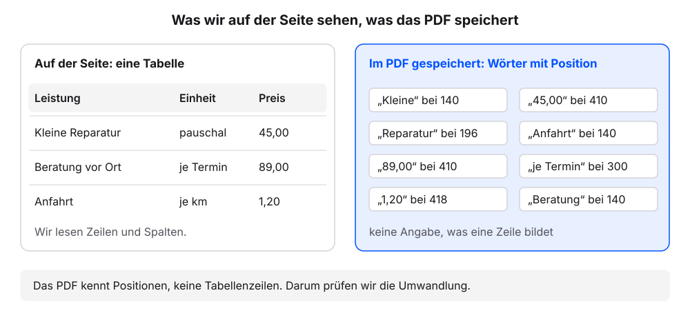
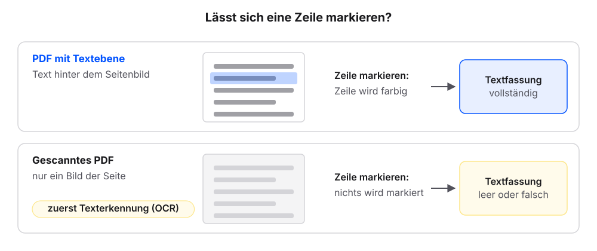
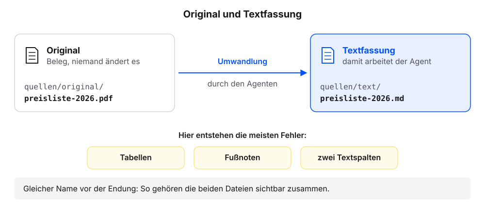
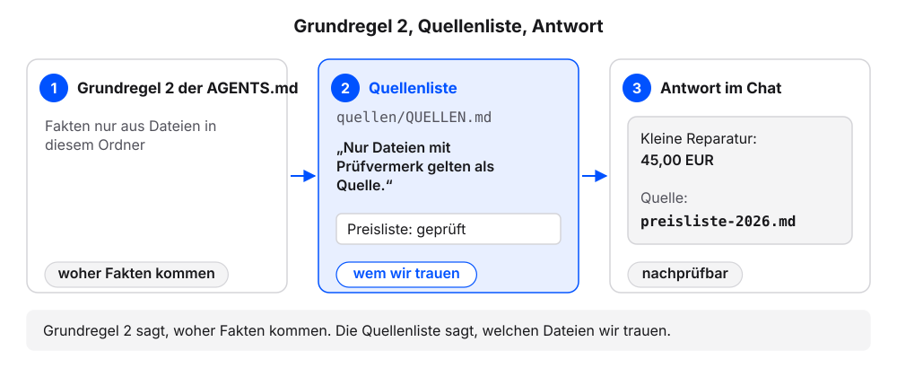

# PDFs als Quellen

Viele Unterlagen eines Betriebs liegen als PDF vor: Preislisten, Merkblätter, Verträge, Angebote von Lieferanten. Ein Agent arbeitet am zuverlässigsten mit reinem Text. Wir nehmen mit dem eigenen Agenten eine PDF-Preisliste als Quelle auf: Original ablegen, Textfassung in Markdown anlegen lassen, gegen das Original prüfen, in eine Quellenliste eintragen. Die Erklärung folgt jeweils am eigenen Ergebnis.

Jeder Schritt hat denselben Aufbau: ein Auftrag zum Kopieren, ein Kasten „Das sollten wir jetzt sehen“, eine kurze Erklärung und ein Abschnitt „Wenn es anders aussieht“.

**Voraussetzungen:**

- Der Ordner `kundenanfragen` ist in der App des Agenten gewählt. `AGENTS.md` enthält sechs Regeln, `UEBERSICHT.md` liegt im Ordner (Stand nach dem Kapitel [Kontext bereitstellen](kontext-bereitstellen.qmd)).
- Die [Beispiel-Preisliste als PDF](downloads/preisliste-2026.pdf) ist heruntergeladen (zwei Seiten, eine Tabelle, Text lässt sich mit der Maus markieren). Alternativ eignet sich ein eigenes PDF mit mindestens einer Tabelle, mit Textebene und ohne vertrauliche Daten; dann in den Aufträgen den Namen `preisliste-2026.pdf` durch den Namen der eigenen Datei ersetzen. Die Datei liegt im Ordner `Downloads`.
- Zwei Handlungen laufen außerhalb der App: das PDF in den Ordner legen und es später im PDF-Programm öffnen. Dafür nutzen wir den Finder (Mac) oder den Explorer (Windows), das Programm, das Ordner und Dateien anzeigt. Alles andere läuft im Chat.

## Schritt 1: Das Original ablegen

1. Diese Frage senden:

   ```text
   Kannst du PDF-Dateien in diesem Ordner direkt lesen? Wenn nein: Welches Werkzeug nutzt du oder brauchst du dafür? Nur antworten, nichts ändern.
   ```

2. Prüfen: Der Agent sagt ja oder nennt ein Werkzeug.
3. Braucht der Agent ein Werkzeug: das Werkzeug nach der Anleitung des Herstellers einrichten.
4. Diesen Auftrag senden:

   ```text
   Lege die Ordner quellen/original und quellen/text an.
   ```

5. Das Anlegen freigeben, wenn der Agent fragt.
6. Im Finder oder Explorer den Ordner `kundenanfragen/quellen/original` öffnen.
7. `preisliste-2026.pdf` aus dem Ordner `Downloads` in den Ordner `original` ziehen.
8. Zurück zur App wechseln.
9. Diese Frage senden:

   ```text
   Liste alle Dateien und Ordner in quellen/ auf, auch die in den Unterordnern.
   ```

10. Prüfen: Die Liste nennt `original/preisliste-2026.pdf`. Der Ordner `text/` ist leer.

### Das sollten wir jetzt sehen

```{=html}
<div style="max-width:620px;border:1px solid #dcd9d2;border-radius:12px;overflow:hidden;background:#fbfaf7;color:#1f2430;margin:0 0 1rem;line-height:1.45"><div style="padding:12px;display:grid;gap:8px"><div style="justify-self:end;max-width:94%;border-radius:10px;padding:8px 11px;background:#dfe6f3"><span style="display:block;font-size:11.5px;color:#5b6170;margin-bottom:2px">Wir</span>Kannst du PDF-Dateien in diesem Ordner direkt lesen? Wenn nein: Welches Werkzeug nutzt du oder brauchst du dafür? Nur antworten, nichts ändern.</div>
<div style="justify-self:start;max-width:94%;border-radius:10px;padding:8px 11px;background:#f4f2ed;border:1px solid #dcd9d2"><span style="display:block;font-size:11.5px;color:#5b6170;margin-bottom:2px">Agent</span>Ja, ich kann PDF-Dateien in diesem Ordner direkt lesen. Ein zusätzliches Werkzeug brauche ich dafür nicht.</div>
<div style="justify-self:end;max-width:94%;border-radius:10px;padding:8px 11px;background:#dfe6f3"><span style="display:block;font-size:11.5px;color:#5b6170;margin-bottom:2px">Wir</span>Lege die Ordner quellen/original und quellen/text an.</div>
<div style="justify-self:stretch;border:1px solid #d9b26a;border-radius:10px;padding:8px 11px;background:#fbf3e3"><span style="display:block;font-size:11.5px;color:#5b6170;margin-bottom:2px">Agent</span>Ich lege zwei leere Ordner an: <code>quellen/original</code> und <code>quellen/text</code>. Darf ich?<br><span style="display:inline-block;margin:6px 6px 0 0;padding:2px 10px;border:1px solid #23417a;color:#23417a;border-radius:999px;font-size:12.5px;font-weight:600">Erlauben</span><span style="display:inline-block;margin:6px 6px 0 0;padding:2px 10px;border:1px solid #dcd9d2;border-radius:999px;font-size:12.5px">Ablehnen</span></div>
<div style="justify-self:start;font-family:ui-monospace,SFMono-Regular,Menlo,monospace;font-size:12px;color:#5b6170;padding:0 4px"><span style="color:#b8862b;font-weight:700">› </span>quellen/original angelegt</div>
<div style="justify-self:start;font-family:ui-monospace,SFMono-Regular,Menlo,monospace;font-size:12px;color:#5b6170;padding:0 4px"><span style="color:#b8862b;font-weight:700">› </span>quellen/text angelegt</div>
<div style="justify-self:start;max-width:94%;border-radius:10px;padding:8px 11px;background:#f4f2ed;border:1px solid #dcd9d2"><span style="display:block;font-size:11.5px;color:#5b6170;margin-bottom:2px">Agent</span>Fertig. Zwei Ordner angelegt, keine Datei geändert.</div>
<div style="justify-self:end;max-width:94%;border-radius:10px;padding:8px 11px;background:#dfe6f3"><span style="display:block;font-size:11.5px;color:#5b6170;margin-bottom:2px">Wir</span>Liste alle Dateien und Ordner in quellen/ auf, auch die in den Unterordnern.</div>
<div style="justify-self:start;max-width:94%;border-radius:10px;padding:8px 11px;background:#f4f2ed;border:1px solid #dcd9d2"><span style="display:block;font-size:11.5px;color:#5b6170;margin-bottom:2px">Agent</span><p style="margin:0 0 4px"><code>quellen/</code> enthält zwei Ordner:</p><ul style="margin:0;padding-left:20px"><li><code>original/</code>: <code>preisliste-2026.pdf</code></li><li><code>text/</code>: leer</li></ul></div></div></div>
```

So sieht es aus, wenn es geklappt hat. Die Antwort auf die erste Frage ist je Werkzeug verschieden. Die PDF-Datei haben wir im Finder oder Explorer hineingelegt; beim Auflisten sieht der Agent sie trotzdem.

### Was gerade passiert ist

Wir haben die PDF-Datei selbst in den Ordner gelegt. Der Agent hat nur zwei leere Ordner angelegt und beim Auflisten die Datei gesehen. Was im Ordner liegt, erfahren wir also im Chat, auch bei Dateien, die wir selbst hineingelegt haben. Am PDF selbst ändert sich ab jetzt nichts mehr.

Das **Original** ist die Datei, so wie sie von außen kam. Sie liegt in `quellen/original/`, und niemand ändert sie. Sie ist der Beleg, gegen den wir später prüfen. In `original/` liegt alles, was von außen kommt und unverändert als Beleg bleibt. Das kann auch eine gespeicherte E-Mail sein, etwa eine `.eml`-Datei (eine E-Mail, als Datei auf dem Rechner gespeichert) eines Lieferanten mit neuen Einkaufspreisen. Sie wirkt wie Korrespondenz, enthält aber Zahlen, auf die sich Antworten stützen. Eine eigene Notiz zu einem Telefonat mit einer Kundin gehört dagegen nicht nach `quellen/`. Sie ist eine Anfrage in unseren eigenen Worten und kommt nach `anfragen/`, ohne den Namen der Kundin.

Ein PDF ist für den Druck gemacht. Es hält fest, wo jedes Zeichen auf der Seite steht, aber nicht, welche Zeichen zu einer Tabellenzeile oder zu einem Absatz gehören. Viele Agenten lesen PDF-Dateien direkt, manche brauchen dafür ein zusätzliches Werkzeug. Deshalb die Frage an den Agenten.

{fig-alt="Links eine Tabelle, wie wir sie auf der PDF-Seite sehen: drei Zeilen mit Leistung, Einheit und Preis. Rechts, was das PDF speichert: dieselben Wörter und Zahlen einzeln mit ihrer Position auf der Seite, ohne Zeilen. Darunter der Merksatz: Das PDF kennt Positionen, keine Tabellenzeilen; darum prüfen wir die Umwandlung."}

::: {.callout-note title="Wenn es anders aussieht"}
- Der Agent sagt nein und nennt kein Werkzeug: „Welches Werkzeug empfiehlst du für PDF-Dateien?“ Das Werkzeug dann nach der Anleitung des Herstellers einrichten.
- Der Agent fragt, bevor er die Ordner anlegt: Das ist in Ordnung. Erlauben.
- Die Ordner heißen anders, etwa `Quellen/Original`: den Agenten sie umbenennen lassen. Die folgenden Aufträge nutzen genau die Namen `quellen/original` und `quellen/text`.
- Die Liste nennt die PDF-Datei nicht: im Finder oder Explorer prüfen, ob die Datei im Ordner `original` liegt und nicht daneben. Die Frage danach erneut senden.
:::

## Schritt 2: Die Textfassung anlegen

::: {.callout-important title="Gescannte PDFs"}
Ein gescanntes PDF enthält Bilder der Seiten, aber keine **Textebene** (den Text hinter dem Seitenbild, der sich mit der Maus markieren und kopieren lässt). Die Textfassung wird dann leer oder enthält falsche Zeichen.

Vor dem Auftrag prüfen: das PDF im Finder oder Explorer mit einem Doppelklick öffnen und mit gedrückter Maustaste über eine Zeile ziehen. Wird die Zeile farbig markiert, hat das PDF eine Textebene. Lässt sich nichts markieren, das PDF zuerst mit einer Texterkennung umwandeln (OCR, Optical Character Recognition: Umwandlung von Bild in Text). Viele PDF-Programme und Scanner bieten das an.
:::

{fig-alt="Zwei Zeilen untereinander. Oben: PDF mit Textebene, eine Zeile lässt sich mit der Maus markieren, die Textfassung wird vollständig. Unten: gescanntes PDF, nur ein Bild der Seite, nichts lässt sich markieren, die Textfassung wird leer oder falsch; zuerst eine Texterkennung (OCR) nutzen."}

**Voraussetzung:** `preisliste-2026.pdf` liegt in `quellen/original/`. Text im PDF lässt sich mit der Maus markieren (Kasten oben).

1. Diesen Auftrag senden:

   ```text
   Lies quellen/original/preisliste-2026.pdf und lege eine Markdown-Fassung unter quellen/text/preisliste-2026.md an. Überschriften, Tabellen und Zahlen vollständig übernehmen, nichts zusammenfassen. Prüfe danach: Hat die Tabelle im Markdown dieselbe Zahl Zeilen wie im PDF? Nenne mir drei Beträge mit Seite und Zeile, damit ich sie vergleichen kann.
   ```

2. Das Anlegen freigeben, wenn der Agent fragt.
3. Prüfen: Die Antwort nennt die Zahl der Tabellenzeilen und drei Beträge mit Seite und Zeile.
4. Diese Frage senden:

   ```text
   Zeig mir den Inhalt von quellen/text/preisliste-2026.md genau so, wie er in der Datei steht, mit allen Zeichen.
   ```

5. Prüfen: Die Antwort zeigt eine Tabelle mit senkrechten Strichen und den Spalten Nr., Leistung, Einheit und Preis.
6. Prüfen: Nach der Tabelle folgt die Überschrift „Bedingungen“ mit drei Punkten.

### Das sollten wir jetzt sehen

```{=html}
<div style="max-width:620px;border:1px solid #dcd9d2;border-radius:12px;overflow:hidden;background:#fbfaf7;color:#1f2430;margin:0 0 1rem;line-height:1.45"><div style="padding:12px;display:grid;gap:8px"><div style="justify-self:end;max-width:94%;border-radius:10px;padding:8px 11px;background:#dfe6f3"><span style="display:block;font-size:11.5px;color:#5b6170;margin-bottom:2px">Wir</span>Lies quellen/original/preisliste-2026.pdf und lege eine Markdown-Fassung unter quellen/text/preisliste-2026.md an. Überschriften, Tabellen und Zahlen vollständig übernehmen, nichts zusammenfassen. Prüfe danach: Hat die Tabelle im Markdown dieselbe Zahl Zeilen wie im PDF? Nenne mir drei Beträge mit Seite und Zeile, damit ich sie vergleichen kann.</div>
<div style="justify-self:start;font-family:ui-monospace,SFMono-Regular,Menlo,monospace;font-size:12px;color:#5b6170;padding:0 4px"><span style="color:#b8862b;font-weight:700">› </span>liest quellen/original/preisliste-2026.pdf</div>
<div style="justify-self:stretch;border:1px solid #d9b26a;border-radius:10px;padding:8px 11px;background:#fbf3e3"><span style="display:block;font-size:11.5px;color:#5b6170;margin-bottom:2px">Agent</span>Ich lege <code>quellen/text/preisliste-2026.md</code> an: Überschrift, Stand-Zeile, die Tabelle mit 5 Zeilen und der Abschnitt „Bedingungen“ von Seite 2. Darf ich?<br><span style="display:inline-block;margin:6px 6px 0 0;padding:2px 10px;border:1px solid #23417a;color:#23417a;border-radius:999px;font-size:12.5px;font-weight:600">Erlauben</span><span style="display:inline-block;margin:6px 6px 0 0;padding:2px 10px;border:1px solid #dcd9d2;border-radius:999px;font-size:12.5px">Ablehnen</span></div>
<div style="justify-self:start;font-family:ui-monospace,SFMono-Regular,Menlo,monospace;font-size:12px;color:#5b6170;padding:0 4px"><span style="color:#b8862b;font-weight:700">› </span>quellen/text/preisliste-2026.md angelegt</div>
<div style="justify-self:start;max-width:94%;border-radius:10px;padding:8px 11px;background:#f4f2ed;border:1px solid #dcd9d2"><span style="display:block;font-size:11.5px;color:#5b6170;margin-bottom:2px">Agent</span><p style="margin:0 0 4px">Fertig. Eine Datei angelegt, keine geändert. Die Tabelle hat im PDF 5 Zeilen und im Markdown 5 Zeilen. Drei Beträge zum Vergleich:</p><ul style="margin:0;padding-left:20px"><li>Seite 1, Zeile 1: Kleine Reparatur, 45,00</li><li>Seite 1, Zeile 3: Beratung vor Ort, 89,00</li><li>Seite 1, Zeile 4: Anfahrt, 1,20</li></ul></div>
<div style="justify-self:end;max-width:94%;border-radius:10px;padding:8px 11px;background:#dfe6f3"><span style="display:block;font-size:11.5px;color:#5b6170;margin-bottom:2px">Wir</span>Zeig mir den Inhalt von quellen/text/preisliste-2026.md genau so, wie er in der Datei steht, mit allen Zeichen.</div>
<div style="justify-self:start;max-width:94%;border-radius:10px;padding:8px 11px;background:#f4f2ed;border:1px solid #dcd9d2"><span style="display:block;font-size:11.5px;color:#5b6170;margin-bottom:2px">Agent</span>Inhalt von <code>quellen/text/preisliste-2026.md</code>:<pre style="margin:6px 0 0;padding:8px 10px;border:1px solid #dcd9d2;border-radius:8px;background:#fbfaf7;font-family:ui-monospace,SFMono-Regular,Menlo,monospace;font-size:.85rem;line-height:1.6;white-space:pre-wrap;word-break:break-word"><i style="color:#23417a;font-style:normal;font-weight:700">#</i> Preisliste 2026

Stand: 1. Januar 2026. Preise in EUR inklusive Umsatzsteuer.

| Nr. | Leistung | Einheit | Preis |
|---|---|---|---|
| 1 | Kleine Reparatur | pauschal | 45,00 |
| 2 | Reparatur nach Aufwand | je Stunde | 68,00 |
| 3 | Beratung vor Ort | je Termin | 89,00 |
| 4 | Anfahrt | je km | 1,20 |
| 5 | Eilzuschlag innerhalb von 24 Stunden | pauschal | 35,00 |

<i style="color:#23417a;font-style:normal;font-weight:700">##</i> Bedingungen

<i style="color:#23417a;font-style:normal;font-weight:700">-</i> Termine nach Vereinbarung, Montag bis Freitag.
<i style="color:#23417a;font-style:normal;font-weight:700">-</i> Eine Absage bis 24 Stunden vorher ist kostenfrei.
<i style="color:#23417a;font-style:normal;font-weight:700">-</i> Ersatzteile werden zusätzlich nach Aufwand berechnet.</pre></div></div></div>
```

So sieht es mit der Beispiel-Preisliste aus. Welche drei Beträge der Agent nennt, kann abweichen. Die Zeichen `#` und `|` gehören zum Rohtext, so wie wir ihn aus dem Kapitel [Markdown](markdown.qmd) kennen.

### Was gerade passiert ist

Der Agent hat das PDF gelesen und den Inhalt als Markdown neu geschrieben. Das Original blieb unverändert.

Die **Textfassung** ist die Markdown-Datei, die der Agent aus dem Original erzeugt. Sie liegt mit demselben Namen in `quellen/text/`. Mit ihr arbeitet der Agent, das Original bleibt der Beleg. Der gleiche Dateiname vor der Endung macht die Zuordnung eindeutig: `original/preisliste-2026.pdf` gehört zu `text/preisliste-2026.md`. In `text/` liegen nur Fassungen, die aus einem Original erzeugt wurden.

| Ordner | Was dort liegt | Wer die Datei ändert |
|---|---|---|
| `quellen/original/` | Das PDF, so wie es von außen kam. Es dient als Beleg. | niemand |
| `quellen/text/` | Die Textfassung mit demselben Namen. Mit ihr arbeitet der Agent. | der Agent, nach Rückfrage |

{fig-alt="Links die Karte Original: quellen/original/preisliste-2026.pdf, Beleg, niemand ändert sie. Ein Pfeil mit der Beschriftung Umwandlung durch den Agenten führt zur Karte Textfassung: quellen/text/preisliste-2026.md, gleicher Name, damit arbeitet der Agent. Unter dem Pfeil drei Stellen, an denen die Umwandlung am häufigsten Fehler macht: Tabellen, Fußnoten, zwei Textspalten."}

Das Lesen allein ist selten das Problem. Fehler entstehen bei der **Umwandlung**, also beim Übertragen der Seitengestaltung in Text. Drei Stellen sind besonders anfällig:

| Element | Typischer Fehler | Woran wir ihn erkennen |
|---|---|---|
| Tabellen | Zellen bleiben leer, Werte rutschen in die Nachbarspalte, Zeilen fehlen | Zahl der Zeilen und einzelne Beträge stimmen nicht mit dem PDF überein |
| Fußnoten | Der Fußnotentext landet mitten in einem Absatz | Ein Satz bricht ab und geht nach einem fremden Einschub weiter |
| Mehrspaltige Seiten | Zeilen aus zwei Spalten werden abwechselnd zusammengesetzt | Sätze ergeben keinen Sinn mehr |

Solche Fehler fallen beim schnellen Lesen nicht auf. Eine Tabelle mit einer leeren Zelle sieht im Markdown vollständig aus. Wenn genau nach diesem Betrag die nächste Anfrage fragt, schreibt der Agent eine Antwort ohne Preis oder mit einem Betrag aus der falschen Zeile. Deshalb verlangt der Auftrag die Zeilenzahl und drei Beträge mit Fundstelle. So prüft nicht der Agent seine eigene Arbeit allein.

::: {.callout-note title="Wenn es anders aussieht"}
- Der Agent fasst zusammen, etwa „Preise zwischen 1,20 und 89,00 EUR“: „Übernimm die Tabelle vollständig, Zeile für Zeile.“
- Die Textfassung ist leer oder enthält wirre Zeichen: Das PDF hat vermutlich keine Textebene. Siehe den Kasten „Gescannte PDFs“.
- Die Bedingungen von Seite 2 fehlen: „Übernimm auch Seite 2 vollständig.“
- Die Antwort zeigt die Tabelle formatiert, ohne Striche: „Zeig mir den Inhalt in einem Codeblock, Zeile für Zeile.“
- Die Tabelle steht als Liste da: Für die Prüfung genügt das, solange jede Zeile Leistung und Preis enthält.
:::

## Schritt 3: Die Stichprobe gegen das Original

**Voraussetzung:** Die Antwort aus Schritt 2 mit drei Beträgen und der Inhalt der Textfassung stehen im Chat.

1. Im Finder oder Explorer den Ordner `kundenanfragen/quellen/original` öffnen.
2. `preisliste-2026.pdf` mit einem Doppelklick öffnen. Das PDF erscheint im PDF-Programm.
3. Die drei Beträge aus der Antwort an der genannten Seite und Zeile suchen.
4. Prüfen: Alle drei Beträge stimmen überein.
5. Die Tabellenzeilen im PDF zählen.
6. Die Tabellenzeilen in der Textfassung im Chat zählen.
7. Prüfen: Beide Tabellen haben gleich viele Zeilen (Beispieldatei: 5).
8. Prüfen: In beiden Fassungen steht die Überschrift „Bedingungen“ nach der Tabelle.
9. Weicht ein Betrag ab: dem Agenten die Zeile nennen und korrigieren lassen.

### Das sollten wir jetzt sehen

```{=html}
<div style="max-width:640px;border:1px solid #dcd9d2;border-radius:12px;overflow:hidden;background:#fbfaf7;color:#1f2430;margin:0 0 1rem">
<div style="padding:6px 12px;background:#f4f2ed;border-bottom:1px solid #dcd9d2;font-size:12px;color:#5b6170;font-family:ui-monospace,SFMono-Regular,Menlo,monospace">Stichprobe: Original und Textfassung</div>
<div style="padding:10px 14px;overflow-x:auto">
<table style="border-collapse:collapse;font-size:.88rem;width:100%">
<thead><tr style="border-bottom:2px solid #dcd9d2;text-align:left"><th style="padding:5px 8px">Prüfstelle</th><th style="padding:5px 8px">Original (PDF)</th><th style="padding:5px 8px">Textfassung</th></tr></thead>
<tbody>
<tr style="border-bottom:1px solid #dcd9d2"><td style="padding:5px 8px">Zeilen der Tabelle</td><td style="padding:5px 8px;background:#e7edf7">5 (Seite 1)</td><td style="padding:5px 8px;background:#e7edf7">5</td></tr>
<tr style="border-bottom:1px solid #dcd9d2"><td style="padding:5px 8px">Zeile 1: Kleine Reparatur</td><td style="padding:5px 8px;background:#e7edf7">45,00</td><td style="padding:5px 8px;background:#e7edf7">45,00</td></tr>
<tr style="border-bottom:1px solid #dcd9d2"><td style="padding:5px 8px">Zeile 3: Beratung vor Ort</td><td style="padding:5px 8px;background:#e7edf7">89,00</td><td style="padding:5px 8px;background:#e7edf7">89,00</td></tr>
<tr style="border-bottom:1px solid #dcd9d2"><td style="padding:5px 8px">Zeile 4: Anfahrt</td><td style="padding:5px 8px;background:#e7edf7">1,20</td><td style="padding:5px 8px;background:#e7edf7">1,20</td></tr>
<tr><td style="padding:5px 8px">Überschrift „Bedingungen“</td><td style="padding:5px 8px;background:#e7edf7">nach der Tabelle (Seite 2)</td><td style="padding:5px 8px;background:#e7edf7">nach der Tabelle</td></tr>
</tbody></table>
</div>
</div>
```

Diese Werte müssen übereinstimmen. Hat der Agent andere Zeilen genannt, prüfen wir diese: Zeile 2 kostet 68,00, Zeile 5 kostet 35,00.

### Was gerade passiert ist

Wir haben nicht das ganze Dokument geprüft, sondern drei Stellen, an denen Fehler am häufigsten auffallen. Eine vollständige Prüfung Zeile für Zeile ist bei langen Dokumenten zu aufwendig. Eine **Stichprobe** genügt meist: eine Tabelle (Zeilen und Spalten vollständig?), zwei Zahlen (identisch?), eine Überschrift (Reihenfolge erhalten?).

Dahinter steht das **Vier-Augen-Prinzip**: Einer überträgt, ein Zweiter liest gegen. Wie bei einem neuen Mitarbeiter bringt der Agent die Unterlage in eine lesbare Form, und wir prüfen. Die Fundstellen aus seiner Antwort machen das schnell.

{fig-alt="Oben zwei Rollen nebeneinander: Der Agent überträgt das Original in die Textfassung und nennt Fundstellen; wir lesen an diesen Stellen gegen. Darunter drei nummerierte Prüfstellen: eine Tabelle (Zeilen vollständig?), zwei Zahlen (identisch?), eine Überschrift (Reihenfolge erhalten?). Merksatz: Drei Stellen statt des ganzen Dokuments."}

Findet die Stichprobe einen Fehler, korrigieren wir gezielt. Zeigt die Textfassung etwa 12 Tabellenzeilen und das PDF 14, nennen wir dem Agenten die fehlenden Zeilen und lassen ihn nachtragen. Die ganze Tabelle abzutippen kostet unnötig Zeit. Ebenso wenig hilft es, den Agenten künftig das PDF statt der Textfassung lesen zu lassen: Hat die Umwandlung die Tabelle falsch gelesen, liest er sie beim nächsten Mal wieder falsch, dann ohne Prüfung.

::: {.callout-note title="Wenn es anders aussieht"}
- Ein Betrag fehlt oder weicht ab, etwa: „In Zeile 3 steht im PDF 89,00. Korrigiere die Textfassung und zeige mir die Änderung, bevor du speicherst.“ Die Stelle danach erneut prüfen.
- Der Agent nennt 6 Zeilen: Er hat die Kopfzeile mitgezählt. Nur die Zeilen mit einer Nummer zählen.
- Die Antwort nennt keine Seite: „Auf welcher Seite des PDF steht dieser Betrag?“
- Eine Zeile ist im PDF nicht zu finden: die Suche des PDF-Programms nutzen (meist Strg+F oder Cmd+F), etwa nach „Anfahrt“.
:::

## Schritt 4: Als Quelle eintragen und nutzen

**Voraussetzung:** Die Stichprobe aus Schritt 3 ist bestanden.

1. Diesen Auftrag senden:

   ```text
   Lege quellen/QUELLEN.md an. Über der Tabelle steht der Satz: „Nur Dateien mit Prüfvermerk gelten als Quelle.“ Die Tabelle hat die Spalten Datei, Herkunft, Stand, Prüfung. Trage die Preisliste ein, Prüfung: heutiges Datum, „drei Beträge geprüft“. Ergänze die neuen Dateien in UEBERSICHT.md.
   ```

2. Prüfen: Die Rückfrage nennt `QUELLEN.md` als neue Datei und neue Zeilen in `UEBERSICHT.md`.
3. Freigeben.
4. Diese Frage senden:

   ```text
   Zeig mir den Inhalt von quellen/QUELLEN.md mit allen Zeichen.
   ```

5. Prüfen: Die Tabelle in `QUELLEN.md` hat eine Zeile mit heutigem Datum und „drei Beträge geprüft“.
6. Eine neue Sitzung im Ordner `kundenanfragen` starten (neuer Chat, wie im Kapitel [Der Projektordner](projektordner.qmd), Schritt 3).
7. Diese Frage senden, den Text in Klammern durch eine Position aus der Preisliste ersetzt:

   ```text
   Was kostet [eine Position aus der Preisliste]? Nenne die Quelle.
   ```

8. Prüfen: Die Antwort nennt den Betrag aus der Preisliste und die Datei `quellen/text/preisliste-2026.md`.

### Das sollten wir jetzt sehen

```{=html}
<div style="max-width:620px;border:1px solid #dcd9d2;border-radius:12px;overflow:hidden;background:#fbfaf7;color:#1f2430;margin:0 0 1rem;line-height:1.45"><div style="padding:12px;display:grid;gap:8px"><div style="justify-self:end;max-width:94%;border-radius:10px;padding:8px 11px;background:#dfe6f3"><span style="display:block;font-size:11.5px;color:#5b6170;margin-bottom:2px">Wir</span>Lege quellen/QUELLEN.md an. Über der Tabelle steht der Satz: „Nur Dateien mit Prüfvermerk gelten als Quelle.“ Die Tabelle hat die Spalten Datei, Herkunft, Stand, Prüfung. Trage die Preisliste ein, Prüfung: heutiges Datum, „drei Beträge geprüft“. Ergänze die neuen Dateien in UEBERSICHT.md.</div>
<div style="justify-self:stretch;border:1px solid #d9b26a;border-radius:10px;padding:8px 11px;background:#fbf3e3"><span style="display:block;font-size:11.5px;color:#5b6170;margin-bottom:2px">Agent</span>Ich lege <code>quellen/QUELLEN.md</code> an (Satz, Tabelle, eine Zeile für die Preisliste) und ergänze drei Zeilen in <code>UEBERSICHT.md</code>:<pre style="margin:6px 0 0;padding:8px 10px;border:1px solid #dcd9d2;border-radius:8px;background:#fbfaf7;font-family:ui-monospace,SFMono-Regular,Menlo,monospace;font-size:.85rem;line-height:1.6;white-space:pre-wrap;word-break:break-word"><span style="display:block;background:#d9e4f5">+ | quellen/original/preisliste-2026.pdf | Preisliste 2026, Original | 2026-01-01 |</span><span style="display:block;background:#d9e4f5">+ | quellen/text/preisliste-2026.md | Preisliste 2026, Textfassung | 2026-01-01 |</span><span style="display:block;background:#d9e4f5">+ | quellen/QUELLEN.md | Quellenliste mit Prüfvermerken | 2026-10-17 |</span></pre>Darf ich?<br><span style="display:inline-block;margin:6px 6px 0 0;padding:2px 10px;border:1px solid #23417a;color:#23417a;border-radius:999px;font-size:12.5px;font-weight:600">Erlauben</span><span style="display:inline-block;margin:6px 6px 0 0;padding:2px 10px;border:1px solid #dcd9d2;border-radius:999px;font-size:12.5px">Ablehnen</span></div>
<div style="justify-self:start;font-family:ui-monospace,SFMono-Regular,Menlo,monospace;font-size:12px;color:#5b6170;padding:0 4px"><span style="color:#b8862b;font-weight:700">› </span>quellen/QUELLEN.md angelegt</div>
<div style="justify-self:start;font-family:ui-monospace,SFMono-Regular,Menlo,monospace;font-size:12px;color:#5b6170;padding:0 4px"><span style="color:#b8862b;font-weight:700">› </span>UEBERSICHT.md geändert</div>
<div style="justify-self:start;max-width:94%;border-radius:10px;padding:8px 11px;background:#f4f2ed;border:1px solid #dcd9d2"><span style="display:block;font-size:11.5px;color:#5b6170;margin-bottom:2px">Agent</span>Fertig. Eine Datei angelegt (<code>quellen/QUELLEN.md</code>), eine geändert (<code>UEBERSICHT.md</code>, drei neue Zeilen).</div>
<div style="justify-self:end;max-width:94%;border-radius:10px;padding:8px 11px;background:#dfe6f3"><span style="display:block;font-size:11.5px;color:#5b6170;margin-bottom:2px">Wir</span>Zeig mir den Inhalt von quellen/QUELLEN.md mit allen Zeichen.</div>
<div style="justify-self:start;max-width:94%;border-radius:10px;padding:8px 11px;background:#f4f2ed;border:1px solid #dcd9d2"><span style="display:block;font-size:11.5px;color:#5b6170;margin-bottom:2px">Agent</span>Inhalt von <code>quellen/QUELLEN.md</code>:<pre style="margin:6px 0 0;padding:8px 10px;border:1px solid #dcd9d2;border-radius:8px;background:#fbfaf7;font-family:ui-monospace,SFMono-Regular,Menlo,monospace;font-size:.85rem;line-height:1.6;white-space:pre-wrap;word-break:break-word"><i style="color:#23417a;font-style:normal;font-weight:700">#</i> Quellen

Nur Dateien mit Prüfvermerk gelten als Quelle.

| Datei | Herkunft | Stand | Prüfung |
|---|---|---|---|
| text/preisliste-2026.md | Preisliste des Betriebs | 2026-01-01 | 2026-10-17 drei Beträge geprüft |</pre></div></div></div>
<div style="max-width:620px;border:1px solid #dcd9d2;border-radius:12px;overflow:hidden;background:#fbfaf7;color:#1f2430;margin:0 0 1rem;line-height:1.45"><div style="display:flex;align-items:center;gap:8px;padding:7px 12px;background:#f4f2ed;border-bottom:1px solid #dcd9d2;font-size:12px;color:#5b6170">Neue Sitzung</div><div style="padding:12px;display:grid;gap:8px"><div style="justify-self:end;max-width:94%;border-radius:10px;padding:8px 11px;background:#dfe6f3"><span style="display:block;font-size:11.5px;color:#5b6170;margin-bottom:2px">Wir</span>Was kostet eine kleine Reparatur? Nenne die Quelle.</div>
<div style="justify-self:start;max-width:94%;border-radius:10px;padding:8px 11px;background:#f4f2ed;border:1px solid #dcd9d2"><span style="display:block;font-size:11.5px;color:#5b6170;margin-bottom:2px">Agent</span>Eine kleine Reparatur kostet pauschal 45,00 EUR. Quelle: <code>quellen/text/preisliste-2026.md</code>, Stand 1. Januar 2026.</div></div></div>
```

Oben die erste Sitzung, unten die neue. Das Prüfdatum ist das heutige Datum. Die Zeilen in der Übersicht formuliert der Agent mit eigenen Worten.

### Was gerade passiert ist

Die Textfassung trägt jetzt einen Prüfvermerk. In der neuen Sitzung hat der Agent den Preis dort gefunden und die Datei genannt.

Die **Quellenliste** ist die Datei `quellen/QUELLEN.md` mit einer Tabelle Datei, Herkunft, Stand, Prüfung. Der Satz über der Tabelle ist die eigentliche Regel. Eine Textfassung ohne Zeile in der Quellenliste ist damit für uns und den Agenten erkennbar ungeprüft. Den Prüfvermerk setzen wir erst, wenn die Stichprobe bestanden ist. Fehlen noch zwei Zeilen, ist der Vermerk falsch, auch wenn zwei von vierzehn Zeilen wenig erscheinen.

Die Quellenliste ergänzt Regel 2 unserer `AGENTS.md`: „Nutze nur Fakten aus Dateien in diesem Ordner.“ Regel 2 sagt, woher Fakten kommen dürfen. Die Quellenliste sagt, welchen dieser Dateien wir trauen. Sie ist damit die Liste der freigegebenen Unterlagen. Die Quellenangabe in der Antwort macht den Betrag nachprüfbar: Wir wissen, in welcher Datei er steht.

{fig-alt="Drei Stufen von links nach rechts. Erste Stufe: Regel 2 der AGENTS.md, Fakten nur aus Dateien in diesem Ordner. Zweite Stufe: die Quellenliste QUELLEN.md mit dem Satz „Nur Dateien mit Prüfvermerk gelten als Quelle“ und einer geprüften Zeile für die Preisliste. Dritte Stufe: die Antwort im Chat nennt den Betrag und die Datei als Quelle. Merksatz: Regel 2 sagt, woher Fakten kommen; die Quellenliste sagt, welchen Dateien wir trauen."}

::: {.callout-note title="Wenn es anders aussieht"}
- Die Antwort nennt das PDF statt der Textfassung: „Nutze für Preise die Textfassung in quellen/text/.“
- Die Antwort beginnt mit „Annahme:“ oder nennt keinen Betrag: prüfen, ob die Position genau so in der Preisliste steht.
- `UEBERSICHT.md` hat keine neuen Zeilen: „Ergänze die Dateien in quellen/ in UEBERSICHT.md.“
:::

Damit hat der Ordner seine erste geprüfte Quelle. Neben PDFs liegen viele Zahlen eines Betriebs in Excel-Dateien. Wie wir sie nach demselben Muster aufnehmen, zeigt das Kapitel [Excel-Tabellen als Quelle](excel-als-quelle.qmd).
