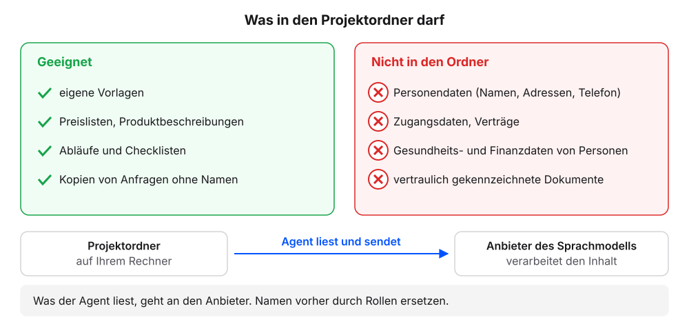
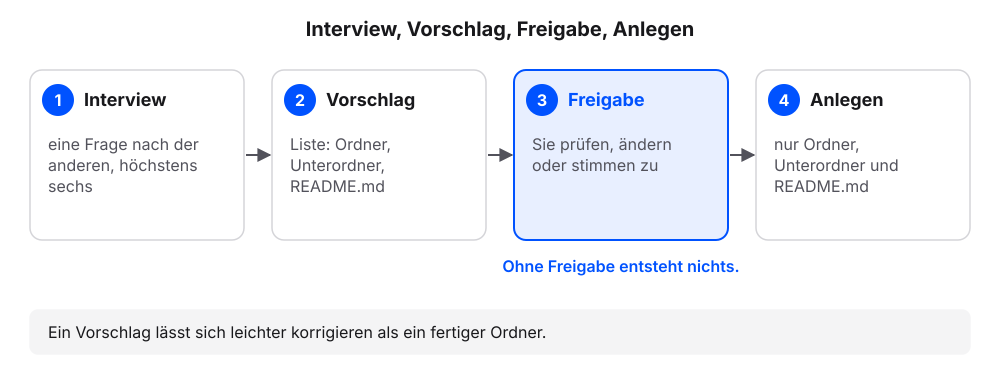
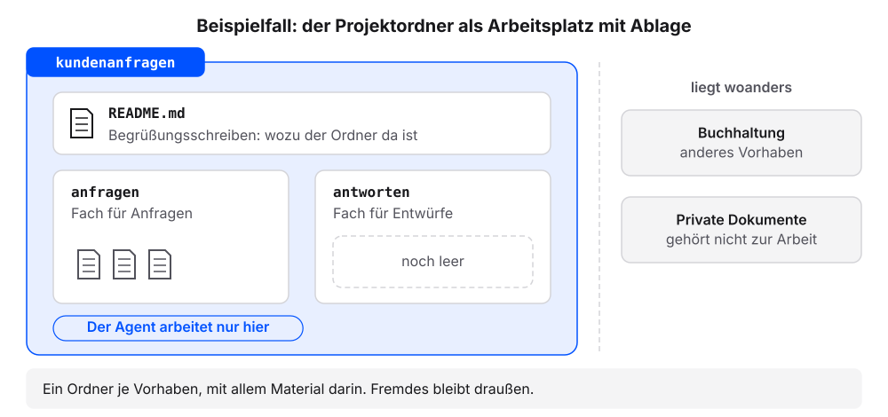
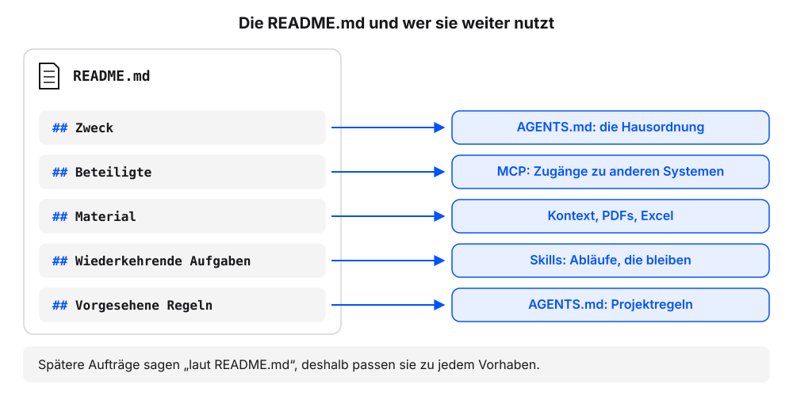

# Der Projektordner: das Interview

Der Projektordner ist der Arbeitsplatz des Agenten, mit einer beschrifteten Ablage. Alles, was er kennen soll, liegt dort als Datei. Zugleich ist der Ordner die Grenze seiner Arbeit. In diesem Kapitel entwirft der Agent den Ordner für unser eigenes Vorhaben: Er fragt nach, schlägt Ordner und eine Beschreibung vor und legt sie erst an, wenn wir zustimmen. Alle folgenden Kapitel arbeiten in diesem Ordner weiter. Wer kein eigenes Vorhaben mitbringt, nimmt den Beispielfall: die Kundenanfragen eines kleinen Betriebs.

**Voraussetzung:** Der Agent besteht die Prüfungen aus dem Kapitel [Chat oder Agent?](chat-oder-agent.qmd). Zum eigenen Vorhaben sind fünf Dinge kurz überlegt: Zweck, Beteiligte, Material, wiederkehrende Aufgaben, Regeln.

::: {.callout-important title="Was in den Projektordner darf"}
Der Ordner liegt auf dem eigenen Rechner, die Verarbeitung nicht. Der Agent sendet jede gelesene Datei und jede Antwort im Interview an den Anbieter des Sprachmodells.

- Nicht in den Ordner und nicht ins Interview: Personendaten von Kundschaft oder Kollegium (Namen, Adressen, Telefonnummern), Zugangsdaten, Verträge, Gesundheits- und Finanzdaten einzelner Personen, vertraulich gekennzeichnete Dokumente.
- Geeignet: eigene Vorlagen, Preislisten, Produktbeschreibungen, Abläufe, Kopien von Anfragen ohne Namen und Kontaktdaten. Namen vorher durch Rollen ersetzen, etwa „Kundin“.
- Im Unternehmen vor dem Ablegen echter Unterlagen klären, ob das Werkzeug freigegeben ist (IT, Datenschutz). Bis dahin mit dem Beispielfall arbeiten.
:::

{fig-alt="Zwei Spalten. Links „Geeignet“: eigene Vorlagen, Preislisten, Produktbeschreibungen, Abläufe, Kopien von Anfragen ohne Namen. Rechts „Nicht in den Ordner“: Personendaten wie Namen, Adressen und Telefonnummern, Zugangsdaten, Verträge, Gesundheits- und Finanzdaten einzelner Personen, vertraulich gekennzeichnete Dokumente. Darunter ein Pfeil vom Ordner auf dem Rechner zum Anbieter des Sprachmodells mit dem Satz: Was der Agent liest, geht an den Anbieter."}

## Das Interview führen

1. In der App den Ordner wählen, in dem die eigenen Projekte liegen sollen, etwa `Dokumente`. Der Weg ist derselbe wie im Kapitel [Chat oder Agent?](chat-oder-agent.qmd#app-einrichten), Schritt 1.
2. Diesen Auftrag senden:

   ```text
   Du richtest für mich einen Projektordner ein. Gehe so vor:

   1. Führe zuerst ein kurzes Interview. Stelle eine Frage nach der anderen und warte jeweils auf meine Antwort. Stelle höchstens sechs Fragen. Frage nach: dem Vorhaben und seinem Zweck; den beteiligten Personen oder Stellen (nur Rollen, keine Namen); dem Material, das anfällt (Art, Format, woher es kommt); den Aufgaben, die regelmäßig wiederkehren; Regeln, die bei der Arbeit immer gelten sollen. Ist eine Antwort unklar, frage einmal nach und mache dann weiter.

   2. Lege danach noch nichts an. Zeige mir zuerst einen Vorschlag als Liste:
   - Name des Projektordners: Kleinbuchstaben, keine Umlaute, Bindestrich statt Leerzeichen
   - höchstens drei Unterordner, je einer pro Art von Material, mit einem Satz, was hineingehört. Die Ordner eingang und quellen kommen später dazu; schlage sie nicht vor.
   - den Inhalt der Datei README.md mit genau diesen Abschnitten: Zweck (zwei bis drei Sätze), Beteiligte (Rollen), Material (Tabelle mit Art, Format, Ordner), Wiederkehrende Aufgaben (Liste), Vorgesehene Regeln (höchstens drei, jede so formuliert, dass man am Ergebnis prüfen kann, ob sie eingehalten wurde)

   3. Frage mich, ob du den Vorschlag so anlegen darfst oder was ich ändern will. Lege erst an, wenn ich ausdrücklich zustimme.

   4. Lege dann nur den Projektordner, die Unterordner und README.md an, keine weiteren Dateien. Nenne am Ende alles, was du angelegt hast.

   Grenzen: Erfinde keine Angaben zu meinem Vorhaben. Was ich nicht gesagt habe, lässt du weg oder markierst es mit „offen:“. Schreibe keine Personennamen in die Datei. Antworte auf Deutsch.
   ```

   Ohne eigenes Vorhaben stattdessen den Beispielfall senden und bei Schritt 5 weitermachen:

   ```text
   Lege den Projektordner kundenanfragen an. Darin die Ordner anfragen und antworten und eine Datei README.md mit genau diesem Inhalt:

   # Kundenanfragen

   ## Zweck

   Der Ordner sammelt Kundenanfragen eines kleinen Betriebs. Zu jeder Anfrage entsteht ein Antwortentwurf. Gesendet wird nichts.

   ## Beteiligte

   - eine Person im Büro, die die Anfragen bearbeitet
   - Kundschaft per E-Mail und Kontaktformular

   ## Material

   | Art | Format | Ordner |
   |---|---|---|
   | Anfrage | Markdown | anfragen |
   | Antwortentwurf | Markdown | antworten |
   | Preisliste | PDF | offen: kommt später nach quellen |

   ## Wiederkehrende Aufgaben

   - neue Anfragen einsortieren
   - Wochenbericht

   ## Vorgesehene Regeln

   - Beträge in EUR mit Komma, etwa 45,00 EUR
   - Antwortentwürfe höchstens 120 Wörter
   - Terminvorschläge immer mit Datum und Uhrzeit

   Zeige mir vorher den Plan und frage, bevor du etwas anlegst.
   ```

3. Die Fragen des Agenten einzeln beantworten. Rollen nennen, keine Namen.
4. Prüfen: Der Agent stellt höchstens sechs Fragen, eine nach der anderen.
5. Prüfen: Der Agent zeigt einen Vorschlag als Liste und fragt, bevor er etwas anlegt.
6. Den Vorschlag prüfen: höchstens drei Unterordner, alle Namen in Kleinbuchstaben ohne Umlaute und Leerzeichen. Passt etwas nicht, im Chat um die Änderung bitten.
7. Den Vorschlag freigeben.
8. Diese Frage senden:

   ```text
   Liste alle Dateien und Ordner im neuen Projektordner auf. Zeig mir dann den Inhalt der README.md genau so, wie er in der Datei steht.
   ```

9. Prüfen: Die Liste nennt `README.md` und mindestens zwei Unterordner (Beispielfall: `anfragen`, `antworten`).
10. Prüfen: Die `README.md` hat die Abschnitte Zweck, Beteiligte, Material, Wiederkehrende Aufgaben und Vorgesehene Regeln.

### So sieht ein Interview aus

Ein Beispiel aus dem Vertriebsinnendienst eines Zulieferers, gekürzt:

```{=html}
<div style="max-width:620px;border:1px solid #dcd9d2;border-radius:12px;overflow:hidden;background:#fbfaf7;color:#1f2430;margin:0 0 1rem;line-height:1.45" role="group" aria-label="Chat: Interview, Vorschlag, Freigabe und Anlegen eines Projektordners">
<div style="padding:12px;display:grid;gap:8px">
<div style="justify-self:end;max-width:94%;border-radius:10px;padding:8px 11px;background:#dfe6f3"><span style="display:block;font-size:11.5px;color:#5b6170;margin-bottom:2px">Wir</span>Du richtest für mich einen Projektordner ein. Gehe so vor: 1. Führe zuerst ein kurzes Interview … (Auftrag oben)</div>
<div style="justify-self:start;max-width:94%;border-radius:10px;padding:8px 11px;background:#f4f2ed;border:1px solid #dcd9d2"><span style="display:block;font-size:11.5px;color:#5b6170;margin-bottom:2px">Agent</span>Frage 1 von höchstens 6: Worum geht es in dem Vorhaben, und was soll am Ende herauskommen?</div>
<div style="justify-self:end;max-width:94%;border-radius:10px;padding:8px 11px;background:#dfe6f3"><span style="display:block;font-size:11.5px;color:#5b6170;margin-bottom:2px">Wir</span>Angebotsanfragen von Kunden bearbeiten. Am Ende soll je Anfrage ein Angebotsentwurf liegen.</div>
<div style="justify-self:start;max-width:94%;border-radius:10px;padding:8px 11px;background:#f4f2ed;border:1px solid #dcd9d2"><span style="display:block;font-size:11.5px;color:#5b6170;margin-bottom:2px">Agent</span>Frage 2: Wer ist beteiligt? Bitte nur Rollen, keine Namen.</div>
<div style="justify-self:end;max-width:94%;border-radius:10px;padding:8px 11px;background:#dfe6f3"><span style="display:block;font-size:11.5px;color:#5b6170;margin-bottom:2px">Wir</span>Ich im Innendienst, die Kundschaft per E-Mail, bei Sonderpreisen die Vertriebsleitung.</div>
<div style="justify-self:start;font-family:ui-monospace,SFMono-Regular,Menlo,monospace;font-size:12px;color:#5b6170;padding:0 4px"><span style="color:#b8862b;font-weight:700">› </span>Fragen 3 bis 6: Material, wiederkehrende Aufgaben, Regeln, Rückfrage</div>
<div style="justify-self:stretch;border:1px solid #d9b26a;border-radius:10px;padding:8px 11px;background:#fbf3e3"><span style="display:block;font-size:11.5px;color:#5b6170;margin-bottom:2px">Agent</span>Vorschlag, noch nichts angelegt: Projektordner <code>angebotsanfragen</code> mit <code>anfragen</code> (Anfragen als Markdown) und <code>angebote</code> (Angebotsentwürfe), dazu <code>README.md</code> mit Zweck, Beteiligte, Material, Wiederkehrende Aufgaben und Vorgesehene Regeln. Darf ich das so anlegen, oder was soll ich ändern?<br><span style="display:inline-block;margin:6px 6px 0 0;padding:2px 10px;border:1px solid #23417a;color:#23417a;border-radius:999px;font-size:12.5px;font-weight:600">Erlauben</span><span style="display:inline-block;margin:6px 6px 0 0;padding:2px 10px;border:1px solid #dcd9d2;border-radius:999px;font-size:12.5px">Ablehnen</span></div>
<div style="justify-self:start;font-family:ui-monospace,SFMono-Regular,Menlo,monospace;font-size:12px;color:#5b6170;padding:0 4px"><span style="color:#b8862b;font-weight:700">› </span>angebotsanfragen/anfragen/ angelegt</div>
<div style="justify-self:start;font-family:ui-monospace,SFMono-Regular,Menlo,monospace;font-size:12px;color:#5b6170;padding:0 4px"><span style="color:#b8862b;font-weight:700">› </span>angebotsanfragen/angebote/ angelegt</div>
<div style="justify-self:start;font-family:ui-monospace,SFMono-Regular,Menlo,monospace;font-size:12px;color:#5b6170;padding:0 4px"><span style="color:#b8862b;font-weight:700">› </span>angebotsanfragen/README.md angelegt</div>
<div style="justify-self:start;max-width:94%;border-radius:10px;padding:8px 11px;background:#f4f2ed;border:1px solid #dcd9d2"><span style="display:block;font-size:11.5px;color:#5b6170;margin-bottom:2px">Agent</span>Fertig. Angelegt: der Ordner <code>angebotsanfragen</code> mit <code>anfragen</code>, <code>angebote</code> und <code>README.md</code>. Sonst nichts.</div>
</div>
</div>
```

Fragen, Antworten und Namen weichen bei jedem Vorhaben ab, die Prüfpunkte gelten. Im Beispielfall heißt der Ordner `kundenanfragen` mit `anfragen` und `antworten`.

### Was gerade passiert ist

Wir haben nur Fragen beantwortet. Den Ordner hat der Agent aus unseren Antworten entworfen und erst nach unserer Freigabe angelegt. Ein Vorschlag lässt sich leichter korrigieren als ein fertiger Ordner.

{fig-alt="Vier Stationen von links nach rechts: 1 Interview, der Agent fragt eine Frage nach der anderen. 2 Vorschlag als Liste, noch nichts angelegt. 3 Freigabe, Sie prüfen und stimmen zu oder bitten um Änderung. 4 Anlegen, Projektordner mit Unterordnern und README.md. Unter Station 3 der Hinweis: Ohne Freigabe entsteht nichts."}

Ein **Projektordner** ist ein Ordner je Vorhaben, mit allem Material darin. Material für andere Vorhaben, etwa die Buchhaltung oder private Dokumente, liegt woanders. Diese Trennung hat zwei Gründe. Erstens weiß der Agent ohne weitere Erklärung, womit er arbeiten soll: mit allem, was im Ordner liegt. Zweitens ist klar, was er lesen und ändern darf.

Die **README.md** beschreibt für Menschen, wozu der Ordner da ist und was darin liegt. Der Name ist eine alte Konvention aus der Softwareentwicklung und bedeutet „lies mich“. Für jeden Neuen am Arbeitsplatz ist sie das Begrüßungsschreiben. Der Agent liest sie ebenfalls, wenn er sich einen Überblick verschafft. Regeln für den Agenten gehören in eine eigene Datei, die `AGENTS.md` (Kapitel [AGENTS.md: die Hausordnung](agents-md.qmd)).

{fig-alt="Ein großer Rahmen mit dem Namen kundenanfragen als Arbeitsplatz des Agenten. Darin die README.md als Begrüßungsschreiben und zwei Fächer: anfragen mit drei Dateien und antworten, noch leer. Rechts außerhalb liegen Buchhaltung und private Dokumente, beschriftet mit „liegt woanders“. Merksatz: Ein Ordner je Vorhaben, Fremdes bleibt draußen."}

Die Grenzen im Auftrag (eine Frage nach der anderen, erst vorschlagen, „offen:“ statt erfinden) senken das Risiko, dass der Agent zu viel anlegt oder Angaben erfindet. Sie schließen es nicht aus. Deshalb prüfen wir den Vorschlag vor der Freigabe.

### Wozu die fünf Abschnitte dienen

Die folgenden Kapitel arbeiten mit der `README.md` weiter. Ihre Aufträge sagen deshalb „laut README.md“ statt eines festen Ordnernamens.

{fig-alt="Eine README.md mit fünf Abschnitten, jeder mit einem Pfeil zum Kapitel, das ihn nutzt: Zweck zum Kapitel AGENTS.md, Beteiligte zum Kapitel MCP, Material zu den Kapiteln Kontext bereitstellen, PDFs und Excel, Wiederkehrende Aufgaben zum Kapitel Skills, Vorgesehene Regeln zum Kapitel AGENTS.md."}

- Zweck und Vorgesehene Regeln: Daraus entsteht die Hausordnung für den Agenten ([AGENTS.md: die Hausordnung](agents-md.qmd)).
- Material: Hier steht, welcher Ordner welche Dateien aufnimmt ([Erstes Material und neue Sitzung](erstes-material.qmd), [Kontext bereitstellen](kontext-bereitstellen.qmd), [PDFs als Quellen](pdf-als-quelle.qmd), [Excel-Tabellen als Quelle](excel-als-quelle.qmd)).
- Wiederkehrende Aufgaben: Daraus wird ein eigener Skill ([Skills: Abläufe, die bleiben](skills.qmd)). Beteiligte: Hier zeigt sich, ob der Agent andere Systeme erreichen muss ([MCP](mcp.qmd)).
- Steht in einem Abschnitt „offen:“, ergänzen wir ihn später im Chat, etwa „Ergänze in README.md unter Material: …“.

::: {.callout-note title="Wenn es anders aussieht"}
- Der Agent stellt alle Fragen auf einmal: „Stelle die Fragen einzeln, eine nach der anderen.“
- Der Agent legt an, bevor wir zugestimmt haben: „Zeige mir, was du angelegt hast, und lösche es. Zeige mir dann zuerst den Vorschlag.“ Danach die Liste prüfen.
- Der Vorschlag enthält Angaben, die wir nicht gemacht haben: „Streiche alles, was ich nicht gesagt habe, oder markiere es mit offen:.“
- Ein Name enthält Umlaute, Großbuchstaben oder Leerzeichen, oder es sind mehr als drei Unterordner: vor der Freigabe um die Änderung bitten, etwa „Benenne den Ordner in angebotsanfragen um und lass vorlagen weg.“
- Der Vorschlag nennt einen anderen Ort als gewünscht: ablehnen, in der App den richtigen Ordner wählen und den Auftrag erneut senden.
:::
