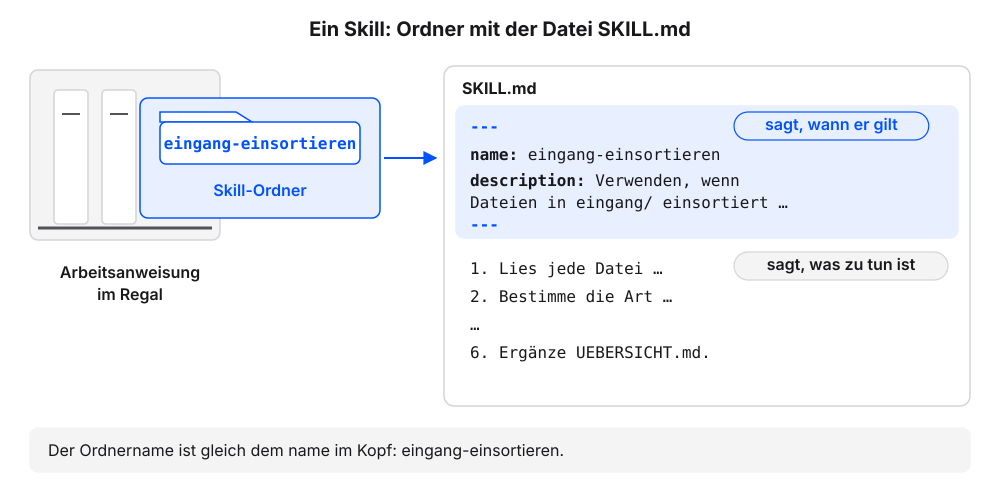
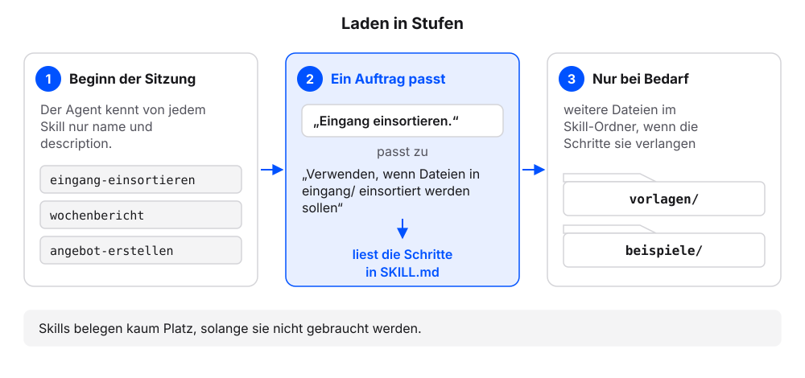
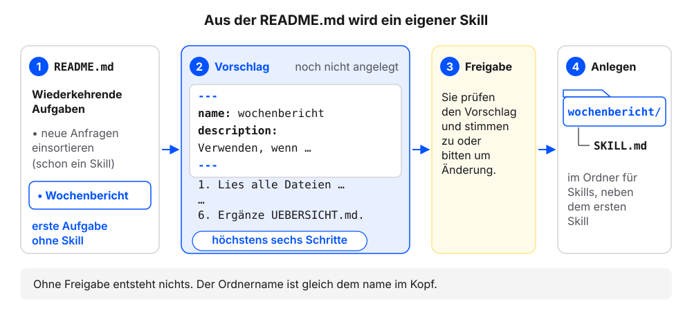
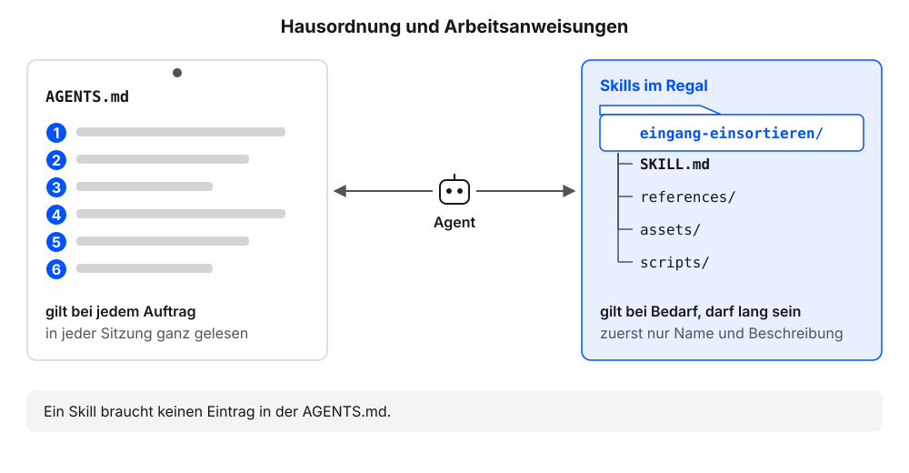

# Skills: Abläufe, die bleiben

Den Ablauf zum Einsortieren aus dem Kapitel [Laufend neue Dateien](laufend-neue-dateien.qmd) haben wir als langen Auftrag mit sechs Schritten geschickt. Jede Woche kommt neue Post, und jede Woche müssten wir den Auftrag wieder einfügen, ohne Tippfehler und ohne einen Schritt zu vergessen. Ein Skill hält einen solchen Ablauf als Datei im Ordner fest. Wir legen mit dem eigenen Agenten Schritt für Schritt einen Skill an und lösen ihn mit einem kurzen Auftrag aus. Im dritten, freiwilligen Schritt machen wir aus einer Aufgabe der eigenen `README.md` einen zweiten Skill. Die Erklärung folgt jeweils am eigenen Ergebnis.

Jeder Schritt hat denselben Aufbau: ein Auftrag zum Kopieren, ein Kasten „So sieht es im Beispielfall aus“, eine kurze Erklärung und ein Abschnitt „Wenn es anders aussieht“.

**Voraussetzung:** Der eigene Projektordner ist in der App des Agenten gewählt (Beispielfall: `kundenanfragen`). Der Ordner `eingang/` ist leer (Stand nach dem Kapitel [Laufend neue Dateien](laufend-neue-dateien.qmd)).

## Schritt 1: Den Skill anlegen

1. Diese Frage senden:

   ```text
   In welchem Ordner erwartest du Skills für dieses Projekt, und in welchem für alle Projekte? Welche Skills kennst du gerade? Nur auflisten.
   ```

2. Prüfen: Der Agent nennt einen Ordner für Skills in diesem Projekt.
3. Diesen Auftrag senden:

   ```text
   Erstelle einen Skill mit dem Namen eingang-einsortieren an dem Ort, an dem du Skills in diesem Projekt erwartest. Die Datei SKILL.md beginnt mit Frontmatter: name: eingang-einsortieren, description: Verwenden, wenn Dateien in eingang/ einsortiert werden sollen. Danach diese sechs Schritte, wörtlich: 1. Lies jede Datei in eingang/. 2. Bestimme die Art: eine Art aus dem Abschnitt Material der README.md, Quelle oder sonstiges. 3. Benenne um nach JJJJ-MM-TT-anliegen.md mit dem Datum aus der Datei, sonst heute. PDF und andere Dateien, die kein Text sind, behalten ihre Endung. 4. Entferne Personennamen und ersetze sie durch Rollen wie „Kundin“ oder „Kunde“. 5. Verschiebe in den Ordner, den README.md für diese Art nennt, Quellen nach quellen/original/; unklare Dateien bleiben in eingang/ und werden gemeldet. 6. Ergänze UEBERSICHT.md. Zum Schluss der Satz: Zeige vor dem Verschieben den Plan als Tabelle (alt, neu, Ziel). Nenne mir den vollständigen Pfad der Datei.
   ```

4. Das Anlegen freigeben.
5. Prüfen: Der Agent nennt einen Pfad, der auf `eingang-einsortieren/SKILL.md` endet.
6. Liegt der Pfad nicht im Skills-Ordner, den der Agent genannt hat: „Verschiebe den Ordner eingang-einsortieren in den Ordner für Skills, den du genannt hast.“ senden.
7. Diese Frage senden:

   ```text
   Zeig mir den Inhalt von SKILL.md im Skill eingang-einsortieren genau so, wie er in der Datei steht, mit allen Zeichen.
   ```

8. Prüfen: Zeile 1 lautet `---`. Darunter stehen `name` und `description`, dann folgt eine zweite Zeile `---`.

### So sieht es im Beispielfall aus

Unsere Namen weichen ab, die Prüfpunkte gelten.

```{=html}
<div style="max-width:620px;border:1px solid #dcd9d2;border-radius:12px;overflow:hidden;background:#fbfaf7;color:#1f2430;margin:0 0 1rem;line-height:1.45"><div style="padding:12px;display:grid;gap:8px"><div style="justify-self:end;max-width:94%;border-radius:10px;padding:8px 11px;background:#dfe6f3"><span style="display:block;font-size:11.5px;color:#5b6170;margin-bottom:2px">Wir</span>In welchem Ordner erwartest du Skills für dieses Projekt, und in welchem für alle Projekte? Welche Skills kennst du gerade? Nur auflisten.</div>
<div style="justify-self:start;max-width:94%;border-radius:10px;padding:8px 11px;background:#f4f2ed;border:1px solid #dcd9d2"><span style="display:block;font-size:11.5px;color:#5b6170;margin-bottom:2px">Agent</span><p style="margin:0 0 4px">Skills für dieses Projekt erwarte ich in <code>.agents/skills/</code> innerhalb von <code>kundenanfragen</code>. Skills für alle Projekte liegen in einem Ordner im Benutzerordner des Rechners.</p><p style="margin:0 0 4px">Gerade kenne ich keine Skills.</p></div>
<div style="justify-self:end;max-width:94%;border-radius:10px;padding:8px 11px;background:#dfe6f3"><span style="display:block;font-size:11.5px;color:#5b6170;margin-bottom:2px">Wir</span>Erstelle einen Skill mit dem Namen eingang-einsortieren an dem Ort, an dem du Skills in diesem Projekt erwartest. Die Datei SKILL.md beginnt mit Frontmatter: name: eingang-einsortieren, description: Verwenden, wenn Dateien in eingang/ einsortiert werden sollen. Danach diese sechs Schritte, wörtlich: 1. Lies jede Datei in eingang/. 2. Bestimme die Art: eine Art aus dem Abschnitt Material der README.md, Quelle oder sonstiges. 3. Benenne um nach JJJJ-MM-TT-anliegen.md mit dem Datum aus der Datei, sonst heute. PDF und andere Dateien, die kein Text sind, behalten ihre Endung. 4. Entferne Personennamen und ersetze sie durch Rollen wie „Kundin“ oder „Kunde“. 5. Verschiebe in den Ordner, den README.md für diese Art nennt, Quellen nach quellen/original/; unklare Dateien bleiben in eingang/ und werden gemeldet. 6. Ergänze UEBERSICHT.md. Zum Schluss der Satz: Zeige vor dem Verschieben den Plan als Tabelle (alt, neu, Ziel). Nenne mir den vollständigen Pfad der Datei.</div>
<div style="justify-self:stretch;border:1px solid #d9b26a;border-radius:10px;padding:8px 11px;background:#fbf3e3"><span style="display:block;font-size:11.5px;color:#5b6170;margin-bottom:2px">Agent</span>Ich lege in <code>.agents/skills/</code> den Ordner <code>eingang-einsortieren</code> an und darin <code>SKILL.md</code> mit Kopf und sechs Schritten. Darf ich?<br><span style="display:inline-block;margin:6px 6px 0 0;padding:2px 10px;border:1px solid #23417a;color:#23417a;border-radius:999px;font-size:12.5px;font-weight:600">Erlauben</span><span style="display:inline-block;margin:6px 6px 0 0;padding:2px 10px;border:1px solid #dcd9d2;border-radius:999px;font-size:12.5px">Ablehnen</span></div>
<div style="justify-self:start;font-family:ui-monospace,SFMono-Regular,Menlo,monospace;font-size:12px;color:#5b6170;padding:0 4px"><span style="color:#b8862b;font-weight:700">› </span>.agents/skills/eingang-einsortieren/SKILL.md angelegt</div>
<div style="justify-self:start;max-width:94%;border-radius:10px;padding:8px 11px;background:#f4f2ed;border:1px solid #dcd9d2"><span style="display:block;font-size:11.5px;color:#5b6170;margin-bottom:2px">Agent</span>Fertig. Eine Datei angelegt. Pfad: <code>kundenanfragen/.agents/skills/eingang-einsortieren/SKILL.md</code></div>
<div style="justify-self:end;max-width:94%;border-radius:10px;padding:8px 11px;background:#dfe6f3"><span style="display:block;font-size:11.5px;color:#5b6170;margin-bottom:2px">Wir</span>Zeig mir den Inhalt von SKILL.md im Skill eingang-einsortieren genau so, wie er in der Datei steht, mit allen Zeichen.</div>
<div style="justify-self:start;max-width:94%;border-radius:10px;padding:8px 11px;background:#f4f2ed;border:1px solid #dcd9d2"><span style="display:block;font-size:11.5px;color:#5b6170;margin-bottom:2px">Agent</span>Inhalt von <code>SKILL.md</code>:<pre style="margin:6px 0 0;padding:8px 10px;border:1px solid #dcd9d2;border-radius:8px;background:#fbfaf7;font-family:ui-monospace,SFMono-Regular,Menlo,monospace;font-size:.85rem;line-height:1.6;white-space:pre-wrap;word-break:break-word"><span style="color:#5b6170;opacity:.6;display:inline-block;width:22px">1</span><i style="color:#23417a;font-style:normal;font-weight:700">---</i>
<span style="color:#5b6170;opacity:.6;display:inline-block;width:22px">2</span><b>name:</b> eingang-einsortieren
<span style="color:#5b6170;opacity:.6;display:inline-block;width:22px">3</span><b>description:</b> Verwenden, wenn Dateien in eingang/ einsortiert werden sollen.
<span style="color:#5b6170;opacity:.6;display:inline-block;width:22px">4</span><i style="color:#23417a;font-style:normal;font-weight:700">---</i>
<span style="color:#5b6170;opacity:.6;display:inline-block;width:22px">5</span>
<span style="color:#5b6170;opacity:.6;display:inline-block;width:22px">6</span><i style="color:#23417a;font-style:normal;font-weight:700">#</i> Eingang einsortieren
<span style="color:#5b6170;opacity:.6;display:inline-block;width:22px">7</span>
<span style="color:#5b6170;opacity:.6;display:inline-block;width:22px">8</span>1. Lies jede Datei in eingang/.
<span style="color:#5b6170;opacity:.6;display:inline-block;width:22px">9</span>2. Bestimme die Art: eine Art aus dem Abschnitt Material der README.md, Quelle oder sonstiges.
<span style="color:#5b6170;opacity:.6;display:inline-block;width:22px">10</span>3. Benenne um nach JJJJ-MM-TT-anliegen.md mit dem Datum aus der Datei, sonst heute. PDF und andere Dateien, die kein Text sind, behalten ihre Endung.
<span style="color:#5b6170;opacity:.6;display:inline-block;width:22px">11</span>4. Entferne Personennamen und ersetze sie durch Rollen wie „Kundin“ oder „Kunde“.
<span style="color:#5b6170;opacity:.6;display:inline-block;width:22px">12</span>5. Verschiebe in den Ordner, den README.md für diese Art nennt, Quellen nach quellen/original/; unklare Dateien bleiben in eingang/ und werden gemeldet.
<span style="color:#5b6170;opacity:.6;display:inline-block;width:22px">13</span>6. Ergänze UEBERSICHT.md.
<span style="color:#5b6170;opacity:.6;display:inline-block;width:22px">14</span>
<span style="color:#5b6170;opacity:.6;display:inline-block;width:22px">15</span>Zeige vor dem Verschieben den Plan als Tabelle (alt, neu, Ziel).</pre></div></div></div>
```

Zeilen 1 bis 4 sind der Kopf, darunter stehen die Schritte. Der Skills-Ordner hängt von der App ab, hier `.agents/skills/` wie bei Codex und Antigravity; die Antwort auf die erste Frage nennt den eigenen. Überschrift und Leerzeilen können etwas anders aussehen.

### Was gerade passiert ist

Der Agent hat einen Ordner mit dem Namen des Skills angelegt und darin die Datei `SKILL.md`. Welche Arten und Zielordner es gibt, steht nicht im Skill, sondern in der `README.md`. Weil Schritt 2 und 5 auf sie verweisen, passt derselbe Skill zu jedem Projektordner. Ein **Skill** ist genau das: ein Ordner mit dem Namen des Skills und darin die Datei `SKILL.md`, die einen wiederkehrenden Ablauf in Schritten beschreibt. Das Format heißt [Agent Skills](https://agentskills.io/). Es ist offen beschrieben und wird von vielen Agenten gelesen. Beim neuen Mitarbeiter wäre ein Skill eine Arbeitsanweisung im Regal: Er kennt die Titel und zieht die passende heraus, wenn ein Auftrag danach verlangt.

Die Datei hat zwei Teile. Unten stehen die Schritte in gewöhnlichem Markdown. Oben steht der Kopf zwischen zwei Zeilen `---`, das **Frontmatter**. Es enthält Angaben über die Datei, die nicht zum eigentlichen Text gehören. Im Frontmatter eines Skills sind zwei Felder Pflicht:

| Feld | Regel laut Spezifikation | Beispiel |
|---|---|---|
| `name` | 1 bis 64 Zeichen, nur Kleinbuchstaben, Ziffern und Bindestriche; gleich dem Namen des Skill-Ordners | `eingang-einsortieren` |
| `description` | 1 bis 1024 Zeichen; sagt, was der Skill tut und wann er gilt | `Verwenden, wenn Dateien in eingang/ einsortiert werden sollen.` |

{fig-alt="Links ein Regal mit drei Ordnern, einer herausgezogen und beschriftet eingang-einsortieren, Untertitel: Arbeitsanweisung im Regal. Rechts die Datei SKILL.md in zwei Teilen: oben der Kopf zwischen zwei Zeilen mit drei Bindestrichen, darin name: eingang-einsortieren und description: Verwenden, wenn Dateien in eingang/ einsortiert werden sollen, beschriftet: sagt, wann der Skill gilt; unten die sechs Schritte, beschriftet: sagt, was zu tun ist. Merksatz: Ordnername gleich name."}

Nach der Beschreibung entscheidet der Agent, ob er den Skill für einen Auftrag holt. Eine Beschreibung beginnt am besten mit „Verwenden, wenn …“ und nennt die Situation in den Worten, in denen wir den Auftrag später schreiben. Wo der Skills-Ordner liegt, hängt vom Werkzeug ab: Meist gibt es einen Ort für Skills eines Projekts, innerhalb des Projektordners, und einen für Skills, die in allen Projekten gelten. Deshalb die Frage an den Agenten.

| Werkzeug | Skills-Ordner im Projekt | Skills-Ordner für alle Projekte |
|---|---|---|
| Claude Code | `.claude/skills/`[^cc-skills] | `~/.claude/skills/` |
| Codex | `.agents/skills/`[^cx-skills] | `~/.agents/skills/` |
| Antigravity | `.agents/skills/`[^ag-skills] | `~/.gemini/config/skills/` |

: Stand: 18. Oktober 2026. Ein Punkt am Anfang eines Ordnernamens bedeutet, dass der Ordner im Dateimanager meist ausgeblendet ist. Ein Pfad mit `~` liegt im eigenen Benutzerordner. Weicht der eigene Agent ab, gilt seine Selbstauskunft.

[^cc-skills]: Claude Code, „Skills“: <https://code.claude.com/docs/en/skills>
[^cx-skills]: Codex, „Build skills“: <https://learn.chatgpt.com/docs/build-skills>
[^ag-skills]: Antigravity, „Skills“: <https://antigravity.google/docs/skills/>

::: {.callout-note title="Wenn es anders aussieht"}
- Der Agent nennt nur einen Ordner für alle Projekte: den Ort für Projekt-Skills aus der Tabelle oben nutzen.
- Der Skill-Ordner heißt anders als der Name im Kopf, etwa `Eingang einsortieren`: „Benenne den Skill-Ordner in eingang-einsortieren um.“
- Die Zeilen `---` fehlen: „Setze name und description in SKILL.md zwischen zwei Zeilen mit ---.“
- Die Schritte stehen als Fließtext statt als Liste: Das ist meist in Ordnung, solange alle sechs Schritte enthalten sind.
:::

## Schritt 2: Der kurze Auftrag

**Voraussetzung:** `SKILL.md` aus Schritt 1 liegt im Skill-Ordner `eingang-einsortieren`.

1. Diesen Auftrag senden:

   ```text
   Lege in eingang/ eine neue Beispieldatei mit unordentlichem Dateinamen an, passend zu meinem Vorhaben laut README.md.
   ```

2. Das Anlegen freigeben.
3. In der App einen neuen Chat im Projektordner beginnen. Das ist eine neue Sitzung (Kapitel [Erstes Material und neue Sitzung](erstes-material.qmd)).
4. Diesen Auftrag senden:

   ```text
   Eingang einsortieren.
   ```

5. Prüfen: Der Agent zeigt den Plan als Tabelle mit alt, neu und Ziel. Die sechs Schritte wurden in dieser Sitzung nicht genannt.
6. Den Plan freigeben.
7. Diese Frage senden:

   ```text
   Liste die Dateien in eingang/ und im Zielordner aus dem Plan auf. Zeig mir die neue Zeile in UEBERSICHT.md.
   ```

8. Prüfen: Die Liste nennt für `eingang/` keine Datei. Die neue Datei liegt im Zielordner aus dem Plan und steht in `UEBERSICHT.md` (Beispielfall: `anfragen/`).

### So sieht es im Beispielfall aus

Unsere Namen weichen ab, die Prüfpunkte gelten.

```{=html}
<div style="max-width:620px;border:1px solid #dcd9d2;border-radius:12px;overflow:hidden;background:#fbfaf7;color:#1f2430;margin:0 0 1rem;line-height:1.45"><div style="display:flex;align-items:center;gap:8px;padding:7px 12px;background:#f4f2ed;border-bottom:1px solid #dcd9d2;font-size:12px;color:#5b6170">Neue Sitzung</div><div style="padding:12px;display:grid;gap:8px"><div style="justify-self:end;max-width:94%;border-radius:10px;padding:8px 11px;background:#dfe6f3"><span style="display:block;font-size:11.5px;color:#5b6170;margin-bottom:2px">Wir</span>Eingang einsortieren.</div>
<div style="justify-self:start;font-family:ui-monospace,SFMono-Regular,Menlo,monospace;font-size:12px;color:#5b6170;padding:0 4px"><span style="color:#b8862b;font-weight:700">› </span>liest .agents/skills/eingang-einsortieren/SKILL.md</div>
<div style="justify-self:start;font-family:ui-monospace,SFMono-Regular,Menlo,monospace;font-size:12px;color:#5b6170;padding:0 4px"><span style="color:#b8862b;font-weight:700">› </span>liest README.md</div>
<div style="justify-self:start;font-family:ui-monospace,SFMono-Regular,Menlo,monospace;font-size:12px;color:#5b6170;padding:0 4px"><span style="color:#b8862b;font-weight:700">› </span>liest eingang/neue anfrage (2).txt</div>
<div style="justify-self:stretch;border:1px solid #d9b26a;border-radius:10px;padding:8px 11px;background:#fbf3e3"><span style="display:block;font-size:11.5px;color:#5b6170;margin-bottom:2px">Agent</span><p style="margin:0 0 4px">Ich verwende den Skill <code>eingang-einsortieren</code>. Plan für <code>eingang/</code>:</p><table style="border-collapse:collapse;font-size:.9rem;margin-top:4px"><thead><tr><th style="border:1px solid #dcd9d2;padding:4px 8px;text-align:left;background:#f4f2ed">alt</th><th style="border:1px solid #dcd9d2;padding:4px 8px;text-align:left;background:#f4f2ed">neu</th><th style="border:1px solid #dcd9d2;padding:4px 8px;text-align:left;background:#f4f2ed">Ziel</th></tr></thead><tbody><tr><td style="border:1px solid #dcd9d2;padding:4px 8px;text-align:left"><code>neue anfrage (2).txt</code></td><td style="border:1px solid #dcd9d2;padding:4px 8px;text-align:left"><code>2026-10-20-terminwunsch.md</code></td><td style="border:1px solid #dcd9d2;padding:4px 8px;text-align:left"><code>anfragen/</code></td></tr></tbody></table><p style="margin:0 0 4px">Danach ergänze ich <code>UEBERSICHT.md</code>. Soll ich verschieben?</p><br><span style="display:inline-block;margin:6px 6px 0 0;padding:2px 10px;border:1px solid #23417a;color:#23417a;border-radius:999px;font-size:12.5px;font-weight:600">Erlauben</span><span style="display:inline-block;margin:6px 6px 0 0;padding:2px 10px;border:1px solid #dcd9d2;border-radius:999px;font-size:12.5px">Ablehnen</span></div>
<div style="justify-self:start;font-family:ui-monospace,SFMono-Regular,Menlo,monospace;font-size:12px;color:#5b6170;padding:0 4px"><span style="color:#b8862b;font-weight:700">› </span>eingang/neue anfrage (2).txt verschoben nach anfragen/2026-10-20-terminwunsch.md</div>
<div style="justify-self:start;font-family:ui-monospace,SFMono-Regular,Menlo,monospace;font-size:12px;color:#5b6170;padding:0 4px"><span style="color:#b8862b;font-weight:700">› </span>UEBERSICHT.md geändert</div>
<div style="justify-self:start;max-width:94%;border-radius:10px;padding:8px 11px;background:#f4f2ed;border:1px solid #dcd9d2"><span style="display:block;font-size:11.5px;color:#5b6170;margin-bottom:2px">Agent</span>Fertig. <code>eingang/</code> ist leer, eine Datei nach <code>anfragen/</code> verschoben, eine Zeile in <code>UEBERSICHT.md</code> ergänzt.</div>
<div style="justify-self:end;max-width:94%;border-radius:10px;padding:8px 11px;background:#dfe6f3"><span style="display:block;font-size:11.5px;color:#5b6170;margin-bottom:2px">Wir</span>Liste die Dateien in eingang/ und im Zielordner aus dem Plan auf. Zeig mir die neue Zeile in UEBERSICHT.md.</div>
<div style="justify-self:start;max-width:94%;border-radius:10px;padding:8px 11px;background:#f4f2ed;border:1px solid #dcd9d2"><span style="display:block;font-size:11.5px;color:#5b6170;margin-bottom:2px">Agent</span><p style="margin:0 0 4px"><code>eingang/</code>: keine Dateien.</p><p style="margin:0 0 4px"><code>anfragen/</code>: 2026-10-05-terminwunsch.md, 2026-10-06-preisfrage.md, 2026-10-07-beschwerde.md, 2026-10-16-rueckruf.md, 2026-10-17-preisfrage.md, 2026-10-20-terminwunsch.md.</p><p style="margin:0 0 4px">Neue Zeile in <code>UEBERSICHT.md</code>:</p><pre style="margin:6px 0 0;padding:8px 10px;border:1px solid #dcd9d2;border-radius:8px;background:#fbfaf7;font-family:ui-monospace,SFMono-Regular,Menlo,monospace;font-size:.85rem;line-height:1.6;white-space:pre-wrap;word-break:break-word"><span style="display:block;background:#d9e4f5">+ | anfragen/2026-10-20-terminwunsch.md | Termin für eine Reparatur | 2026-10-20 |</span></pre></div></div></div>
```

Dateiname, Datum und Anliegen hängen von der Beispieldatei ab. Entscheidend: die Zeile „liest … SKILL.md“, die drei Spalten und die Rückfrage, obwohl wir die sechs Schritte nicht genannt haben.

### Was gerade passiert ist

In der neuen Sitzung kannte der Agent die sechs Schritte nicht aus dem Chat. Er hat sie aus unserer `SKILL.md` geholt, weil der Auftrag zur Beschreibung passte. Das ist der übliche **Aufruf** eines Skills: Ein Auftrag, der zur Beschreibung passt, genügt. „Eingang einsortieren.“ passt zu „Verwenden, wenn Dateien in eingang/ einsortiert werden sollen.“ Manche Werkzeuge bieten zusätzlich einen direkten Aufruf mit einem Schrägstrich und dem Namen, etwa `/eingang-einsortieren`.

Möglich ist das, weil der Agent Skills in Stufen lädt. Dieses **Laden in Stufen** sorgt dafür, dass Skills kaum Platz im Kontext belegen, solange sie nicht gebraucht werden:

| Stufe | Was der Agent liest | Wann |
|---|---|---|
| 1 | `name` und `description` jedes Skills | zu Beginn der Sitzung |
| 2 | die Schritte in der `SKILL.md` | wenn ein Auftrag zur Beschreibung passt |
| 3 | weitere Dateien im Skill-Ordner, etwa Vorlagen | nur wenn die Schritte sie verlangen |

{fig-alt="Drei Stufen von links nach rechts. Stufe 1, Beginn der Sitzung: Der Agent kennt von jedem Skill nur name und description. Stufe 2, ein Auftrag passt: Der Auftrag „Eingang einsortieren.“ trifft die Beschreibung „Verwenden, wenn Dateien in eingang/ einsortiert werden sollen“, der Agent liest die Schritte in SKILL.md. Stufe 3, nur bei Bedarf: weitere Dateien im Skill-Ordner, etwa Vorlagen. Merksatz: Skills belegen kaum Platz, solange sie nicht gebraucht werden."}

Die Zeilen „liest … SKILL.md“ und „liest README.md“ im Kasten zeigen das Holen. Die Plan-Tabelle stammt aus dem letzten Satz unserer `SKILL.md`. Was wir im Kapitel [Laufend neue Dateien](laufend-neue-dateien.qmd) jedes Mal in den Auftrag schreiben mussten, steht jetzt dauerhaft im Ordner.

::: {.callout-note title="Wenn es anders aussieht"}
- Der Agent fragt nach den Schritten oder sortiert ohne Plan: Diese Frage senden und den genannten Ort mit der Tabelle in Schritt 1 vergleichen.

  ```text
  Welche Skills kennst du, und wo hast du gesucht?
  ```

  Fehlt `eingang-einsortieren`, den Agenten den Skill-Ordner an einen der genannten Orte verschieben lassen. Danach eine neue Sitzung starten.
- Manche Werkzeuge erkennen einen neuen Skill erst in einer neuen Sitzung. Deshalb starten wir vor dem kurzen Auftrag eine neue Sitzung.
- Der Plan hat andere Spaltennamen: Das ist in Ordnung, solange alter Name, neuer Name und Zielordner erkennbar sind.
:::

## Schritt 3: Die eigene wiederkehrende Aufgabe als Skill (freiwillig)

Dieser Schritt ist freiwillig. Er macht aus einer Aufgabe der eigenen `README.md` einen zweiten Skill.

**Voraussetzung:** Der Skill `eingang-einsortieren` aus Schritt 1 liegt im Skills-Ordner. Die `README.md` hat den Abschnitt Wiederkehrende Aufgaben (Kapitel [Der Projektordner: das Interview](projektordner.qmd)). Im Beispielfall schlägt der Agent den Skill `wochenbericht` vor.

1. Diesen Auftrag senden:

   ```text
   Lies den Abschnitt Wiederkehrende Aufgaben in README.md. Nimm die erste Aufgabe, für die es noch keinen Skill gibt. Schlage dafür eine SKILL.md vor: Frontmatter mit name (Kleinbuchstaben, Ziffern, Bindestriche) und description, die mit „Verwenden, wenn“ beginnt; darunter höchstens sechs nummerierte Schritte. Nimm Ordnernamen aus dem Abschnitt Material der README.md. Nur vorschlagen, nichts anlegen. Frage mich, ob du den Skill so anlegen darfst.

   Nach meiner Freigabe: Lege den Skill im selben Ordner für Skills an wie eingang-einsortieren. Nenne den vollständigen Pfad und zeige die ersten vier Zeilen der Datei mit allen Zeichen.
   ```

2. Prüfen: Der Agent zeigt den Vorschlag und fragt, bevor er etwas anlegt.
3. Den Vorschlag prüfen: Jeder Schritt ist eine Handlung, die zur Aufgabe gehört. Fehlt etwas oder stimmt etwas nicht, im Chat um Änderung bitten.
4. Den Vorschlag freigeben.
5. Prüfen: Der Pfad endet auf `<name>/SKILL.md`. Der Ordnername ist gleich dem Wert von `name` im Kopf (Beispielfall: `wochenbericht/SKILL.md`).
6. Prüfen: Die `description` beginnt mit „Verwenden, wenn“.

### So sieht es im Beispielfall aus

Unsere Namen weichen ab, die Prüfpunkte gelten.

```{=html}
<div style="max-width:620px;border:1px solid #dcd9d2;border-radius:12px;overflow:hidden;background:#fbfaf7;color:#1f2430;margin:0 0 1rem;line-height:1.45" role="group" aria-label="Beispielfall: Vorschlag und Anlegen des Skills wochenbericht"><div style="padding:12px;display:grid;gap:8px"><div style="justify-self:end;max-width:94%;border-radius:10px;padding:8px 11px;background:#dfe6f3"><span style="display:block;font-size:11.5px;color:#5b6170;margin-bottom:2px">Wir</span>Lies den Abschnitt Wiederkehrende Aufgaben in README.md. Nimm die erste Aufgabe, für die es noch keinen Skill gibt. Schlage dafür eine SKILL.md vor: … Nur vorschlagen, nichts anlegen. Frage mich, ob du den Skill so anlegen darfst. …</div>
<div style="justify-self:start;font-family:ui-monospace,SFMono-Regular,Menlo,monospace;font-size:12px;color:#5b6170;padding:0 4px"><span style="color:#b8862b;font-weight:700">› </span>liest README.md</div>
<div style="justify-self:start;max-width:94%;border-radius:10px;padding:8px 11px;background:#f4f2ed;border:1px solid #dcd9d2"><span style="display:block;font-size:11.5px;color:#5b6170;margin-bottom:2px">Agent</span><p style="margin:0 0 4px">Unter Wiederkehrende Aufgaben stehen „neue Anfragen einsortieren“ (dafür gibt es <code>eingang-einsortieren</code>) und „Wochenbericht“. Vorschlag für den Wochenbericht:</p><pre style="margin:6px 0 0;padding:8px 10px;border:1px solid #dcd9d2;border-radius:8px;background:#fbfaf7;font-family:ui-monospace,SFMono-Regular,Menlo,monospace;font-size:.85rem;line-height:1.6;white-space:pre-wrap;word-break:break-word"><span style="color:#5b6170;opacity:.6;display:inline-block;width:22px">1</span><i style="color:#23417a;font-style:normal;font-weight:700">---</i>
<span style="color:#5b6170;opacity:.6;display:inline-block;width:22px">2</span><b>name:</b> wochenbericht
<span style="color:#5b6170;opacity:.6;display:inline-block;width:22px">3</span><b>description:</b> Verwenden, wenn ein Wochenbericht zu den Anfragen in anfragen/ erstellt werden soll.
<span style="color:#5b6170;opacity:.6;display:inline-block;width:22px">4</span><i style="color:#23417a;font-style:normal;font-weight:700">---</i>
<span style="color:#5b6170;opacity:.6;display:inline-block;width:22px">5</span>
<span style="color:#5b6170;opacity:.6;display:inline-block;width:22px">6</span><i style="color:#23417a;font-style:normal;font-weight:700">#</i> Wochenbericht
<span style="color:#5b6170;opacity:.6;display:inline-block;width:22px">7</span>
<span style="color:#5b6170;opacity:.6;display:inline-block;width:22px">8</span>1. Lies alle Dateien in anfragen/ der letzten sieben Tage. Das Datum steht vorn im Dateinamen.
<span style="color:#5b6170;opacity:.6;display:inline-block;width:22px">9</span>2. Zähle die Anfragen je Anliegen.
<span style="color:#5b6170;opacity:.6;display:inline-block;width:22px">10</span>3. Prüfe je Anfrage, ob in antworten/ ein Entwurf mit demselben Datum und Anliegen liegt. Anfragen ohne Entwurf sind offen.
<span style="color:#5b6170;opacity:.6;display:inline-block;width:22px">11</span>4. Lege den Bericht als antworten/JJJJ-MM-TT-wochenbericht-entwurf.md an: eine Tabelle mit Anliegen und Anzahl, darunter die offenen Anfragen als Liste.
<span style="color:#5b6170;opacity:.6;display:inline-block;width:22px">12</span>5. Schreibe „Annahme:“ vor jede Angabe, die nicht aus den Dateien stammt.
<span style="color:#5b6170;opacity:.6;display:inline-block;width:22px">13</span>6. Ergänze UEBERSICHT.md.</pre><p style="margin:0 0 4px">Ordner: <code>.agents/skills/wochenbericht/</code>. Darf ich den Skill so anlegen, oder was soll ich ändern?</p></div>
<div style="justify-self:end;max-width:94%;border-radius:10px;padding:8px 11px;background:#dfe6f3"><span style="display:block;font-size:11.5px;color:#5b6170;margin-bottom:2px">Wir</span>Ja, lege ihn so an.</div>
<div style="justify-self:start;font-family:ui-monospace,SFMono-Regular,Menlo,monospace;font-size:12px;color:#5b6170;padding:0 4px"><span style="color:#b8862b;font-weight:700">› </span>.agents/skills/wochenbericht/SKILL.md angelegt</div>
<div style="justify-self:start;max-width:94%;border-radius:10px;padding:8px 11px;background:#f4f2ed;border:1px solid #dcd9d2"><span style="display:block;font-size:11.5px;color:#5b6170;margin-bottom:2px">Agent</span>Fertig. Pfad: <code>kundenanfragen/.agents/skills/wochenbericht/SKILL.md</code>. Die ersten vier Zeilen:<pre style="margin:6px 0 0;padding:8px 10px;border:1px solid #dcd9d2;border-radius:8px;background:#fbfaf7;font-family:ui-monospace,SFMono-Regular,Menlo,monospace;font-size:.85rem;line-height:1.6;white-space:pre-wrap;word-break:break-word"><span style="color:#5b6170;opacity:.6;display:inline-block;width:22px">1</span><i style="color:#23417a;font-style:normal;font-weight:700">---</i>
<span style="color:#5b6170;opacity:.6;display:inline-block;width:22px">2</span><b>name:</b> wochenbericht
<span style="color:#5b6170;opacity:.6;display:inline-block;width:22px">3</span><b>description:</b> Verwenden, wenn ein Wochenbericht zu den Anfragen in anfragen/ erstellt werden soll.
<span style="color:#5b6170;opacity:.6;display:inline-block;width:22px">4</span><i style="color:#23417a;font-style:normal;font-weight:700">---</i></pre></div></div></div>
```

Ordnername und `name` sind gleich, die Beschreibung beginnt mit „Verwenden, wenn“, und angelegt wird erst nach der Freigabe. Die Schritte nennen die Ordner aus dem Abschnitt Material der `README.md`.

### Was gerade passiert ist

Die `README.md` nennt, welche Aufgaben wiederkehren. Der neue Skill legt fest, wie eine davon abläuft, Schritt für Schritt. Ein solcher **eigener Skill** stammt ganz aus dem eigenen Vorhaben: Der Agent hat ihn aus der `README.md` vorgeschlagen und erst nach der Freigabe angelegt. Im Beispielfall ist es `wochenbericht` mit sechs Schritten, vom Lesen der Anfragen bis zum Eintrag in `UEBERSICHT.md`.

{fig-alt="Vier Stationen von links nach rechts. 1 README.md: Abschnitt Wiederkehrende Aufgaben mit „neue Anfragen einsortieren“, schon ein Skill, und „Wochenbericht“, hervorgehoben als erste Aufgabe ohne Skill. 2 Vorschlag, noch nicht angelegt: eine SKILL.md mit Kopf zwischen zwei Zeilen mit drei Bindestrichen, name: wochenbericht, description: Verwenden, wenn …, darunter Schritte 1 bis 6, Hinweis: höchstens sechs Schritte. 3 Freigabe: Sie prüfen den Vorschlag und stimmen zu oder bitten um Änderung. 4 Anlegen: Ordner wochenbericht/ mit der Datei SKILL.md im Ordner für Skills, neben dem ersten Skill. Merksatz: Ohne Freigabe entsteht nichts. Der Ordnername ist gleich dem name im Kopf."}

Damit stellt sich die Frage **AGENTS.md oder Skill**. Was bei jedem Auftrag gilt, gehört in die `AGENTS.md`: die Grundregeln und die Projektregeln. Ein Ablauf, der nur bei Bedarf läuft, wird ein Skill. Im Beispielfall ist „Beträge in EUR mit Komma“ eine Projektregel, der Wochenbericht ein Skill.

Die Grenzen im Auftrag (höchstens sechs Schritte, „Verwenden, wenn …“, erst vorschlagen) senken das Risiko, dass der Skill zu lang wird oder nie gefunden wird. Sie schließen es nicht aus. Deshalb prüfen wir den Vorschlag vor der Freigabe. Ausprobieren lässt sich der neue Skill wie in Schritt 2: einen neuen Chat beginnen und einen kurzen Auftrag senden, der zur Beschreibung passt, im Beispielfall „Erstelle den Wochenbericht.“

::: {.callout-note title="Wenn es anders aussieht"}
- Der Agent legt den Skill an, bevor wir zugestimmt haben: „Zeige mir, was du angelegt hast, und lösche es. Zeige mir dann zuerst den Vorschlag.“ Danach die Liste prüfen.
- Der Agent wählt eine Aufgabe, für die es schon einen Skill gibt, etwa das Einsortieren: „Nimm die nächste Aufgabe aus der Liste.“
- Der Abschnitt Wiederkehrende Aufgaben ist leer oder enthält nur „offen:“: ihn zuerst ergänzen, etwa „Ergänze in README.md unter Wiederkehrende Aufgaben: …“.
- Der Vorschlag hat mehr als sechs Schritte: „Fasse die Schritte auf höchstens sechs zusammen.“
- Die `description` beginnt anders, etwa „Erstellt einen Wochenbericht“: „Beginne die description mit Verwenden, wenn und nenne die Situation.“
:::

### Was die drei Schritte gezeigt haben

Wir haben einen Ablauf als Datei abgelegt und mit einem kurzen Auftrag ausgelöst, und vielleicht einen zweiten aus der eigenen `README.md` abgeleitet. Beide Dateien, `AGENTS.md` und `SKILL.md`, sind Markdown, und beide liest der Agent. Sie haben verschiedene Aufgaben. Die Hausordnung liest der Agent in jeder Sitzung ganz, die Arbeitsanweisungen im Regal nur bei Bedarf:

| | `AGENTS.md` | Skill |
|---|---|---|
| Gilt | bei jedem Auftrag | bei Bedarf |
| Länge | kurz, eine Zeile je Regel | darf lang sein, mit Vorlagen und Beispielen |
| Wird gelesen | in jeder Sitzung vollständig | zuerst nur Name und Beschreibung |
| Bei uns | Grundregeln 1 bis 6, etwa „Nenne am Ende jedes Auftrags, welche Dateien du angelegt oder geändert hast.“, und die Projektregeln ab P1 | `eingang-einsortieren` mit sechs Schritten und der Plan-Tabelle, dazu der eigene Skill aus Schritt 3 (Beispielfall: `wochenbericht`) |

Ein Skill braucht keinen Eintrag in der `AGENTS.md`. Der Agent findet ihn über seinen Ordner und seine Beschreibung. Ein Skill darf ausführlich sein: Neben der `SKILL.md` kann der Ordner Unterordner enthalten, etwa `references/` für Nachschlagetexte, `assets/` für Vorlagen oder `scripts/` für kleine Programme. Die Spezifikation empfiehlt, die `SKILL.md` selbst unter 500 Zeilen zu halten. Für unsere Abläufe reichen meist zwanzig.

{fig-alt="Links die Hausordnung AGENTS.md als Aushang: sechs kurze Zeilen, Beschriftung: gilt bei jedem Auftrag, wird in jeder Sitzung ganz gelesen. Rechts ein Regal mit Skill-Ordnern, einer geöffnet mit SKILL.md und den Unterordnern references/, assets/ und scripts/, Beschriftung: gilt bei Bedarf, darf lang sein, zuerst nur Name und Beschreibung. In der Mitte der Agent mit Pfeilen zu beiden. Merksatz: Ein Skill braucht keinen Eintrag in der AGENTS.md."}

Vier weitere Vorgaben für unseren Ordner zeigen die Unterscheidung. „Antworte auf Deutsch.“ und „Schreibe keine Personennamen in neue Dateien.“ gelten bei jedem Auftrag und gehören in die `AGENTS.md`. Ein Wochenbericht aus `anfragen/` mit der Zahl je Anliegen und den offenen Anfragen ist ein Ablauf mit mehreren Schritten, ebenso ein Angebot aus Preisliste und Anfrage mit einer Vorlage. Beide sind Skills. Der Wochenbericht wirkt wie eine Regel, weil er jede Woche vorkommt. In der `AGENTS.md` läge er aber in jeder Sitzung im Kontext, auch wenn niemand einen Bericht braucht.

Wie viel von der Beschreibung abhängt, zeigt ein Vergleich:

| Beschreibung | Wird der Skill gefunden? |
|---|---|
| `Hilfreicher Skill` | Nein, sie nennt keinen Anlass. |
| `Angebote` | Unsicher, sie nennt ein Thema, aber keine Situation. |
| `Verwenden, wenn ein Angebot aus Preisliste und Anfrage erstellt werden soll.` | Ja, sie nennt den Anlass und die Unterlagen. |

::: {.callout-note title="Die Quelle des Formats"}
Die vollständige Beschreibung des Formats steht in der [Spezifikation von Agent Skills](https://agentskills.io/specification). Dort sind auch optionale Felder im Frontmatter beschrieben, die wir für den Anfang nicht brauchen.
:::
